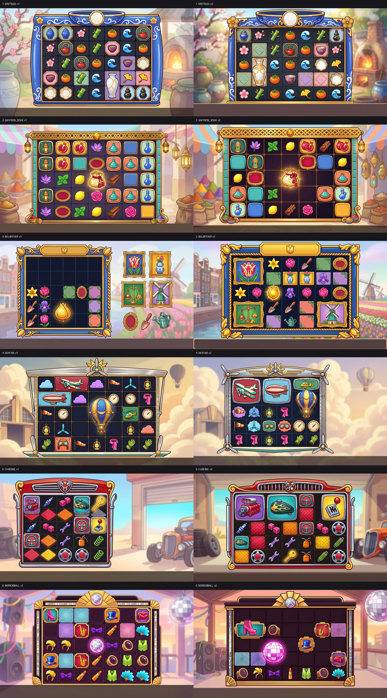
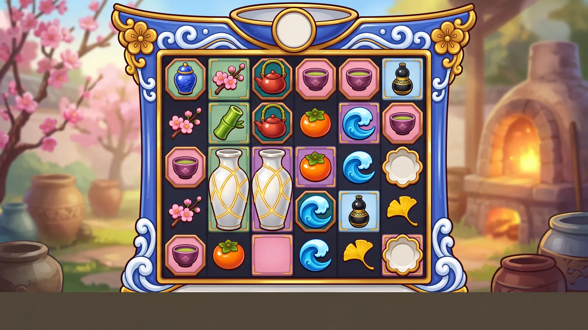
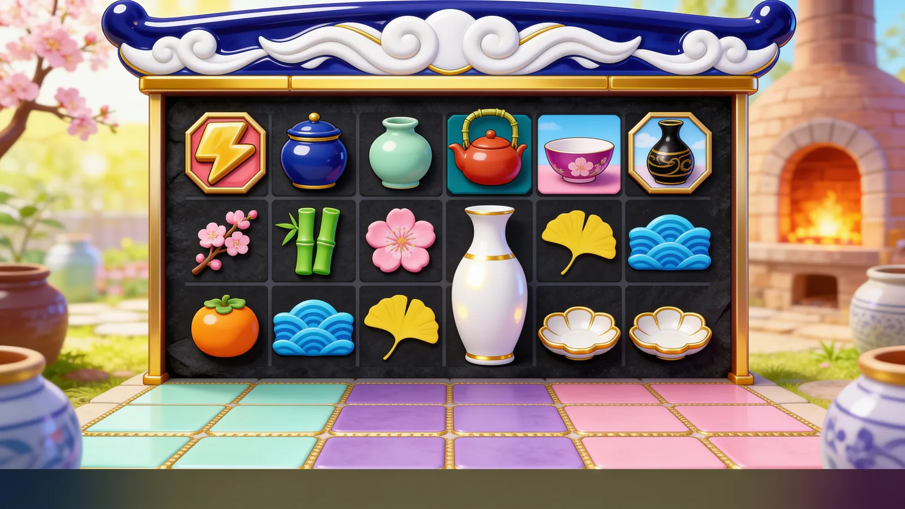

# Concept: 7×5 tumble cluster, board multipliers, dropping multipliers (no mascot)

A Sugar-Gates-like game (same mechanics, same bright casual draw style, no mascot) in a theme of our own.
**Status: pick a theme.** Nothing is scaffolded yet; `pnpm new-game <id> --title "<Title>"` starts it once a theme is chosen.

| File | What it holds |
|---|---|
| [THEMES.md](THEMES.md) | 6 vetted finalists (full briefs, symbol sets, frame, backgrounds, animation ideas, risks, compliance and production reviews) + 6 vetted alternates + what was dropped and why |
| [STYLE.md](STYLE.md) | The reference draw style, measured: style and environment formulas, board composition, symbol tiers, multiplier and spot-tile look, what not to copy |
| [MECHANICS.md](MECHANICS.md) | Decision-ready mechanics spec v2 (engine mapping, math-sdk design, compliance), bet modes, book events, engine deltas, fixtures, open decisions |
| [hf/](hf/) | Every paid Higgsfield request and reply (ledger batches `ctm-boards-*`), plus `prompts.json` (thumb, hero, symbol sheet, background plate and frame prompts per finalist) |
| [boards/](boards/) | Board mockups (web size); full-size masters are in `art/_raw/ctm_board*/` (local, gitignored) |

## The mechanic in one paragraph

7 reels × 5 rows, clusters of 5+ pay and explode, the board tumbles until no win is left. Every explosion marks its cell in
the board background; the second explosion on a cell makes it a ×2 spot and every later one doubles it (to ×128); a cluster
is multiplied by the sum of the spots under it. Multiplier symbols (×2–×100) drop in every mode and multiply the whole tumble
sequence. 4+ scatters trigger the bonus (spots persist through the free spins). Full detail, RTP split and bet modes in
[MECHANICS.md](MECHANICS.md).

## The six finalists

| # | Theme | Title | Hook |
|---|---|---|---|
| 1 | KINTSUGI | Golden Seams | every crack turns to gold: broken porcelain cells are mended in gold and double |
| 2 | SAFFRON SOUK | Saffron & Brass | spice bursts settle into glazed floor tiles that upgrade turquoise → cobalt → saffron → crimson-gold |
| 3 | BULBFEVER | Bulb Fever | Golden Age tulip craze: seeds sprout, bud, bloom and turn gold |
| 4 | SKYFAIR | Barnstorm Skies | 1930s air race: contrail puffs swell into gold cumulus |
| 5 | CHROME | Hubcap Heat | custom-car garage: diamond-plate floor heats cherry → white-hot gold |
| 6 | MIRRORBALL | Mirrorball Nights | Deco dance floor: etched sunbursts light up panel by panel |

## Board rounds

**Round 1** (`nano_banana_pro`, 2k, text-only, 12 boards, 24 credits): the board structure is right on the best ones
(KINTSUGI v1, SAFFRON SOUK v1, MIRRORBALL v1, SKYFAIR v1), but the owner's verdict is that the rendering is too flat and
cheap next to the reference: small icon-like symbols in empty cells, little gloss or volume.

**Model A/B on KINTSUGI** (one stronger prompt, the reference screenshot as a style-only reference, 23 credits):

| Model | Result |
|---|---|
| `nano_banana_2_1` 4k (3 cr) |  fuller and bolder, still flat 2D icons; 6 columns instead of 7 |
| `seedream_v4_5` high (1 cr) |  best original glossy, near-3D render; wrong layout (6×3) and it copied the reference's lightning tile |
| `flux_3_image` 4k (19 cr) | best polish, but it cloned the reference (columns, candy world, grapes, laurel, numbered coins): rejected, not kept in the docs |

Lesson: **never pass the competitor's screenshot as an image reference**; it leaks their IP into the output. Text-only
prompts with the measured style rules (STYLE.md) are the safe route.

**Round 3 (prepared, not yet run):** `hf/boards-b03-sd45.request.json` (Seedream 4.5 high, 2 per theme, 12 credits) and
`hf/boards-b03-nb21.request.json` (Nano Banana 2.1 4k, 1 per theme, 18 credits), with a stronger text-only rendering brief.

**Open model decision:** the owner prefers GPT Image 2.5 (Sunburst high 4k, 4.25 credits a board). The repo's licence gate
refuses it (`licenses/denylist.json` → `openai-gpt-image`: OpenAI's usage policy lists "real money gambling" as a
prohibited use). Using it is the owner's call; it needs that denylist entry changed by the owner (or the change approved),
ideally so GPT outputs carry a separate pending licence and can never ship by accident.

## Next steps

1. Pick a theme (or ask for a mix: e.g. KINTSUGI's mechanic story with SAFFRON SOUK's palette).
2. `pnpm new-game <id> --title "<Title>"`, then copy MECHANICS.md decisions into `docs/games/<id>/DESIGN.md` and
   `MATH_BRIEF.md`, and the chosen theme's brief into `ANIMATION_SET.md` (docs/new-slot/WORKFLOW.md phase A).
3. Art direction from STYLE.md + the theme brief: style exploration batch (`/hf-batch`), then symbol masters, frame
   pieces, background plates (docs/new-slot/HIGGSFIELD_PLAYBOOK.md).
