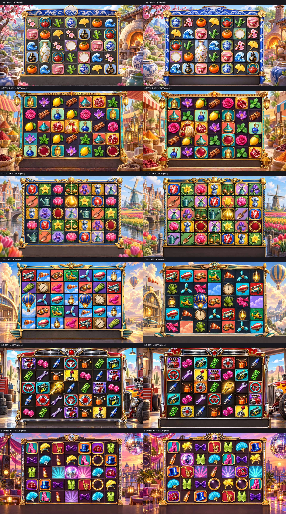
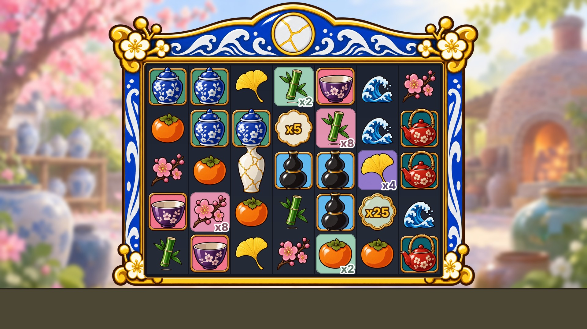

# Concept: 7×5 tumble cluster, board multipliers, dropping multipliers (no mascot)

A Sugar-Gates-like game (same mechanics, same bright casual draw style, no mascot) in a theme of our own.
**Status: pick a theme.** Nothing is scaffolded yet; `pnpm new-game <id> --title "<Title>"` starts it once a theme is chosen.

| File | What it holds |
|---|---|
| [THEMES.md](THEMES.md) | 6 vetted finalists (full briefs, symbol sets, frame, backgrounds, animation ideas, risks, compliance and production reviews) + 6 vetted alternates + what was dropped and why |
| [STYLE.md](STYLE.md) | The reference draw style, measured: style and environment formulas, board composition, symbol tiers, multiplier and spot-tile look, what not to copy |
| [MECHANICS.md](MECHANICS.md) | Decision-ready mechanics spec v2 (engine mapping, math-sdk design, compliance), bet modes, book events, engine deltas, fixtures, open decisions |
| [hf/](hf/) | Every paid Higgsfield request and reply (ledger batches `ctm-boards-*`), plus `prompts.json` (thumb, hero, symbol sheet, background plate and frame prompts per finalist) |
| [boards/](boards/) | Board mockups (web size); full-size masters are in `art/_raw/ctm_board*/` (local, gitignored) |

## The mechanic in one paragraph

7 reels × 5 rows, clusters of 5+ pay and explode, the board tumbles until no win is left. Every explosion marks its cell in
the board background; the second explosion on a cell makes it a ×2 spot and every later one doubles it (to ×128); a cluster
is multiplied by the sum of the spots under it. Multiplier symbols (×2–×100) drop in every mode and multiply the whole tumble
sequence. 4+ scatters trigger the bonus (spots persist through the free spins). Full detail, RTP split and bet modes in
[MECHANICS.md](MECHANICS.md).

## The six finalists

| # | Theme | Title | Hook |
|---|---|---|---|
| 1 | KINTSUGI | Golden Seams | every crack turns to gold: broken porcelain cells are mended in gold and double |
| 2 | SAFFRON SOUK | Saffron & Brass | spice bursts settle into glazed floor tiles that upgrade turquoise → cobalt → saffron → crimson-gold |
| 3 | BULBFEVER | Bulb Fever | Golden Age tulip craze: seeds sprout, bud, bloom and turn gold |
| 4 | SKYFAIR | Barnstorm Skies | 1930s air race: contrail puffs swell into gold cumulus |
| 5 | CHROME | Hubcap Heat | custom-car garage: diamond-plate floor heats cherry → white-hot gold |
| 6 | MIRRORBALL | Mirrorball Nights | Deco dance floor: etched sunbursts light up panel by panel |

## The method that works: build the board from parts (round 5, KINTSUGI pilot)

Whole-board prompts (rounds 1–4) always read as generic AI slot ads: every element competes, low symbols get tiles like
premiums, backgrounds come out sharp and busy, and the "glossy 3D" render looks plastic. Studios build the board from parts,
and so does this kit:

1. **Symbol sprite sheet** on a transparent background, one generation (4×3: 4 framed premiums, 5 frameless lows, scatter,
   2 blank multiplier dishes), in the clean 2D style: bold uniform dark-brown outline, 2–3-tone cel shading, one highlight,
   no 3D gloss, no filigree. Review: [kintsugi_symbols_review.png](boards/kintsugi_symbols_review.png) (in-game size + 64 px
   greyscale silhouettes).
2. **Frame alone**, transparent, with an empty opening (9-sliced in code to a 7:5 opening).
3. **Background plate**, soft and low-detail, blurred again at composite time.
4. **Composite in code** (`tools/concept/compose_board.py`): the well inset over the frame (flourishes tuck behind it), an
   exact 7×5 grid, per-tier symbol sizes, flat spot tiles with live values, multiplier numerals, empty HUD band. This is
   how the engine renders the board, so the mockup is honest.

Batch `ctm-kintsugi-c01`: 3 GPT Image 2.5 jobs (owner override), about 13 credits per theme. Run it per theme:
`tools/.venv/bin/python tools/concept/compose_board.py <symbols.png> <frame.png> <bg.png> <out_dir>`.

## Board rounds (whole-board prompts, superseded)

**Round 4: the reference boards** (`gpt_image_2_5` Sunburst, quality high, 4k 3840×2160, text-only prompts, 12 boards,
about 51 credits; batch `ctm-boards-b04-gpt25`). Every board holds the full 7×5 grid with dense, glossy, near-3D symbols, deep
gold frames and complete themed worlds: this is the quality bar. Per-board files: `boards/gpt_<theme>_v1|v2.webp`. Notes for
production:
- Backgrounds came out sharp and busy; the reference keeps its world soft-focus so the board pops (STYLE.md). The real plates
  are generated separately with the bright-style value vars and blurred at build time (`tools/bg/layers.py`).
- In BULBFEVER and SKYFAIR the lows sit on tiles like the premiums; the tier rule (framed premiums, frameless lows) must hold
  in the symbol masters.
- These boards were made under the owner's GPT Image override (`licenses/denylist.json` → `openai-gpt-image.ownerOverride`):
  they are concept references with the pending licence `higgsfield-openai-owner-override` and cannot ship until cleared.

**Round 1** (`nano_banana_pro`, 2k, text-only, 12 boards, 24 credits): the board structure is right on the best ones
(KINTSUGI v1, SAFFRON SOUK v1, MIRRORBALL v1, SKYFAIR v1), but the owner's verdict is that the rendering is too flat and
cheap next to the reference: small icon-like symbols in empty cells, little gloss or volume.

**Model A/B on KINTSUGI** (one stronger prompt, the reference screenshot as a style-only reference, 23 credits):

| Model | Result |
|---|---|
| `nano_banana_2_1` 4k (3 cr) |  fuller and bolder, still flat 2D icons; 6 columns instead of 7 |
| `seedream_v4_5` high (1 cr) |  best original glossy, near-3D render; wrong layout (6×3) and it copied the reference's lightning tile |
| `flux_3_image` 4k (19 cr) | best polish, but it cloned the reference (columns, candy world, grapes, laurel, numbered coins): rejected, not kept in the docs |

Lesson: **never pass the competitor's screenshot as an image reference**; it leaks their IP into the output. Text-only
prompts with the measured style rules (STYLE.md) are the safe route.

**Round 3 (prepared, not run; superseded by round 4):** `hf/boards-b03-sd45.request.json` (Seedream 4.5 high) and
`hf/boards-b03-nb21.request.json` (Nano Banana 2.1 4k) remain as the non-OpenAI fallback with the same prompts.

## Next steps

1. Pick a theme (or ask for a mix: e.g. KINTSUGI's mechanic story with SAFFRON SOUK's palette).
2. `pnpm new-game <id> --title "<Title>"`, then copy MECHANICS.md decisions into `docs/games/<id>/DESIGN.md` and
   `MATH_BRIEF.md`, and the chosen theme's brief into `ANIMATION_SET.md` (docs/new-slot/WORKFLOW.md phase A).
3. Art direction from STYLE.md + the theme brief: style exploration batch (`/hf-batch`), then symbol masters, frame
   pieces, background plates (docs/new-slot/HIGGSFIELD_PLAYBOOK.md).
