# Themes: six vetted finalists (+ six alternates)

Generated by the concept workflow (style extraction → 3 ideation lenses → rank → compliance and production vetting → final prompts). Every finalist passed both reviews with **adjust** (no reject); the adjustments are already applied in its board prompt. Boards: two `nano_banana_pro` 2k 16:9 mockups per theme (ledger batch `ctm-boards-b01`, 24 credits). They are **mood references**, not production art: the image model does not always respect the 7×5 grid (noted per board), and the real board is built in code from 9-slice frame pieces, symbol masters and spot tiles.

| # | Theme | Title | Lobby | Read | Anim | Orig | Vibe | Brand | Total |
|---|---|---|---|---|---|---|---|---|---|
| 1 | KINTSUGI | Golden Seams | 8 | 8 | 9 | 9 | 7 | 8 | **49** |
| 2 | SAFFRON SOUK | Saffron & Brass | 9 | 8 | 9 | 6 | 9 | 7 | **48** |
| 3 | BULBFEVER | Bulb Fever | 7 | 7 | 8 | 9 | 8 | 8 | **47** |
| 4 | SKYFAIR | Barnstorm Skies | 7 | 8 | 8 | 8 | 9 | 6 | **46** |
| 5 | CHROME | Hubcap Heat | 8 | 7 | 9 | 7 | 7 | 7 | **45** |
| 6 | MIRRORBALL | Mirrorball Nights | 8 | 7 | 9 | 6 | 8 | 6 | **44** |

---

## 1. KINTSUGI: *Golden Seams*

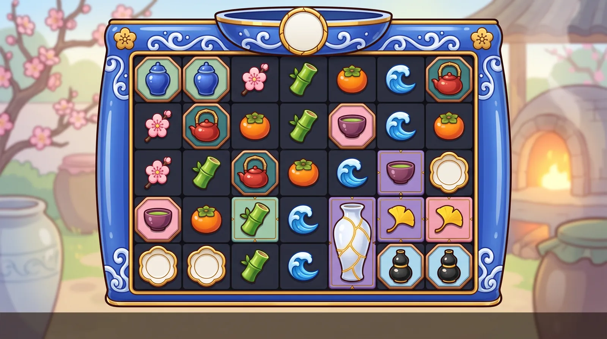

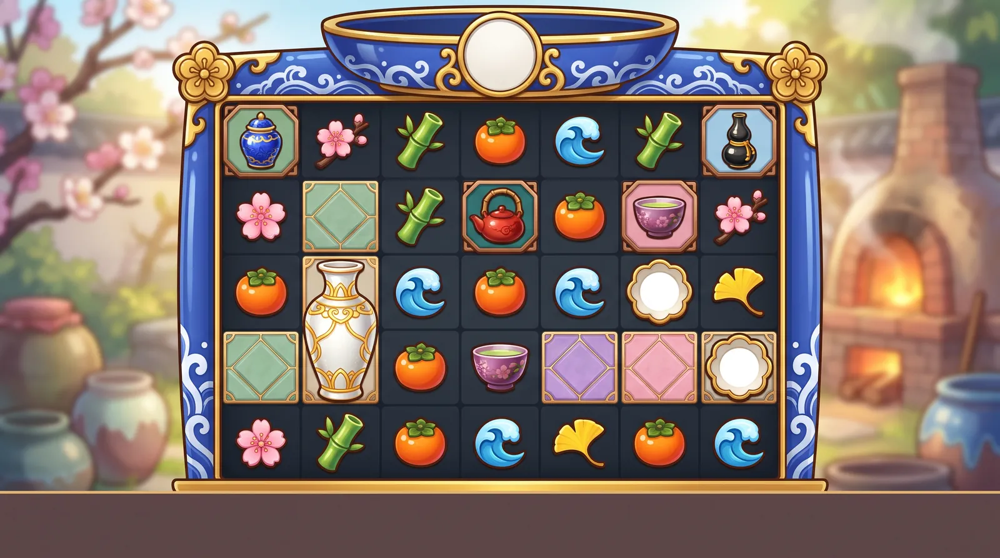

*Boards:* v1 is the strongest board of the set: clean 7×5, framed premiums, frameless lows, the seamed vase scatter, dishes and matte spot tiles.

**Title ideas:** Golden Seams, Shatter & Gild, Mended in Gold

**Hook.** Every crack turns to gold. Each winning cluster shatters its glazed porcelain pieces, and the crack each one leaves in the board's floor tile is mended in gold. Every later break on that cell adds more gold and doubles its multiplier, so the craft is the mechanic. Foliate porcelain multiplier dishes drop in on top.

**World.** A sunlit spring pottery garden beside a still lake: shelves of jewel-glazed porcelain, a round wood-fired kiln with a soft glow, flowering plum trees and drifting pink petals. Every object is glossy glazed ceramic or polished gold, with the glazes pushed to the reference's candy-level saturation. It reads as adult craft luxury: the art of mending broken ceramics with gold, described in generic craft words only (no culture-named vessel forms). No people, animals, dragons, bridges, gates, torii, pagodas, temples, script, seals, stamps or key-fret / meander borders.

**Palette.** #2350C8 cobalt, #E0402E cinnabar red, #8C3FB0 plum, #F49BB9 blossom pink, #4CC23A leaf green, #F07A2A persimmon orange, #2B9CF0 cerulean, #F7C61B ginkgo yellow, #A8DCC0 celadon, #139E9A deep teal, #8FD3F7 pale sky, #6A3FD0 spot violet, #F2B92E kintsugi gold, #F7F3EA porcelain white, #111827 ink-navy well

**Premium symbols (framed tiles)**
- **Cobalt Lidded Jar** (deep cobalt blue (celadon plaque)): A round-shouldered lidded jar in one solid deep-cobalt glaze with a domed lid and a small polished-gold knob, with no painted pattern and no seams at rest, centred on a cut-corner octagonal celadon glazed plaque with a bevelled bronze-copper border.
- **Cinnabar Teapot** (cinnabar red (deep-teal plaque)): A squat, glossy cinnabar-red glazed teapot with a short curved spout and a tall arched bamboo handle over its lid, centred on a cut-corner octagonal deep-teal glazed plaque with a bevelled bronze-copper border.
- **Plum Tea Bowl** (plum violet (blossom-pink plaque)): A wide, low, rounded plum-purple glazed tea bowl with a smooth unbroken glaze and a thin polished-gold lip, seen from a low three-quarter angle, centred on a cut-corner octagonal blossom-pink glazed plaque with a bevelled bronze-copper border.
- **Banded Gourd Vase** (jet black and gold (pale-sky plaque)): A tall double-gourd vase in glossy jet-black glaze with three bold polished-gold bands at the foot, the narrow waist and a collar at the mouth, with no stopper, centred on a cut-corner octagonal pale sky-blue glazed plaque with a bevelled bronze-copper border.

**Low symbols (frameless)**
- **Plum Sprig** (blossom pink): A short diagonal twig carrying three chunky glossy pink porcelain plum blossoms with gold centres and one closed bud.
- **Bamboo Segment** (leaf green #4CC23A): A short, upright, glossy leaf-green porcelain bamboo segment with two knuckle joints and one small leaf.
- **Persimmon** (persimmon orange): A plump, squat, glossy orange porcelain persimmon with a four-leaf dark-green calyx on top.
- **Wave Crest** (cerulean #2B9CF0): A single chunky, curling cerulean-blue porcelain wave crest with a white foam curl at its tip.
- **Ginkgo Leaf** (lemon yellow): A glossy lemon-yellow porcelain ginkgo leaf with a wide fan shape, a notch in its top edge and a short stem.

**Scatter ("hidden bonus").** Hidden bonus = THE GOLDEN MENDED VASE: an oversized, frameless, tall long-necked mallet-shaped porcelain vase laced so densely with glowing gold mended seams that it reads gold at a glance. It is the only tall frameless shape on the board and the only symbol that shows gold seams at rest. Golden light leaks from the cracks, a soft gold aura surrounds it, and it fills about 112% of the cell height. Idle: one seam brightens and creeps a little. Anticipation (driven by the book only): the seams spread and pulse like a heartbeat. Trigger (3 or more): every vase splits along its seams, the halves swing apart, and gold leaf and petals pour out into the evening crossfade before the vases click back together. Miss: the seams dim to faint lines with a soft chime.

**Multiplier symbol.** FOLIATE DISH: a round porcelain dish with an eight-lobed, scalloped, polished-gold rim and a smooth, blank, glossy pearl-white glazed centre with no seam across it. The live x-value sits on it as runtime BitmapText in cobalt numerals with a thick dark outline, a step shadow and a top glint. The lobed gold rim and white centre keep it clear of the reference's gold-and-green coin and of every blue symbol. Value tiers change the rim, never the centre: plain gold (low), rose-gold with a soft glow (mid), a gold-leaf flood with a white-hot glow (high); never black. Land: the heaviest clack on the board, with a ring of petals. Hold: a gold glint runs round the lobes. Collect: it rings like a bell, flies to the win meter and cracks into gold dust on it. Miss: the glaze dulls and the value fades.

**Board spot tiles (background multipliers).** Flat, matte glazed floor tiles that fill each cell of the ink-navy well, drawn under the symbols (SpotGrid draws behind the symbol layer, so the cell centre is hidden). The tier is carried by full-bleed colour plus a bevelled rim that shows around the symbol; gold seams are edge decoration only. T1 (marked): navy with a light celadon rim and one hairline crack at the edge, no number. T2 (x2-x16): celadon with a thin gold seam along the rim. T3 (x32-x64): violet #6A3FD0 with forked gold seams at the corners. T4 (x128-x256): blossom pink with a gold seam web round the edge. T5 (x512+): matte gold leaf with small cobalt islands at the rim and a soft inner glow. Numerals are live outlined text in a deeper shade of the tile, readable when the cell is empty or mid-tumble. Upgrade: the exploding symbol's shards fly into the cell, a crack shoots out to the rim and gold flows into it (one flash). Apply: the rims under the cluster pulse on win_peak. Reset: the gold sinks back as the tile is refired to plain navy. The spot gold stays matte, so the frame and the dish rim remain the brightest gold on screen.

**Frame.** A top-heavy frame of glossy cobalt-glazed porcelain painted with white wave scrolls and trimmed in cartoon gold, with gold mended seams running through the glaze. Crown: a broad, shallow cartouche shaped like the rim of a porcelain bowl, cradling a plain round porcelain disc crossed by gold seams (no pearl, no cloud scroll, no dragon). Sides: flat cobalt panels with white wave scroll and gold seams, with no end bands, capitals or bases, so nothing reads as a column. Corners: gold plum-blossom branches; the top pair curls inward over the crown, the bottom pair flares gently outward. Sill: a thin gold-lacquer bar. Well: ink-navy lanes. Same thick dark outline as the symbols, no key-fret or meander borders, built as 9-slice pieces on magenta. Emissive layer: the seams, which light in the winner's colour on connect and flash along their length on each burst.

**Background.** A soft-focus, high-key spring pottery garden beside a still lake in clear morning light (21:9, only moderately soft). Far left: flowering plum trees in pink bloom above shelves of jewel-glazed jars. Far right: a round wood-fired kiln glowing softly beside a wooden drying rack. In the distance: misty blue hills across the lake and drifting petals (no footbridge). Bottom corners: huge glossy glazed storage jars and a stone water basin with floating petals. The centre is a calm, pale sky and lake, lighter than the edges (bright-style value overrides). No people, animals, dragons, bridges, gates, torii, pagodas, script, seals or stamps.

**Feature backgrounds.** Free spins: the same garden on a lantern-lit evening, with a huge pale moon reflected in the lake, round frosted-glass lanterns (never paper lanterns) glowing along the shore, the kiln blazing orange and the petals turned into slow-falling gold flakes. Super bonus: a firing night, with the kiln roaring white-gold, sparks spiralling upward and a gilded sky. Both are section-E edits of the base plate. On the trigger the kiln flares and gold runs through the frame seams before the crossfade.

**Animation ideas (spin, land, miss, connect, explode).** SPIN: the pieces fall with a glossy glaze streak while petals whip past. LAND: crisp, hard porcelain contact. The jar thuds with a short ring and its lid hops; the teapot handle sways; the gourd vase wobbles like a bell; the tea bowl spins a quarter turn and settles. The lows land light, each with a tiny chime and a single puff of petals. MISS: the glaze dulls toward matte, unfired-looking bisque (the E1 desaturate; use the dim tint until E1 lands) and the piece sinks one pixel; it gets its shine back on the next spin. CONNECT: a gold glint sweeps across each glaze and gold seams light up on the winners only (nothing shows seams at rest except the scatter, the spots and the frame). The jar lid lifts, the teapot puffs steam, the gourd's gold bands ring and the tea bowl's new seams pulse. Among the lows, the sprig's blossoms open wider, the bamboo leaf flicks, the persimmon gleams, the wave curls and throws foam, and the ginkgo flutters. One thin gold seam traces the cluster outline from cell to cell, and everything gleams together on win_peak. EXPLODE: the shared pooled crack overlay races across the glaze for the first two frames only, a 100 ms hit-stop follows, then each symbol breaks its own way: the jar lid pops off first and the body bursts, the teapot vents steam then bursts, the gourd vase splits at its waist band, the tea bowl breaks into rim arcs, the sprig sheds its petals, the bamboo splits lengthwise, the persimmon calyx flies off before the fruit cracks, the wave bursts into droplets and the ginkgo tears along its notch. Shards are rounded and glossy in the symbol's own glaze, and a puff of gold dust flows down into the cell as its new gold seam (spot mark or upgrade). BACKGROUND: idle = petals drift and the lake shimmers. Spin = a breeze streams petals sideways and the kiln glow rises. Land = the lake ripples and the jars on the shelves rattle at each column impact. Connect = the kiln glow and lake shimmer tint to the top winner's glaze colour and pulse. Explode = a burst of petals and gold flakes, with a flash along the frame seams and a zoom punch. Miss = a soft cloud shadow passes and the petals settle on the water. Anticipation = the wind rises, the branches sway and the kiln pulses like a heartbeat. Big win = gold leaf rains over the garden. Feature = the lantern-lit crossfade. Vary the shatter pitch and keep it short so long tumbles do not tire the ear.

**Lobby appeal.** A cobalt jar splitting open with gold pouring from its cracks against blossom pink. It looks luxurious and calm, and nothing like it is in the Stake lobby. 'Every crack turns to gold' explains the board-multiplier mechanic in one line and gives the trailer an ASMR shot: a cluster shatters, gold runs into the cracks and the number doubles. The 3-star rubric rewards exactly this fit between theme and mechanic. Game tile: the golden mended vase mid-split on a light celadon-to-blossom gradient. Social-safe menu: Extra Chance becomes 'Second Firing', the 100x spin 'Gold Leaf Spin', the 1000x spin 'Mended Vase Spin', the bonus 'Kiln Bonus' and the super bonus 'Golden Kiln Bonus'.

**Risks and guardrails.** Show the craft only, in generic words: no culture-named forms (ginger jar, tenmoku, moon jar), no samurai, geisha, kimono, temples, deities, torii, shrine bridges or dragons, and no pearl-and-cloud motif (it pulls in a dragon). NBP writes kanji on lanterns, invents seals and stamps and adds key-fret borders to porcelain, so every prompt says 'no people, no characters, no script, no seals, no stamps, no key-fret or meander borders' and every plate gets a text check. Real porcelain is pale: push the glazes to the reference's saturation. Gold appears on the frame, the scatter, the dish rim and the spots, so keep the spot gold matte and the frame the brightest; only the scatter, the spots and the frame show seams at rest. 64 px gate pairs: the cobalt jar against the cerulean wave, the persimmon against the tall vase scatter, and the sprig against the lobed dish. The gourd must read as a vase (gold collar, no stopper) to avoid an alcohol cue. The tagline is 'Every crack turns to gold', never 'Broken is worth more' (loss-chasing read). 'Golden Seams' came back clean in a quick search but needs counsel; 'Kintsugi' stays an internal codename. A crack-then-shatter on 15 or more symbols needs one pooled crack overlay for frames 1-2 and per-symbol flipbooks after it.

**Why it ranked here.** Ranked first because it is the only idea where the theme itself explains the board-multiplier mechanic: a cell that breaks again gets more gold. That gives a creative coherence the 3-star reviewers reward, a one-line marketing story and an ASMR trailer shot that nothing in the lobby has. It merges GOLDEN SEAMS and KINTSUGI, which were the same pitch. From GOLDEN SEAMS it keeps the nature-charm lows (flower, cylinder, squat fruit, curl, fan), whose silhouettes are far more distinct than KINTSUGI's spoon, box and jar vessels. From KINTSUGI it keeps the tier ladder and the emissive frame seams. It also absorbs MAJOLICA's jewel-glaze saturation and its shards-fly-into-the-cell upgrade. The fixes: the yellow gourd became a black-and-gold tenmoku gourd on a sky tile, so ginkgo owns yellow. The ginger jar is solid cobalt rather than blue-and-white, so it does not echo Bulb Fever's Delft vase. The multiplier became an eight-lobed foliate dish, to move away from the reference coin. The scatter now reads gold, not white. VibeFit scores below the others because porcelain is calmer than candy; pushed saturation and big shatter FX close that gap.

Vetting (compliance + production)

**Compliance review: adjust**

Issues:
- Mixed cultures: a Chinese blue-and-white ginger jar, tenmoku (the Japanese name for Chinese Jian ware) and a Korean moon jar (a Korean national-treasure form) are all presented as one Japanese craft. The crown's pearl under a cloud scroll is the Chinese dragon-and-flaming-pearl motif, so NBP is likely to add a dragon. A reviewer could read this as a careless pan-Asian mash-up, which is a 'poor taste' risk.
- Prompt items that pull in text and shrines: NBP almost always writes kanji on blank paper lanterns. A curved wooden footbridge tends to come with red shrine bridges or torii. Porcelain prompts add key-fret or meander borders, and that is the same Greek-key pattern on the reference's gold card corners.
- Too close to the reference: pearl-white porcelain side rails bound with gold bands at the ends will be drawn as the reference's white marble columns with gold capitals. The cobalt jar on a saffron tile is the reference's orange urn on a blue tile with the colours swapped (same object, same colour pair). The outward-curling gold corner branches echo the reference's gold winged corner caps.
- Titles: 'Gilded Crackle' contains Crackle, a Sony streaming trademark. The word 'Kintsugi' is already used by board games and apps. 'Golden Seams' came back clean in a quick search but still needs counsel.
- The tagline 'Broken is worth more' can be read as loss-chasing messaging in a real-money game.
- The double-gourd bottle with a stopper reads as a sake or wine flask (a mild alcohol cue).
- No issues with appeal to minors.

Applied in the board prompt and brief:
- C
- o
- m
- m
- i
- t
-  
- t
- o
-  
- g
- e
- n
- e
- r
- i
- c
-  
- c
- r
- a
- f
- t
-  
- w
- o
- r
- d
- i
- n
- g
-  
- a
- n
- d
-  
- d
- r
- o
- p
-  
- t
- h
- e
-  
- c
- u
- l
- t
- u
- r
- e
- -
- n
- a
- m
- e
- d
-  
- f
- o
- r
- m
- s
- .
-  
- R
- e
- n
- a
- m
- e
-  
- t
- h
- e
-  
- s
- c
- a
- t
- t
- e
- r
-  
- '
- G
- o
- l
- d
- e
- n
-  
- M
- e
- n
- d
- e
- d
-  
- V
- a
- s
- e
- '
- ,
-  
- n
- o
- t
-  
- '
- m
- o
- o
- n
-  
- j
- a
- r
- '
- .
-  
- M
- a
- k
- e
-  
- H
- 1
-  
- '
- C
- o
- b
- a
- l
- t
-  
- L
- i
- d
- d
- e
- d
-  
- J
- a
- r
- '
-  
- i
- n
-  
- a
-  
- s
- o
- l
- i
- d
-  
- g
- l
- a
- z
- e
-  
- w
- i
- t
- h
-  
- n
- o
-  
- b
- l
- u
- e
- -
- a
- n
- d
- -
- w
- h
- i
- t
- e
-  
- p
- a
- t
- t
- e
- r
- n
- .
-  
- R
- e
- p
- l
- a
- c
- e
-  
- t
- h
- e
-  
- c
- r
- o
- w
- n
-  
- p
- e
- a
- r
- l
-  
- w
- i
- t
- h
-  
- a
-  
- p
- l
- a
- i
- n
-  
- g
- o
- l
- d
- -
- s
- e
- a
- m
- e
- d
-  
- p
- o
- r
- c
- e
- l
- a
- i
- n
-  
- d
- i
- s
- c
-  
- w
- i
- t
- h
-  
- n
- o
-  
- c
- l
- o
- u
- d
-  
- s
- c
- r
- o
- l
- l
- ,
-  
- a
- n
- d
-  
- a
- d
- d
-  
- '
- n
- o
-  
- d
- r
- a
- g
- o
- n
- '
-  
- t
- o
-  
- t
- h
- e
-  
- p
- r
- o
- m
- p
- t
- .
-  
- R
- e
- p
- l
- a
- c
- e
-  
- t
- h
- e
-  
- p
- a
- p
- e
- r
-  
- l
- a
- n
- t
- e
- r
- n
- s
-  
- w
- i
- t
- h
-  
- r
- o
- u
- n
- d
-  
- f
- r
- o
- s
- t
- e
- d
- -
- g
- l
- a
- s
- s
-  
- l
- a
- n
- t
- e
- r
- n
- s
-  
- a
- n
- d
-  
- c
- u
- t
-  
- t
- h
- e
-  
- f
- o
- o
- t
- b
- r
- i
- d
- g
- e
- .
-  
- E
- v
- e
- r
- y
-  
- p
- r
- o
- m
- p
- t
-  
- s
- a
- y
- s
-  
- '
- n
- o
-  
- p
- e
- o
- p
- l
- e
- ,
-  
- n
- o
-  
- c
- h
- a
- r
- a
- c
- t
- e
- r
- s
- ,
-  
- n
- o
-  
- s
- c
- r
- i
- p
- t
- ,
-  
- n
- o
-  
- s
- e
- a
- l
- s
- ,
-  
- n
- o
-  
- s
- t
- a
- m
- p
- s
- ,
-  
- n
- o
-  
- k
- e
- y
- -
- f
- r
- e
- t
-  
- o
- r
-  
- m
- e
- a
- n
- d
- e
- r
-  
- b
- o
- r
- d
- e
- r
- s
- '
- .
-  
- F
- r
- a
- m
- e
- :
-  
- m
- a
- k
- e
-  
- t
- h
- e
-  
- b
- o
- d
- y
-  
- c
- o
- b
- a
- l
- t
- -
- g
- l
- a
- z
- e
- d
- ,
-  
- n
- o
- t
-  
- w
- h
- i
- t
- e
- .
-  
- T
- h
- e
-  
- s
- i
- d
- e
-  
- r
- a
- i
- l
- s
-  
- b
- e
- c
- o
- m
- e
-  
- f
- l
- a
- t
-  
- c
- o
- b
- a
- l
- t
-  
- p
- a
- n
- e
- l
- s
-  
- w
- i
- t
- h
-  
- w
- h
- i
- t
- e
-  
- w
- a
- v
- e
-  
- s
- c
- r
- o
- l
- l
-  
- a
- n
- d
-  
- g
- o
- l
- d
-  
- s
- e
- a
- m
- s
- ,
-  
- w
- i
- t
- h
-  
- n
- o
-  
- e
- n
- d
-  
- b
- a
- n
- d
- s
- ,
-  
- s
- o
-  
- n
- o
- t
- h
- i
- n
- g
-  
- r
- e
- a
- d
- s
-  
- a
- s
-  
- a
-  
- c
- o
- l
- u
- m
- n
- .
-  
- T
- h
- e
-  
- t
- o
- p
- -
- c
- o
- r
- n
- e
- r
-  
- c
- a
- p
- s
-  
- c
- u
- r
- l
-  
- i
- n
- w
- a
- r
- d
- .
-  
- R
- e
- c
- o
- l
- o
- u
- r
-  
- t
- h
- e
-  
- j
- a
- r
- '
- s
-  
- t
- i
- l
- e
-  
- f
- r
- o
- m
-  
- s
- a
- f
- f
- r
- o
- n
-  
- t
- o
-  
- c
- e
- l
- a
- d
- o
- n
- .
-  
- G
- i
- v
- e
-  
- t
- h
- e
-  
- p
- r
- e
- m
- i
- u
- m
-  
- t
- i
- l
- e
- s
-  
- a
-  
- c
- u
- t
- -
- c
- o
- r
- n
- e
- r
-  
- (
- o
- c
- t
- a
- g
- o
- n
- a
- l
- )
-  
- g
- l
- a
- z
- e
- d
- -
- p
- l
- a
- q
- u
- e
-  
- s
- h
- a
- p
- e
-  
- i
- n
- s
- t
- e
- a
- d
-  
- o
- f
-  
- t
- h
- e
-  
- r
- e
- f
- e
- r
- e
- n
- c
- e
- '
- s
-  
- r
- o
- u
- n
- d
- e
- d
-  
- s
- q
- u
- a
- r
- e
- .
-  
- L
- e
- a
- d
-  
- w
- i
- t
- h
-  
- t
- h
- e
-  
- '
- G
- o
- l
- d
- e
- n
-  
- S
- e
- a
- m
- s
- '
-  
- t
- i
- t
- l
- e
-  
- a
- n
- d
-  
- d
- r
- o
- p
-  
- '
- G
- i
- l
- d
- e
- d
-  
- C
- r
- a
- c
- k
- l
- e
- '
- .
-  
- C
- h
- a
- n
- g
- e
-  
- t
- h
- e
-  
- t
- a
- g
- l
- i
- n
- e
-  
- t
- o
-  
- '
- E
- v
- e
- r
- y
-  
- c
- r
- a
- c
- k
-  
- t
- u
- r
- n
- s
-  
- t
- o
-  
- g
- o
- l
- d
- '
- .
-  
- O
- n
-  
- t
- h
- e
-  
- g
- o
- u
- r
- d
- ,
-  
- r
- e
- p
- l
- a
- c
- e
-  
- t
- h
- e
-  
- s
- t
- o
- p
- p
- e
- r
-  
- w
- i
- t
- h
-  
- a
-  
- g
- o
- l
- d
-  
- c
- o
- l
- l
- a
- r
-  
- a
- t
-  
- t
- h
- e
-  
- m
- o
- u
- t
- h
-  
- s
- o
-  
- i
- t
-  
- r
- e
- a
- d
- s
-  
- a
- s
-  
- a
-  
- v
- a
- s
- e
- .

**Production review: adjust**

Issues:
- Persimmon vs scatter: the persimmon (orange, round body with a calyx nub) and the moon-jar scatter (gold, round body with a short neck) are both frameless with the same round body and small top feature. They are next to each other in hue and fail the 64 px greyscale silhouette gate, and the scatter loses its uniqueness.
- Ginger jar vs scatter: both are round lidded jars with gold cracks. Gold seams also appear at rest on the tea bowl, the dish, the spots and the frame, so the seam no longer signals the scatter or a multiplier.
- Plum blossom (a five-lobed rosette) vs foliate dish (an eight-lobed rosette) give the same lobed-disc silhouette at 64 px.
- Bamboo jade #3FBF7F vs wave turquoise #22B8B0 are adjacent hues and merge under the miss dim.
- Multiplier tiers reuse premium colours: cobalt matches the jar, cinnabar the teapot, black the gourd. The high tier, a black dish on the ink-navy well, makes the most valuable multiplier the least visible. The seam across the centre runs under the live number.
- Spots: SpotGrid draws the tiles and numbers behind the symbols (src/board/SpotGrid.ts:13-16), so the centre crack and the seam density that carry the tier are hidden under every symbol. The T1 navy tile sits on a navy well, so the mark is invisible. T2 celadon and T3 turquoise are adjacent hues.
- Explode: all 11 symbols share one crack-and-shatter that changes only the shard colour, which is the 'one generic explosion' trait that drops pillar P3 to 2.0 (STAKE_3_STAR.md §3).
- Tenmoku oil-spot speckle turns to noise at 64 px. The 'glaze dulls toward bisque' miss needs the E1 desaturate, which is still to do (ANIMATION_STATES.md §5).
- The background's nine states are all covered and fit LayeredEnvironment: kiln and lake light layers plus decomposed shelf jars.

Applied in the board prompt and brief:
- S
- c
- a
- t
- t
- e
- r
- :
-  
- m
- a
- k
- e
-  
- i
- t
-  
- a
-  
- t
- a
- l
- l
- ,
-  
- l
- o
- n
- g
- -
- n
- e
- c
- k
- e
- d
-  
- m
- a
- l
- l
- e
- t
-  
- v
- a
- s
- e
-  
- l
- a
- c
- e
- d
-  
- w
- i
- t
- h
-  
- g
- o
- l
- d
-  
- s
- e
- a
- m
- s
- ,
-  
- a
- b
- o
- u
- t
-  
- 1
- 1
- 2
- %
-  
- o
- f
-  
- t
- h
- e
-  
- c
- e
- l
- l
- .
-  
- I
- t
-  
- i
- s
-  
- t
- h
- e
-  
- o
- n
- l
- y
-  
- t
- a
- l
- l
-  
- f
- r
- a
- m
- e
- l
- e
- s
- s
-  
- s
- h
- a
- p
- e
- ,
-  
- a
- n
- d
-  
- i
- t
-  
- k
- e
- e
- p
- s
-  
- t
- h
- e
-  
- s
- p
- l
- i
- t
- -
- o
- p
- e
- n
-  
- t
- r
- i
- g
- g
- e
- r
- .
-  
- R
- e
- m
- o
- v
- e
-  
- t
- h
- e
-  
- r
- e
- s
- t
- -
- s
- t
- a
- t
- e
-  
- g
- o
- l
- d
-  
- s
- e
- a
- m
- s
-  
- f
- r
- o
- m
-  
- t
- h
- e
-  
- j
- a
- r
- ,
-  
- t
- h
- e
-  
- b
- o
- w
- l
-  
- a
- n
- d
-  
- t
- h
- e
-  
- d
- i
- s
- h
- ;
-  
- t
- h
- e
-  
- s
- e
- a
- m
- s
-  
- l
- i
- g
- h
- t
-  
- o
- n
- l
- y
-  
- o
- n
-  
- c
- o
- n
- n
- e
- c
- t
- .
-  
- R
- e
- s
- e
- r
- v
- e
-  
- r
- e
- s
- t
- -
- s
- t
- a
- t
- e
-  
- g
- o
- l
- d
-  
- s
- e
- a
- m
- s
-  
- f
- o
- r
-  
- t
- h
- e
-  
- s
- c
- a
- t
- t
- e
- r
- ,
-  
- t
- h
- e
-  
- s
- p
- o
- t
- s
-  
- a
- n
- d
-  
- t
- h
- e
-  
- f
- r
- a
- m
- e
- .
-  
- R
- e
- p
- l
- a
- c
- e
-  
- t
- h
- e
-  
- P
- l
- u
- m
-  
- B
- l
- o
- s
- s
- o
- m
-  
- w
- i
- t
- h
-  
- a
-  
- P
- l
- u
- m
-  
- S
- p
- r
- i
- g
- :
-  
- a
-  
- d
- i
- a
- g
- o
- n
- a
- l
-  
- t
- w
- i
- g
-  
- w
- i
- t
- h
-  
- t
- h
- r
- e
- e
-  
- c
- h
- u
- n
- k
- y
-  
- p
- i
- n
- k
-  
- b
- l
- o
- s
- s
- o
- m
- s
-  
- a
- n
- d
-  
- a
-  
- b
- u
- d
- .
-  
- R
- e
- c
- o
- l
- o
- u
- r
-  
- t
- h
- e
-  
- w
- a
- v
- e
-  
- t
- o
-  
- c
- e
- r
- u
- l
- e
- a
- n
-  
- #
- 2
- B
- 9
- C
- F
- 0
-  
- w
- i
- t
- h
-  
- w
- h
- i
- t
- e
-  
- f
- o
- a
- m
-  
- a
- n
- d
-  
- t
- h
- e
-  
- b
- a
- m
- b
- o
- o
-  
- t
- o
-  
- l
- e
- a
- f
-  
- g
- r
- e
- e
- n
-  
- #
- 4
- C
- C
- 2
- 3
- A
- .
-  
- D
- i
- s
- h
- :
-  
- a
-  
- p
- e
- a
- r
- l
- -
- w
- h
- i
- t
- e
-  
- g
- l
- a
- z
- e
- d
-  
- c
- e
- n
- t
- r
- e
-  
- w
- i
- t
- h
-  
- c
- o
- b
- a
- l
- t
-  
- n
- u
- m
- e
- r
- a
- l
- s
-  
- a
- n
- d
-  
- a
-  
- d
- a
- r
- k
-  
- o
- u
- t
- l
- i
- n
- e
- ,
-  
- a
- n
- d
-  
- n
- o
-  
- s
- e
- a
- m
-  
- a
- c
- r
- o
- s
- s
-  
- i
- t
- .
-  
- I
- t
- s
-  
- t
- i
- e
- r
- s
-  
- c
- h
- a
- n
- g
- e
-  
- t
- h
- r
- o
- u
- g
- h
-  
- t
- h
- e
-  
- r
- i
- m
- :
-  
- g
- o
- l
- d
- ,
-  
- t
- h
- e
- n
-  
- r
- o
- s
- e
- -
- g
- o
- l
- d
-  
- w
- i
- t
- h
-  
- a
-  
- g
- l
- o
- w
- ,
-  
- t
- h
- e
- n
-  
- a
-  
- g
- o
- l
- d
- -
- l
- e
- a
- f
-  
- f
- l
- o
- o
- d
-  
- w
- i
- t
- h
-  
- a
-  
- w
- h
- i
- t
- e
- -
- h
- o
- t
-  
- g
- l
- o
- w
-  
- (
- n
- e
- v
- e
- r
-  
- b
- l
- a
- c
- k
- )
- .
-  
- S
- p
- o
- t
- s
- :
-  
- c
- a
- r
- r
- y
-  
- t
- h
- e
-  
- t
- i
- e
- r
-  
- i
- n
-  
- f
- u
- l
- l
- -
- b
- l
- e
- e
- d
-  
- c
- o
- l
- o
- u
- r
-  
- p
- l
- u
- s
-  
- a
-  
- b
- e
- v
- e
- l
- l
- e
- d
-  
- r
- i
- m
-  
- v
- i
- s
- i
- b
- l
- e
-  
- a
- r
- o
- u
- n
- d
-  
- t
- h
- e
-  
- s
- y
- m
- b
- o
- l
- .
-  
- T
- 1
-  
- i
- s
-  
- n
- a
- v
- y
-  
- w
- i
- t
- h
-  
- a
-  
- l
- i
- g
- h
- t
-  
- c
- e
- l
- a
- d
- o
- n
-  
- r
- i
- m
- ,
-  
- T
- 2
-  
- c
- e
- l
- a
- d
- o
- n
- ,
-  
- T
- 3
-  
- v
- i
- o
- l
- e
- t
-  
- #
- 6
- A
- 3
- F
- D
- 0
- ,
-  
- T
- 4
-  
- b
- l
- o
- s
- s
- o
- m
-  
- p
- i
- n
- k
- ,
-  
- T
- 5
-  
- m
- a
- t
- t
- e
-  
- g
- o
- l
- d
- .
-  
- S
- e
- a
- m
- s
-  
- a
- r
- e
-  
- e
- d
- g
- e
-  
- d
- e
- c
- o
- r
- a
- t
- i
- o
- n
-  
- o
- n
- l
- y
- .
-  
- E
- x
- p
- l
- o
- d
- e
- :
-  
- u
- s
- e
-  
- t
- h
- e
-  
- s
- h
- a
- r
- e
- d
-  
- c
- r
- a
- c
- k
-  
- o
- v
- e
- r
- l
- a
- y
-  
- f
- o
- r
-  
- t
- h
- e
-  
- f
- i
- r
- s
- t
-  
- t
- w
- o
-  
- f
- r
- a
- m
- e
- s
-  
- o
- n
- l
- y
- ,
-  
- t
- h
- e
- n
-  
- a
-  
- s
- i
- g
- n
- a
- t
- u
- r
- e
-  
- p
- e
- r
-  
- s
- y
- m
- b
- o
- l
- .
-  
- T
- h
- e
-  
- j
- a
- r
-  
- l
- i
- d
-  
- p
- o
- p
- s
-  
- o
- f
- f
-  
- f
- i
- r
- s
- t
- ,
-  
- t
- h
- e
-  
- t
- e
- a
- p
- o
- t
-  
- v
- e
- n
- t
- s
-  
- s
- t
- e
- a
- m
-  
- t
- h
- e
- n
-  
- b
- u
- r
- s
- t
- s
- ,
-  
- t
- h
- e
-  
- g
- o
- u
- r
- d
-  
- s
- p
- l
- i
- t
- s
-  
- a
- t
-  
- i
- t
- s
-  
- w
- a
- i
- s
- t
-  
- b
- a
- n
- d
-  
- a
- n
- d
-  
- t
- h
- e
-  
- b
- o
- w
- l
-  
- b
- r
- e
- a
- k
- s
-  
- i
- n
- t
- o
-  
- r
- i
- m
-  
- a
- r
- c
- s
- .
-  
- T
- h
- e
-  
- s
- p
- r
- i
- g
-  
- s
- h
- e
- d
- s
-  
- p
- e
- t
- a
- l
- s
- ,
-  
- t
- h
- e
-  
- b
- a
- m
- b
- o
- o
-  
- s
- p
- l
- i
- t
- s
-  
- l
- e
- n
- g
- t
- h
- w
- i
- s
- e
- ,
-  
- t
- h
- e
-  
- p
- e
- r
- s
- i
- m
- m
- o
- n
-  
- c
- a
- l
- y
- x
-  
- f
- l
- i
- e
- s
-  
- o
- f
- f
- ,
-  
- t
- h
- e
-  
- w
- a
- v
- e
-  
- b
- u
- r
- s
- t
- s
-  
- i
- n
- t
- o
-  
- d
- r
- o
- p
- l
- e
- t
- s
-  
- a
- n
- d
-  
- t
- h
- e
-  
- g
- i
- n
- k
- g
- o
-  
- t
- e
- a
- r
- s
-  
- a
- l
- o
- n
- g
-  
- i
- t
- s
-  
- n
- o
- t
- c
- h
- .
-  
- G
- o
- u
- r
- d
- :
-  
- r
- e
- p
- l
- a
- c
- e
-  
- t
- h
- e
-  
- s
- p
- e
- c
- k
- l
- e
-  
- w
- i
- t
- h
-  
- t
- h
- r
- e
- e
-  
- b
- o
- l
- d
-  
- g
- o
- l
- d
-  
- b
- a
- n
- d
- s
- .
-  
- M
- i
- s
- s
- :
-  
- s
- c
- h
- e
- d
- u
- l
- e
-  
- t
- h
- e
-  
- E
- 1
-  
- d
- e
- s
- a
- t
- u
- r
- a
- t
- e
- ,
-  
- o
- r
-  
- u
- s
- e
-  
- t
- h
- e
-  
- d
- i
- m
-  
- t
- i
- n
- t
-  
- u
- n
- t
- i
- l
-  
- i
- t
-  
- l
- a
- n
- d
- s
- .

---

## 2. SAFFRON SOUK: *Saffron & Brass*

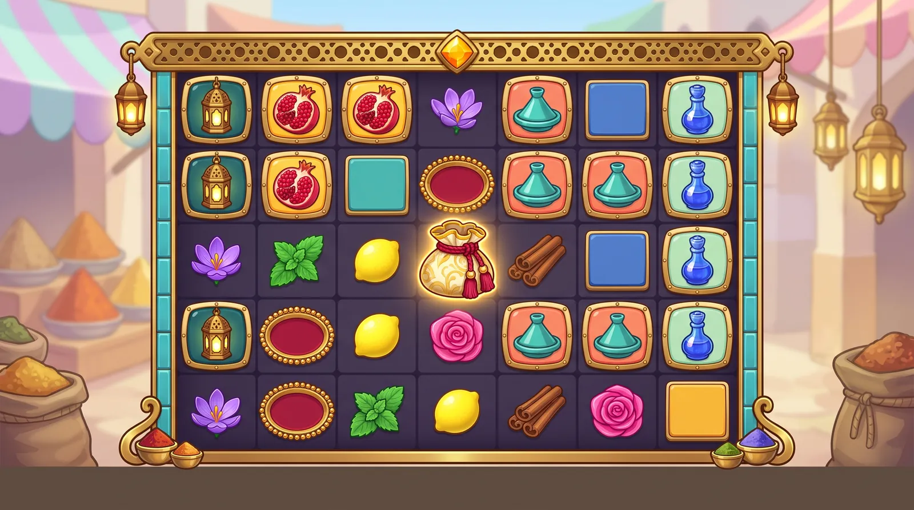

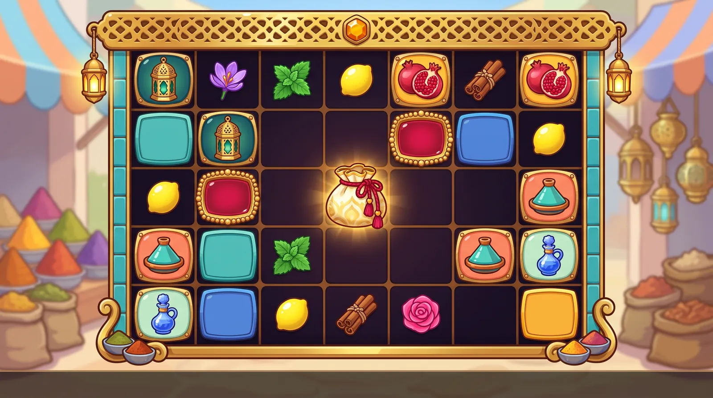

*Boards:* v1: clean 7×5 with the full symbol hierarchy and lantern frame.

**Title ideas:** Saffron & Brass, Saffron Souk, Lantern Courtyard

**Hook.** Wins colour the courtyard floor. Every winning cluster bursts into a puff of its own coloured spice, and the powder settles into a glazed tile in the board floor. Later bursts upgrade that tile from plain sand to a turquoise square inset, a cobalt diamond, a saffron scalloped tile and finally crimson edged in gold leaf, doubling its multiplier each time. Brass spice-tray multipliers drop in from the stalls.

**World.** A sun-washed spice-market courtyard at late morning that belongs to no one country: striped canvas awnings, stepped shelves of towering spice cones in every colour, hexagonal pierced-brass lanterns, potted lemon trees, a fountain of plain turquoise tiles and gold dust hanging in the light. Every object is glossy brass, glazed ceramic, jewel glass, lacquered spice or fruit, and loose powder is always coloured, never white. It feels like warm, adult hospitality. No people, genies, lamps, carpets, dancers, shoes, arches, keyhole doorways, domes, minarets, columns, star patterns, rosettes, interlace, calligraphy or script.

**Palette.** #F7A90F saffron, #C21F3A pomegranate ruby, #17B8B2 turquoise, #0F6E78 deep teal, #2F55D4 cobalt, #3FCF6E spearmint, #BDEFD2 pale mint, #9A4FD6 crocus violet, #FF5FA2 rose pink, #FF8A6B coral, #A0522D cinnamon brown, #FFE14D lemon, #E9B43A brass gold, #F3E3C3 sand stucco, #1A1530 indigo-plum well

**Premium symbols (framed tiles)**
- **Brass Lantern** (brass gold (deep-teal cushion tile)): A hexagonal pierced-brass hanging lantern with a flat pointed cap and a hanging ring, its round and teardrop cut-outs glowing with ruby, emerald and sapphire glass, centred on a cushion-shaped deep-teal enamel tile with a hammered-brass rim and corner rivets.
- **Split Pomegranate** (ruby red (saffron cushion tile)): A plump ruby-red pomegranate split open to show packed, glistening, jewel-like seeds, with a small gold-tipped calyx and two glossy green leaves, centred on a cushion-shaped saffron enamel tile with a hammered-brass rim and corner rivets.
- **Turquoise Tagine** (turquoise (coral cushion tile)): A glossy turquoise-glazed tagine with a tall conical lid topped by a small gold knob and bold white and gold scallop bands round its rim, centred on a cushion-shaped coral enamel tile with a hammered-brass rim and corner rivets.
- **Rosewater Sprinkler** (cobalt blue (pale-mint cushion tile)): A rosewater sprinkler with a round cobalt-blue glass body, a tall slender neck, a gold filigree collar and a small gold sprinkler cap, centred on a cushion-shaped pale-mint enamel tile with a hammered-brass rim and corner rivets.

**Low symbols (frameless)**
- **Saffron Crocus** (crocus violet): A single violet crocus bloom in side view with cupped glossy petals and three bright red saffron threads curling out of its centre.
- **Mint Sprig** (spearmint green): A chunky sprig of four glossy spearmint-green leaves fanned out from a short stem.
- **Lemon** (lemon yellow): A plump, glossy lemon-yellow lemon with pointed ends and one small green leaf.
- **Cinnamon Bundle** (deep cinnamon brown #A0522D): Three chunky curled cinnamon quills in glossy deep cinnamon brown with warm orange highlights, tied at the middle with a turquoise cord bow.
- **Open Damask Rose** (rose pink): A round, fully open hot-pink damask rose seen from directly above, its glossy petals spiralling into a tight centre.

**Scatter ("hidden bonus").** Hidden bonus = THE SAFFRON POUCH: an oversized, frameless, ivory-and-gold brocade pouch drawn as a tall vertical teardrop, cinched at the neck with a crimson cord whose long tasselled ends hang down, with saffron light leaking from its neck and a warm glow aura. It fills about 110% of the cell and is the only white-gold object on the board. Idle: a slow gold glint slides across the brocade (never a puff of powder). Anticipation (driven by the book): the cord strains and the glow pulses with the heartbeat. Trigger (3 or more): the cords loosen and each pouch releases a towering plume of saffron and gold coloured spice that sweeps across the board into the dusk crossfade. Miss: the glow sighs out.

**Multiplier symbol.** SPICE-TRAY MEDALLION: a round hammered-brass tray with a raised rim of brass beads and a smooth, blank, glossy ruby-enamel centre. The live x-value sits on it in saffron-gold numerals with a thick dark outline and a step shadow. It is round, raised and glossy, unlike the flat floor tiles, and its ruby centre keeps it clear of the reference's green coin. Value tiers change the centre: ruby (low), cobalt (mid), gold leaf with a white-hot glow (high); never black. Land: a heavy brass clang with a ring of saffron dust. Hold: a slow glint travels round the beads. Collect: it spins up like a tossed tray, flies to the win meter and drops a puff of gold powder on it. Miss: the enamel dulls and the value fades.

**Board spot tiles (background multipliers).** Flat, matte glazed floor tiles set into the indigo-plum well under the symbols, using only plain shapes and colour: no stars, rosettes or interlace, and no cross-cell joining (that would need neighbour-aware autotiling, an engine change). SpotGrid draws behind the symbols, so each tier is a full-bleed colour plus a rim profile that shows around the symbol. T1 (marked): a sand tile with a plain border line, dusted with the winner's coloured powder, no number. T2 (x2-x16): turquoise glaze with a square inset rim. T3 (x32-x64): cobalt with a rotated-square (diamond) inset whose points touch the cell edges. T4 (x128-x256): saffron with a scalloped edge. T5 (x512+): crimson with a gold-leaf rim and a slow glint. Numerals are live text in a deeper shade of the tile. Upgrade: a puff in the winner's colour drifts down and the new rim profile clicks into place (one flash). Apply: the rims under the cluster pulse on win_peak. Reset: a breeze sweeps the powder out and the tiles fade back to plain sand.

**Frame.** A top-heavy frame of polished brass and cartoon gold set with turquoise-and-cobalt glazed tile strips. Crown: a flat rectangular band of pierced brass with round and teardrop cut-outs (never a fan, arch or semicircle), a faceted saffron gem in the centre and a small hexagonal brass lantern hanging from each end. Sides: slim turquoise tile strips set in brass rails (not ivory, no columns, no doorway shapes). Corners: curled gold brackets, each cradling a tiny brass bowl of coloured spice. Sill: a thin hammered-brass tray bar. Well: indigo-plum lanes. Thick dark outline, no star patterns, no script; built as 9-slice pieces. Emissive layer: the lantern glass and the gem, which glow in the winner's colour on connect; the crown lanterns swing on every land and burst.

**Background.** A soft-focus, high-key spice-market courtyard in warm late-morning sun (21:9, only moderately soft). Overhead: unlettered striped saffron-and-cream canvas awnings and strings of unlit hexagonal brass lanterns. Far left: stepped shelves of towering spice cones in every colour. Far right: a stall of hanging lanterns and folded plain-striped rugs above a fountain of plain turquoise tiles. Mid-ground: potted lemon trees and floating gold dust motes. Bottom corners: huge burlap sacks overflowing with turmeric and paprika, and a brass tray of spice bowls. The centre is a calm, evenly lit wall of sand-coloured stucco (bright-style value overrides). No people, arches, domes, columns, star patterns, calligraphy, script or signage.

**Feature backgrounds.** Free spins: the same courtyard at dusk under a violet-rose sky. Every lantern is lit in ruby, turquoise and amber and throws round and teardrop pools of light on the awnings and walls, the string lights glow warm and a haze of coloured spice drifts through. Super bonus: the haze turns gold and the awnings are lit from beneath. Both are section-E edits of the base plate. On the trigger the lanterns light one by one before the crossfade.

**Animation ideas (spin, land, miss, connect, explode).** SPIN: symbols fall trailing their own spice colour, and the lantern glass streaks. LAND: brass lands heavy (the lantern clanks and swings on its ring, the tagine lid rattles once), the pomegranate lands with a juicy wobble, and the sprinkler clinks down while its neck rings like glass. The lows land light, each with a tiny puff of its colour at the base: the crocus petals flex, the mint leaves flutter, the lemon squashes and rebounds, the cinnamon bundle bounces end over end and the rose turns a little and settles. MISS: a thin film of coloured dust settles on the losers; they lose their gloss and deflate slightly, and the lantern goes dark. One soft sigh, never comic. CONNECT: the lantern lights up and throws round coloured dots onto neighbouring cells, the tagine lid lifts on a curl of steam, the pomegranate cracks wider as its seeds sparkle, and the sprinkler's gold collar shimmers as a fine rosewater mist rises. Among the lows, the crocus opens and its threads glow, the mint fans out, the lemon spins and glints, the cinnamon quills twirl and the rose's petals breathe open. A thin glowing brass line links the cluster cells, and everything flares gold on win_peak. EXPLODE: a 100 ms hit-stop, then a coloured spice puff in the symbol's own colour plus pieces of its material: brass flakes and coloured glass for the lantern, ceramic shards for the tagine, ruby seeds for the pomegranate, cobalt glass beads and a rosewater splash for the sprinkler, petals for the crocus and the rose, leaves for the mint, zest droplets for the lemon and spinning quills for the cinnamon. The powder falls into the cell and the new tile rim clicks into place (spot mark or upgrade). Budget: one tinted flipbook puff per burst, at most 40 live particles each, a cap of 15 bursts. BACKGROUND: idle = the awnings ripple and the motes drift. Spin = a breeze ripples the awnings and the motes stream upward. Land = the hanging lanterns sway and dust lifts off the shelves at each column impact. Connect = the courtyard lanterns glow in the top winner's colour and pulse. Explode = a gust carries a band of coloured powder across the courtyard (one additive sprite band), with a flash and a zoom punch. Miss = the sunlight dims behind a passing cloud and the motes settle. Anticipation = the wind picks up and the lanterns turn slowly in a heartbeat glow. Tier-up = light runs along the fountain tiles. Big win = the spice cones erupt into coloured plumes. Feature = the dusk crossfade. The awnings and lanterns need environment Spine rigs or mesh deformation.

**Lobby appeal.** A warm saffron-to-turquoise tile with a brass lantern bursting through a cloud of coloured spice. It feels hot, joyful and worldly, spice markets are rare among slots, it reads at thumbnail size, and the spice burst is the trailer's hero shot. Watching the floor warm up tile by tile under a tumble is very clippable. Game tile: the saffron pouch releasing its plume over a crimson-and-gold tile on a light saffron gradient. Social-safe menu: Extra Chance becomes 'Extra Saffron', the 100x spin 'Saffron Spin', the 1000x spin 'Golden Pouch Spin', the bonus 'Courtyard Bonus' and the super bonus 'Grand Courtyard Bonus'.

**Risks and guardrails.** Religious geometry is the main compliance risk: no eight-point stars, star rosettes, interlace or zellige star patterns anywhere (the Rub el Hizb and mosque decoration must never become a gambling ladder), and no domes, arches, keyhole doorways or minarets. No genies, lamps, flying carpets, dancers, turbaned figures or scimitars, no festival references such as Holi, and no shoes. NBP invents pseudo-Arabic calligraphy on tiles, rugs and lanterns, so every prompt says 'no calligraphy, no script, no lettering, no star patterns, no arches, no domes, no people', the rugs stay plain-striped, the awnings unlettered, and every plate gets a text check. Powder is always coloured and kept in glossy bowls or puffs, never white and never baggie-like; the scatter's idle is a glint, not a puff. FX budget: one tinted flipbook puff per burst, at most 40 live particles, a 15-burst cap, and the courtyard gust as one additive sprite band. 64 px gate pairs: the lemon against the brass lantern, the side-view crocus cup against the top-down rose, the spearmint sprig against the sprinkler's pale-mint tile, and the cinnamon against the saffron tile. 'The Saffron Souk' is an existing marketplace name, so lead with 'Saffron & Brass', keep 'Saffron Souk' only after counsel, and never use 'Spice' or 'Starlight' in titles.

**Why it ranked here.** It has the strongest lobby pull and fits the reference vibe most closely of any non-candy idea. Every symbol is a bright, glossy, chunky object, the warm painted courtyard matches the reference's soft dreamy plate, and the powder burst gives each explosion its own colour. It merges SAFFRON SOUK with ZELLIGE, which pitched the same courtyard. ZELLIGE's ladder from square to star to rosette replaces the flat powder stars, so the tier reads from shape as well as colour, and adjacent high tiers joining into one mosaic gives the board a payoff that builds. The fixes: the emerald teapot became a cobalt babouche, which avoids KINTSUGI's teapot and the green clash with mint. The tagine is now turquoise, so three finalists do not all lean on cobalt ceramics. The chili was dropped because it clashed with the pomegranate's red, and the star anise because it would echo the star spots; the cinnamon bundle and the rosebud replace them. The multiplier became a round ruby spice tray, because a star would be confused with the spots and a green coin would copy the reference. Originality scores lower because market settings are common and cultural care is a production gate.

Vetting (compliance + production)

**Compliance review: adjust**

Issues:
- Religious geometry (the most serious compliance issue across the six finalists): an eight-point star made of two overlapping squares is the Rub el Hizb, the Qur'an section marker. Zellige star rosettes and interlace are the signature decoration of mosques and madrasas. Using them as the gambling multiplier ladder, in a setting from a culture where gambling is religiously forbidden, invites a 'poor taste' rejection, and Stake supports ar and tr.
- The pitch breaks its own 'no domes' rule: the hero lantern has an onion-dome top and star-shaped cut-outs.
- 'Holi-style puff' brings a Hindu religious festival into a North African souk, a cultural mash-up that would also leak into marketing.
- The babouche 'slaps down toe first', and a shoe or sole is an insult gesture in Arab cultures.
- Titles: 'Saffron Starlight' echoes Pragmatic's Starlight Princess, from the Gates of Olympus / Sugar Rush family the reference descends from. 'Spice Stars': 'Spice' is a street name for synthetic cannabinoids. 'The Saffron Souk' is an existing marketplace name.
- A cinched pouch puffing powder, together with the social name 'Extra Pinch', carries a drug-baggie connotation, and worse if any powder reads white.
- Frame: a wide, pierced filigree fan over ivory side rails draws a semicircle on posts, which reads as an arch or keyhole gate. Ivory rails also echo the reference's columns.
- NBP adds pseudo-Arabic text to rugs, tiles and lanterns (the risk is noted). The striped and plain rugs in the plate are the main source of fake text.

Applied in the board prompt and brief:
- R
- e
- p
- l
- a
- c
- e
-  
- t
- h
- e
-  
- z
- e
- l
- l
- i
- g
- e
-  
- s
- t
- a
- r
-  
- l
- a
- d
- d
- e
- r
-  
- w
- i
- t
- h
-  
- n
- o
- n
- -
- r
- e
- l
- i
- g
- i
- o
- u
- s
-  
- t
- i
- e
- r
- s
-  
- t
- h
- a
- t
-  
- u
- s
- e
-  
- o
- n
- l
- y
-  
- p
- l
- a
- i
- n
-  
- s
- h
- a
- p
- e
- s
-  
- a
- n
- d
-  
- c
- o
- l
- o
- u
- r
- .
-  
- T
- 1
-  
- i
- s
-  
- a
-  
- s
- a
- n
- d
-  
- t
- i
- l
- e
-  
- w
- i
- t
- h
-  
- a
-  
- p
- l
- a
- i
- n
-  
- b
- o
- r
- d
- e
- r
-  
- l
- i
- n
- e
- .
-  
- T
- 2
-  
- i
- s
-  
- t
- u
- r
- q
- u
- o
- i
- s
- e
-  
- g
- l
- a
- z
- e
-  
- w
- i
- t
- h
-  
- a
-  
- s
- q
- u
- a
- r
- e
-  
- i
- n
- s
- e
- t
- ,
-  
- T
- 3
-  
- c
- o
- b
- a
- l
- t
-  
- w
- i
- t
- h
-  
- a
-  
- d
- i
- a
- m
- o
- n
- d
-  
- (
- r
- o
- t
- a
- t
- e
- d
- -
- s
- q
- u
- a
- r
- e
- )
-  
- i
- n
- s
- e
- t
- ,
-  
- T
- 4
-  
- s
- a
- f
- f
- r
- o
- n
-  
- w
- i
- t
- h
-  
- a
-  
- s
- c
- a
- l
- l
- o
- p
- e
- d
-  
- e
- d
- g
- e
-  
- a
- n
- d
-  
- T
- 5
-  
- c
- r
- i
- m
- s
- o
- n
-  
- w
- i
- t
- h
-  
- a
-  
- g
- o
- l
- d
- -
- l
- e
- a
- f
-  
- r
- i
- m
- .
-  
- N
- o
-  
- 8
- -
- p
- o
- i
- n
- t
-  
- s
- t
- a
- r
- s
- ,
-  
- i
- n
- t
- e
- r
- l
- a
- c
- e
-  
- o
- r
-  
- r
- o
- s
- e
- t
- t
- e
- s
- ,
-  
- a
- n
- d
-  
- d
- r
- o
- p
-  
- t
- h
- e
-  
- c
- r
- o
- s
- s
- -
- c
- e
- l
- l
-  
- i
- n
- t
- e
- r
- l
- a
- c
- e
-  
- j
- o
- i
- n
- i
- n
- g
- .
-  
- L
- a
- n
- t
- e
- r
- n
- :
-  
- a
-  
- h
- e
- x
- a
- g
- o
- n
- a
- l
-  
- p
- i
- e
- r
- c
- e
- d
- -
- b
- r
- a
- s
- s
-  
- l
- a
- n
- t
- e
- r
- n
-  
- w
- i
- t
- h
-  
- a
-  
- f
- l
- a
- t
-  
- p
- o
- i
- n
- t
- e
- d
-  
- c
- a
- p
-  
- a
- n
- d
-  
- r
- o
- u
- n
- d
-  
- a
- n
- d
-  
- t
- e
- a
- r
- d
- r
- o
- p
-  
- c
- u
- t
- -
- o
- u
- t
- s
- .
-  
- D
- r
- o
- p
-  
- t
- h
- e
-  
- w
- o
- r
- d
-  
- '
- h
- o
- l
- i
- '
-  
- a
- n
- d
-  
- c
- a
- l
- l
-  
- i
- t
-  
- a
-  
- '
- c
- o
- l
- o
- u
- r
- e
- d
-  
- s
- p
- i
- c
- e
-  
- p
- u
- f
- f
- '
- .
-  
- R
- e
- p
- l
- a
- c
- e
-  
- t
- h
- e
-  
- b
- a
- b
- o
- u
- c
- h
- e
-  
- w
- i
- t
- h
-  
- a
-  
- C
- o
- b
- a
- l
- t
-  
- R
- o
- s
- e
- w
- a
- t
- e
- r
-  
- S
- p
- r
- i
- n
- k
- l
- e
- r
- :
-  
- a
-  
- r
- o
- u
- n
- d
-  
- c
- o
- b
- a
- l
- t
- -
- g
- l
- a
- s
- s
-  
- b
- o
- d
- y
-  
- w
- i
- t
- h
-  
- a
-  
- t
- a
- l
- l
-  
- s
- l
- e
- n
- d
- e
- r
-  
- n
- e
- c
- k
-  
- a
- n
- d
-  
- a
-  
- g
- o
- l
- d
-  
- f
- i
- l
- i
- g
- r
- e
- e
-  
- c
- o
- l
- l
- a
- r
- .
-  
- T
- i
- t
- l
- e
- s
- :
-  
- k
- e
- e
- p
-  
- '
- S
- a
- f
- f
- r
- o
- n
-  
- S
- o
- u
- k
- '
-  
- o
- n
- l
- y
-  
- a
- f
- t
- e
- r
-  
- c
- o
- u
- n
- s
- e
- l
- ,
-  
- a
- n
- d
-  
- d
- r
- o
- p
-  
- '
- S
- a
- f
- f
- r
- o
- n
-  
- S
- t
- a
- r
- l
- i
- g
- h
- t
- '
-  
- a
- n
- d
-  
- '
- S
- p
- i
- c
- e
-  
- S
- t
- a
- r
- s
- '
- .
-  
- C
- h
- a
- n
- g
- e
-  
- t
- h
- e
-  
- s
- o
- c
- i
- a
- l
-  
- n
- a
- m
- e
-  
- '
- E
- x
- t
- r
- a
-  
- P
- i
- n
- c
- h
- '
-  
- t
- o
-  
- '
- E
- x
- t
- r
- a
-  
- S
- a
- f
- f
- r
- o
- n
- '
- .
-  
- P
- o
- w
- d
- e
- r
-  
- i
- s
-  
- a
- l
- w
- a
- y
- s
-  
- c
- o
- l
- o
- u
- r
- e
- d
- ,
-  
- n
- e
- v
- e
- r
-  
- w
- h
- i
- t
- e
- ,
-  
- a
- n
- d
-  
- t
- h
- e
-  
- s
- c
- a
- t
- t
- e
- r
- '
- s
-  
- i
- d
- l
- e
-  
- b
- e
- c
- o
- m
- e
- s
-  
- a
-  
- g
- o
- l
- d
-  
- g
- l
- i
- n
- t
- ,
-  
- n
- o
- t
-  
- a
-  
- p
- u
- f
- f
- .
-  
- F
- r
- a
- m
- e
-  
- c
- r
- o
- w
- n
- :
-  
- a
-  
- f
- l
- a
- t
-  
- r
- e
- c
- t
- a
- n
- g
- u
- l
- a
- r
-  
- p
- i
- e
- r
- c
- e
- d
- -
- b
- r
- a
- s
- s
-  
- b
- a
- n
- d
- .
-  
- T
- h
- e
-  
- s
- i
- d
- e
-  
- r
- a
- i
- l
- s
-  
- b
- e
- c
- o
- m
- e
-  
- t
- u
- r
- q
- u
- o
- i
- s
- e
-  
- t
- i
- l
- e
-  
- s
- t
- r
- i
- p
- s
-  
- s
- e
- t
-  
- i
- n
-  
- b
- r
- a
- s
- s
- ,
-  
- n
- o
- t
-  
- i
- v
- o
- r
- y
- .
-  
- P
- r
- e
- m
- i
- u
- m
-  
- t
- i
- l
- e
- s
-  
- b
- e
- c
- o
- m
- e
-  
- c
- u
- s
- h
- i
- o
- n
- -
- s
- h
- a
- p
- e
- d
-  
- w
- i
- t
- h
-  
- a
-  
- h
- a
- m
- m
- e
- r
- e
- d
- -
- b
- r
- a
- s
- s
-  
- r
- i
- m
-  
- a
- n
- d
-  
- c
- o
- r
- n
- e
- r
-  
- r
- i
- v
- e
- t
- s
- .
-  
- E
- v
- e
- r
- y
-  
- p
- r
- o
- m
- p
- t
-  
- s
- a
- y
- s
-  
- '
- n
- o
-  
- c
- a
- l
- l
- i
- g
- r
- a
- p
- h
- y
- ,
-  
- n
- o
-  
- s
- c
- r
- i
- p
- t
- ,
-  
- n
- o
-  
- l
- e
- t
- t
- e
- r
- i
- n
- g
- ,
-  
- n
- o
-  
- s
- t
- a
- r
-  
- p
- a
- t
- t
- e
- r
- n
- s
- ,
-  
- n
- o
-  
- a
- r
- c
- h
- e
- s
- ,
-  
- n
- o
-  
- d
- o
- m
- e
- s
- ,
-  
- n
- o
-  
- p
- e
- o
- p
- l
- e
- '
- .
-  
- M
- a
- k
- e
-  
- t
- h
- e
-  
- r
- u
- g
- s
-  
- p
- l
- a
- i
- n
- -
- s
- t
- r
- i
- p
- e
- d
-  
- a
- n
- d
-  
- t
- h
- e
-  
- a
- w
- n
- i
- n
- g
- s
-  
- u
- n
- l
- e
- t
- t
- e
- r
- e
- d
- .

**Production review: adjust**

Issues:
- Saffron Crocus vs Damask Rosebud: both are a cupped bloom on a short stem with sepals, the same greyscale silhouette at 64 px.
- Lemon vs Saffron Pouch: a yellow pointed oval and a saffron-gold rounded blob, both frameless. They are close in colour and silhouette, so the scatter is not unique.
- Too many reds: the ruby pomegranate, the babouche's crimson tile, the ruby tray centre and the crimson T5 spot.
- The high-tier tray (black with a gold-leaf rim) on the indigo-plum well makes the top multiplier the least visible.
- Spots: the shape ladder (square, star, rosette) sits at the cell centre, but SpotGrid draws it behind the symbols (src/board/SpotGrid.ts:13-16), so it is hidden. The cross-cell interlace needs neighbour-aware autotiling (16 mask variants) that SpotGrid lacks, which is an engine change.
- Powder FX: puffs on a 15-symbol cluster plus a courtyard-wide gust run into the particle budget (1,000, or 400 on the low tier) and cause heavy alpha overdraw (ANIMATION_STATES.md §2.3).
- Cinnamon #D9772B and the saffron pouch/tile #F7A90F are close.
- Per-symbol land, connect and explode ideas are strong and material-specific. The background's nine states are covered, but the awning ripple and lantern sway need env Spine rigs or mesh deformation.
- NBP can draw every symbol in the glossy thick-outline style once the star cut-outs are removed.

Applied in the board prompt and brief:
- R
- e
- p
- l
- a
- c
- e
-  
- t
- h
- e
-  
- r
- o
- s
- e
- b
- u
- d
-  
- w
- i
- t
- h
-  
- a
- n
-  
- O
- p
- e
- n
-  
- D
- a
- m
- a
- s
- k
-  
- R
- o
- s
- e
-  
- s
- e
- e
- n
-  
- t
- o
- p
- -
- d
- o
- w
- n
- :
-  
- a
-  
- r
- o
- u
- n
- d
-  
- h
- o
- t
- -
- p
- i
- n
- k
-  
- s
- p
- i
- r
- a
- l
-  
- b
- l
- o
- o
- m
- ,
-  
- a
- g
- a
- i
- n
- s
- t
-  
- t
- h
- e
-  
- s
- i
- d
- e
- -
- v
- i
- e
- w
-  
- c
- r
- o
- c
- u
- s
-  
- c
- u
- p
- .
-  
- R
- e
- c
- o
- l
- o
- u
- r
-  
- t
- h
- e
-  
- p
- o
- u
- c
- h
-  
- t
- o
-  
- i
- v
- o
- r
- y
- -
- a
- n
- d
- -
- g
- o
- l
- d
-  
- b
- r
- o
- c
- a
- d
- e
-  
- w
- i
- t
- h
-  
- a
-  
- c
- r
- i
- m
- s
- o
- n
-  
- c
- o
- r
- d
-  
- a
- n
- d
-  
- s
- a
- f
- f
- r
- o
- n
-  
- l
- i
- g
- h
- t
-  
- l
- e
- a
- k
- i
- n
- g
-  
- o
- u
- t
- ,
-  
- d
- r
- a
- w
- n
-  
- a
- s
-  
- a
-  
- v
- e
- r
- t
- i
- c
- a
- l
-  
- t
- e
- a
- r
- d
- r
- o
- p
-  
- w
- i
- t
- h
-  
- l
- o
- n
- g
-  
- t
- a
- s
- s
- e
- l
- l
- e
- d
-  
- c
- o
- r
- d
-  
- e
- n
- d
- s
- .
-  
- I
- t
-  
- b
- e
- c
- o
- m
- e
- s
-  
- t
- h
- e
-  
- o
- n
- l
- y
-  
- w
- h
- i
- t
- e
- -
- g
- o
- l
- d
-  
- o
- b
- j
- e
- c
- t
-  
- o
- n
-  
- t
- h
- e
-  
- b
- o
- a
- r
- d
- .
-  
- T
- r
- a
- y
- :
-  
- k
- e
- e
- p
-  
- t
- h
- e
-  
- r
- u
- b
- y
-  
- c
- e
- n
- t
- r
- e
- ,
-  
- w
- i
- t
- h
-  
- t
- i
- e
- r
- s
-  
- o
- f
-  
- r
- u
- b
- y
- ,
-  
- c
- o
- b
- a
- l
- t
- ,
-  
- t
- h
- e
- n
-  
- a
-  
- g
- o
- l
- d
- -
- l
- e
- a
- f
-  
- c
- e
- n
- t
- r
- e
-  
- w
- i
- t
- h
-  
- a
-  
- w
- h
- i
- t
- e
- -
- h
- o
- t
-  
- g
- l
- o
- w
-  
- (
- n
- e
- v
- e
- r
-  
- b
- l
- a
- c
- k
- )
- .
-  
- P
- u
- t
-  
- t
- h
- e
-  
- n
- e
- w
-  
- r
- o
- s
- e
- w
- a
- t
- e
- r
-  
- s
- p
- r
- i
- n
- k
- l
- e
- r
-  
- o
- n
-  
- a
-  
- m
- i
- n
- t
-  
- t
- i
- l
- e
- ,
-  
- s
- o
-  
- c
- r
- i
- m
- s
- o
- n
-  
- l
- e
- a
- v
- e
- s
-  
- t
- h
- e
-  
- t
- i
- l
- e
-  
- s
- e
- t
- .
-  
- R
- e
- c
- o
- l
- o
- u
- r
-  
- c
- i
- n
- n
- a
- m
- o
- n
-  
- t
- o
-  
- a
-  
- d
- e
- e
- p
-  
- c
- i
- n
- n
- a
- m
- o
- n
-  
- b
- r
- o
- w
- n
-  
- #
- A
- 0
- 5
- 2
- 2
- D
-  
- w
- i
- t
- h
-  
- o
- r
- a
- n
- g
- e
-  
- h
- i
- g
- h
- l
- i
- g
- h
- t
- s
- .
-  
- S
- p
- o
- t
- s
- :
-  
- c
- a
- r
- r
- y
-  
- t
- h
- e
-  
- t
- i
- e
- r
-  
- i
- n
-  
- f
- u
- l
- l
- -
- b
- l
- e
- e
- d
-  
- c
- o
- l
- o
- u
- r
-  
- p
- l
- u
- s
-  
- a
-  
- r
- i
- m
-  
- p
- r
- o
- f
- i
- l
- e
-  
- v
- i
- s
- i
- b
- l
- e
-  
- a
- r
- o
- u
- n
- d
-  
- t
- h
- e
-  
- s
- y
- m
- b
- o
- l
- .
-  
- D
- r
- o
- p
-  
- t
- h
- e
-  
- i
- n
- t
- e
- r
- l
- a
- c
- e
-  
- o
- r
-  
- s
- c
- h
- e
- d
- u
- l
- e
-  
- i
- t
-  
- a
- s
-  
- a
- n
-  
- e
- n
- g
- i
- n
- e
-  
- d
- e
- l
- t
- a
- .
-  
- F
- X
- :
-  
- o
- n
- e
-  
- t
- i
- n
- t
- e
- d
-  
- f
- l
- i
- p
- b
- o
- o
- k
-  
- p
- u
- f
- f
-  
- p
- e
- r
-  
- b
- u
- r
- s
- t
-  
- w
- i
- t
- h
-  
- n
- o
-  
- m
- o
- r
- e
-  
- t
- h
- a
- n
-  
- 4
- 0
-  
- l
- i
- v
- e
-  
- p
- a
- r
- t
- i
- c
- l
- e
- s
-  
- a
- n
- d
-  
- a
-  
- 1
- 5
- -
- b
- u
- r
- s
- t
-  
- c
- a
- p
- ;
-  
- t
- h
- e
-  
- c
- o
- u
- r
- t
- y
- a
- r
- d
-  
- g
- u
- s
- t
-  
- i
- s
-  
- o
- n
- e
-  
- a
- d
- d
- i
- t
- i
- v
- e
-  
- s
- p
- r
- i
- t
- e
-  
- b
- a
- n
- d
- .
-  
- P
- l
- a
- n
-  
- e
- n
- v
-  
- r
- i
- g
- s
-  
- f
- o
- r
-  
- t
- h
- e
-  
- a
- w
- n
- i
- n
- g
- s
-  
- a
- n
- d
-  
- l
- a
- n
- t
- e
- r
- n
- s
- .

---

## 3. BULBFEVER: *Bulb Fever*

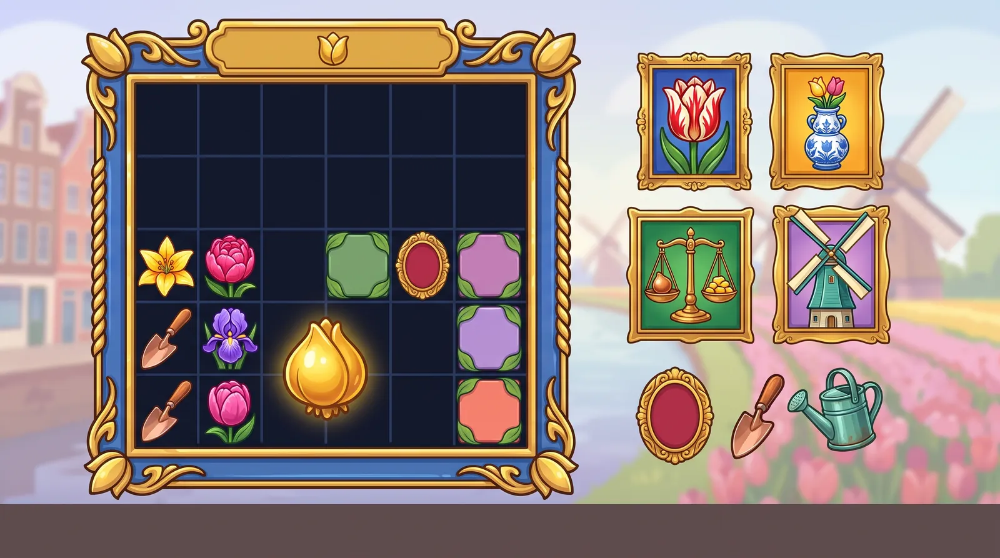

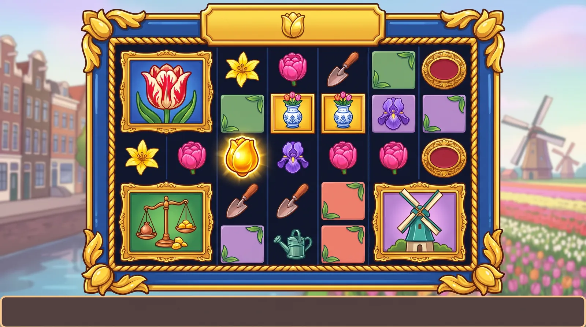

*Boards:* v1 broke the layout (symbols outside the frame); v2 is the usable reference.

**Title ideas:** Bulb Fever, Golden Bulb Bloom, The Rarest Bloom

**Hook.** The rarest bloom wins. In the Golden Age, a single flamed tulip was the rarest treasure in the canal town. Every explosion plants a seed in the board's soil, and every later one grows it from sprout to bud to bloom to a golden tulip, doubling its multiplier, so a hot board blooms into a tulip field. Gilded medallion multipliers drop in on top.

**World.** A spring canal town in the Dutch Golden Age: glossy tulips and irises, blue-and-white porcelain, a polished brass merchant's scale, tower windmills over striped bulb fields and gilded picture-frame splendour. Rarity, craft and trade keep it adult and historical, never speculation. No clogs, cheese, costumes or figures, no ships, boats or flags, no portraits, hallmarks, inscriptions, signs or lettering on tiles.

**Palette.** #2346A6 Delft blue, #E2232E tulip red, #FFD12E lily yellow, #FF6FA8 double pink, #7A3DB8 iris violet, #3E9C8C verdigris, #C8733A copper, #1F7A7A deep teal, #C9A8F0 lilac, #1FA35B emerald, #6CC24A leaf green, #FF6B4F coral red, #F2BE3A gilded gold, #CFE6F7 spring sky, #161B2A dark well

**Premium symbols (framed tiles)**
- **Flamed Tulip** (red and white (cobalt plaque)): A single legendary tulip in full cup bloom with flame-like red-and-white feathered stripes on every petal and two broad green leaves, centred on a small carved gilded picture-frame plaque with a cobalt enamel field.
- **Delft Tulip Vase** (Delft blue and white (saffron plaque)): A tiered blue-and-white porcelain tulip vase shaped like a stepped pyramid with five short spouts, each holding a closed red tulip bud, painted with abstract floral sprays only, centred on a small carved gilded picture-frame plaque with a saffron enamel field.
- **Merchant's Scale** (brass gold (emerald plaque)): A polished brass balance scale with a single plain copper tulip bulb on one pan outweighing a heap of smooth, unmarked gold nuggets on the other, centred on a small carved gilded picture-frame plaque with an emerald enamel field.
- **Tower Windmill** (deep teal and cream (lilac plaque)): A tall, realistically proportioned tower windmill painted deep teal with a red cap and four broad solid cream sails with no lattice, standing on no mound, centred on a small carved gilded picture-frame plaque with a lilac enamel field.

**Low symbols (frameless)**
- **Lily Tulip** (lemon yellow): A lemon-yellow lily-flowered tulip head with slender pointed petals flaring outward like a star, on a short stem stub.
- **Double Tulip** (hot pink): A hot-pink double tulip shaped like a round, densely packed ball of petals, on a short stem stub.
- **Bearded Iris** (iris violet): A violet bearded iris with three upright petals and three broad falling petals, each fall marked with a small yellow beard.
- **Copper Trowel** (copper orange): A garden trowel lying diagonally, with a polished copper-orange blade and a short turned wooden handle with a brass ferrule.
- **Verdigris Watering Can** (verdigris green): An antique copper watering can with a round belly covered in a smooth verdigris-green patina, a long spout ending in a polished brass rose and a curved handle, in side view.

**Scatter ("hidden bonus").** Hidden bonus = THE GOLDEN BULB: an oversized, frameless, glowing gold tulip bulb with a solid polished-gold closed bud bursting from its tip (no red flames, so the flamed stripes belong to the Flamed Tulip alone) and rays of warm light. It fills about 110% of the cell, and no other symbol is a bulb. Idle: the bud slowly swells and relaxes. Anticipation (driven by the book): the light rays intensify and golden roots shimmer down into the cell. Trigger (3 or more): every bud bursts open into a huge golden tulip and a wave of petals sweeps the board into the sunset crossfade. Miss: the bud closes and the glow sinks back into the bulb.

**Multiplier symbol.** GILDED MEDALLION (the rules name): an empty carved-gold oval picture-frame cartouche with tulip-leaf carving round its rim and a smooth, blank, glossy enamel centre. The live x-value sits on it in gold numerals with a thick dark outline and a step shadow. It is not a coin and carries no portrait, inscription or currency name, and the oval carved frame and enamel centre keep it clear of the reference's gold-and-green coin. Value tiers change the enamel: crimson (low), violet (mid), white-gold with a petal glow (high); there is no green tier. Land: a heavy gilded clack that kicks up a few petals. Hold: a slow glint travels round the carving. Collect: it flips end over end to the win meter. Miss: the enamel dulls and the value fades.

**Board spot tiles (background multipliers).** Flat, matte painted soil tiles in the dark well, where the multiplier grows like a plant. SpotGrid draws behind the symbols, so each tier is a full-bleed colour plus a rim, and the growth motif is drawn as leaves and petals curling in from the corners where it shows around the symbol. T1 (marked): umber soil with a light leaf-green rim and a seed dot in one corner, no number. T2 (x2-x16): leaf green with sprout leaves at two corners. T3 (x32-x64): lilac-violet with closed buds at the corners. T4 (x128-x256): coral-red with open blooms at the corners. T5 (x512+): gold with a gold tulip outline round the rim and a soft glow. Numerals are live text in a deeper shade of the tile. Upgrade: a short grow-in at the corners as the exploding symbol's petals settle into the soil (one flash). Apply: the corner blooms sway on win_peak. Reset: the blooms fold back into the soil.

**Frame.** A top-heavy Golden Age gilded picture frame in glossy Delft-blue lacquer with broad cartoon-gold carving (not cream). Crown: a shallow, flat carved-gold cartouche band (not an arch) with tulip-leaf scroll carving and a centred golden tulip. Sides: slim gold rope-twist mouldings round a narrow Delft-blue lacquer strip painted with abstract tulip sprays (rails, never pillars). Corners: gold tulip-leaf flourishes; the top pair curls inward over the crown, the bottom pair flares outward. Sill: a thin gold planter-rim bar with tulip leaves peeking over it. Well: dark navy lanes. Thick dark outline, no lettering, no hallmarks; built as 9-slice pieces. Emissive layer: the gold leaves and the cartouche, which glow on connect and feature.

**Background.** A soft-focus, high-key spring canal town in hazy morning light (21:9, only moderately soft). Far left: stepped-gable canal houses along a quiet canal with no boats. Far right: tower windmills over striped red, yellow and pink tulip fields running to the horizon. Top: pale blossom branches. Bottom corners: big blue-and-white porcelain planters overflowing with tulips. The centre is a calm, light cobbled quay under a soft blue sky (bright-style value overrides). No people, boats, ships, flags, signs, hallmarks or lettering.

**Feature backgrounds.** Free spins: the same town at golden sunset, with the tulip stripes glowing saturated, the windmill sails rim-lit, lamplit windows reflected in the canal and golden pollen drifting. Super bonus: the golden-bloom variant, in which every field has turned to golden tulips and gold petals fall. Both are section-E edits of the base plate.

**Animation ideas (spin, land, miss, connect, explode).** SPIN: the heads blur with one trailing petal, and the background windmill sails spin faster. LAND: the tulip heads bounce on their stem stubs with one petal fluttering, the iris falls flex, the trowel clinks down blade first and the watering can sloshes out a droplet. The scale's pans see-saw and settle, the windmill thumps down and its sails creak a quarter turn, and the tulip vase clinks like porcelain. MISS: the petals close slightly and the heads dip; the can tips back and the trowel dulls. CONNECT: every winning flower opens wide as golden pollen sparkles. The flamed tulip's stripes ripple like fire, the scale tips toward the bulb, the vase's buds pop open, the windmill sails spin, the can sprinkles and the trowel's blade flashes. A green vine draws through the cluster linking the cells, and on win_peak they all bloom fully together. EXPLODE: a 100 ms hit-stop, then a signature burst per symbol: the lily tulip spins its petals out like a star, the double tulip pops into a ball of petals, the iris falls apart three and three, the trowel flips and scrapes up a spray of soil, the can sloshes a gold water splash, the tulip vase cracks into porcelain shards, the scale's pans fling gold nuggets, the windmill's sails spin off and the flamed tulip flares like a torch. Golden pollen settles into the cell to plant or grow the spot. BACKGROUND: idle = the sails turn slowly and petals drift. Spin = the sails speed up and a breeze ripples the fields. Land = the tulip rows ripple at each column impact. Connect = the fields glow in the winner's colour and pulse. Explode = a gust of petals across the canal with a light flash. Miss = a cloud shadow sweeps across the town. Anticipation = the wind rises and the sky warms. Tier-up = a wave of blooming runs through the background fields. Big win = the sky fills with petals. Feature = the golden-sunset crossfade. The windmill sails are a cheap environment rig.

**Lobby appeal.** 'The rarest bloom' is a one-line hook for a high-volatility game, told through rarity and craft rather than speculation. The 3-second clip is the board blooming from bare soil into a golden tulip field as the multipliers grow. The fresh spring palette stands apart from every neon, marble and dark tile in the lobby. Game tile: a golden tulip bursting from the golden bulb on a light sky-blue gradient. Social-safe menu: Extra Chance becomes 'Early Bloom', the 100x spin 'Bloom Spin', the 1000x spin 'Golden Bulb Spin', the bonus 'Tulip Bonus' and the super bonus 'Golden Bloom Bonus'.

**Risks and guardrails.** Never sell a bubble, a crash or speculation ('mania', 'bubble', 'worth a canal house', 'tycoon'); market rarity instead. Dutch kitsch (clogs, cheese, costumes) cheapens the theme, and there are no ships, flags, trading-company monograms, city crests or 'Royal Delft' naming ('Delft blue' is a colour word only). NBP writes hallmarks on gold, signs on houses and inscriptions on tiles, so every prompt says 'no hallmarks, no inscriptions, no signs, no lettering on tiles, no flags, no ships, no people' and every plate gets a text check. NBP does not know the word 'tulipiere', so the brief spells out the stepped-pyramid geometry; budget three or more candidates. Two tulip lows plus the flamed tulip: keep the silhouettes strictly star (lily), ball (double) and cup on a plaque (flamed), and run the 64 px gate early with the iris, the trowel and the can; also check the copper trowel against the copper bulb on the scale. The windmill stays tall and realistic so it never reads as a farm toy, and the can is antique copper with patina, not a toy. The scale's bulb stays plain copper so it never reads as the golden scatter. Run a title search: 'Tulip Mania'-style titles exist, and 'Bulb Fever' and 'Golden Bulb Bloom' need counsel.

**Why it ranked here.** It has the best fit between story and gambling of all fifteen ideas: tulip mania is a real speculative bubble, and the spot ladder becomes plant growth from seed to golden tulip, which reads by shape before colour and turns a hot board into a blooming field. The setting is bright and springlike and the gold trade cues keep it adult, so it sits comfortably in the reference's glossy, saturated style. The fixes: the fringed tulip was dropped (a fourth tulip head is a readability risk), and so was the low tulip bulb, which had the same silhouette as the golden-bulb scatter. A grape hyacinth bead cone and a lime watering can replace them, which gives five distinct colours and silhouettes. The scale now holds a plain copper bulb. The frame moved from Delft porcelain to a gilded Golden Age picture frame, so it does not echo KINTSUGI's porcelain frame. Lobby pull is a notch lower than the top two because flowers can read as gentle at thumbnail size.

Vetting (compliance + production)

**Compliance review: adjust**

Issues:
- The hook sells a speculative crash ('first bubble in history', 'one bulb was worth a canal house', 'Mania Bonus'). In a gambling product, reviewers can read that as encouraging reckless staking, and 'mania' is also a mental-health term.
- The Grape Hyacinth (a cluster of glossy violet beads) is the reference's purple grape-bunch premium, with the same colour and the same bead-cluster silhouette.
- Frame: cream lacquer with carved gold scrolls, a centred crest and outward-curling gold corner flourishes is the reference's cream entablature with gold scroll and winged corners.
- Toy cues: a glossy lime-green watering can and a chunky windmill on a green mound read as a toddler's garden toy or farm playset.
- Multiplier: a gold coin is the closest form to the reference coin of any finalist, and its 'emerald (mid)' tier is literally a gold coin with a green centre. 'Guilder' is a real currency name, and social mode replaces currency and money words.
- NBP adds text in several places: hallmarks on gold bars ('999.9 FINE GOLD'), shop signs on canal houses, inscriptions on Delft tiles, and a portrait or legend on the coin.
- Marks and associations to avoid: 'Royal Delft' (a trade name of De Porceleyne Fles), 'Keukenhof' (check), VOC monograms, ships or flags (colonial associations) and city crests. 'Tulip Tycoon' borrows from the Tycoon game franchises (low risk).

Applied in the board prompt and brief:
- R
- e
- f
- r
- a
- m
- e
-  
- t
- h
- e
-  
- h
- o
- o
- k
-  
- a
- r
- o
- u
- n
- d
-  
- r
- a
- r
- i
- t
- y
-  
- (
- '
- t
- h
- e
-  
- r
- a
- r
- e
- s
- t
-  
- b
- l
- o
- o
- m
- '
- )
- ,
-  
- n
- e
- v
- e
- r
-  
- a
-  
- b
- u
- b
- b
- l
- e
-  
- o
- r
-  
- c
- r
- a
- s
- h
- .
-  
- R
- e
- n
- a
- m
- e
-  
- '
- M
- a
- n
- i
- a
-  
- B
- o
- n
- u
- s
- '
-  
- t
- o
-  
- '
- G
- o
- l
- d
- e
- n
-  
- B
- l
- o
- o
- m
-  
- B
- o
- n
- u
- s
- '
-  
- a
- n
- d
-  
- d
- r
- o
- p
-  
- '
- T
- u
- l
- i
- p
-  
- T
- y
- c
- o
- o
- n
- '
- ;
-  
- u
- s
- e
-  
- '
- B
- u
- l
- b
-  
- F
- e
- v
- e
- r
- '
-  
- o
- r
-  
- '
- G
- o
- l
- d
- e
- n
-  
- B
- u
- l
- b
-  
- B
- l
- o
- o
- m
- '
-  
- a
- f
- t
- e
- r
-  
- c
- o
- u
- n
- s
- e
- l
- .
-  
- R
- e
- p
- l
- a
- c
- e
-  
- t
- h
- e
-  
- G
- r
- a
- p
- e
-  
- H
- y
- a
- c
- i
- n
- t
- h
-  
- w
- i
- t
- h
-  
- a
-  
- V
- i
- o
- l
- e
- t
-  
- B
- e
- a
- r
- d
- e
- d
-  
- I
- r
- i
- s
-  
- (
- t
- h
- r
- e
- e
-  
- u
- p
- r
- i
- g
- h
- t
-  
- a
- n
- d
-  
- t
- h
- r
- e
- e
-  
- f
- a
- l
- l
- i
- n
- g
-  
- p
- e
- t
- a
- l
- s
- )
- .
-  
- F
- r
- a
- m
- e
- :
-  
- D
- e
- l
- f
- t
- -
- b
- l
- u
- e
-  
- l
- a
- c
- q
- u
- e
- r
-  
- o
- r
-  
- d
- a
- r
- k
-  
- w
- a
- l
- n
- u
- t
-  
- w
- i
- t
- h
-  
- g
- o
- l
- d
- ,
-  
- t
- o
- p
-  
- c
- o
- r
- n
- e
- r
- s
-  
- c
- u
- r
- l
- i
- n
- g
-  
- i
- n
- w
- a
- r
- d
- ,
-  
- a
- n
- d
-  
- p
- r
- e
- m
- i
- u
- m
-  
- t
- i
- l
- e
- s
-  
- a
- s
-  
- s
- m
- a
- l
- l
-  
- c
- a
- r
- v
- e
- d
-  
- g
- i
- l
- d
- e
- d
-  
- p
- i
- c
- t
- u
- r
- e
- -
- f
- r
- a
- m
- e
-  
- p
- l
- a
- q
- u
- e
- s
-  
- i
- n
- s
- t
- e
- a
- d
-  
- o
- f
-  
- r
- o
- u
- n
- d
- e
- d
-  
- s
- q
- u
- a
- r
- e
- s
- .
-  
- W
- a
- t
- e
- r
- i
- n
- g
-  
- c
- a
- n
- :
-  
- a
- n
-  
- a
- n
- t
- i
- q
- u
- e
-  
- c
- o
- p
- p
- e
- r
-  
- c
- a
- n
-  
- w
- i
- t
- h
-  
- a
-  
- v
- e
- r
- d
- i
- g
- r
- i
- s
- -
- g
- r
- e
- e
- n
-  
- p
- a
- t
- i
- n
- a
-  
- a
- n
- d
-  
- a
-  
- b
- r
- a
- s
- s
-  
- r
- o
- s
- e
- .
-  
- W
- i
- n
- d
- m
- i
- l
- l
- :
-  
- a
-  
- t
- a
- l
- l
-  
- t
- o
- w
- e
- r
-  
- m
- i
- l
- l
-  
- i
- n
-  
- r
- e
- a
- l
- i
- s
- t
- i
- c
-  
- p
- r
- o
- p
- o
- r
- t
- i
- o
- n
- s
- ,
-  
- w
- i
- t
- h
-  
- n
- o
-  
- m
- o
- u
- n
- d
- .
-  
- M
- u
- l
- t
- i
- p
- l
- i
- e
- r
- :
-  
- a
-  
- G
- i
- l
- d
- e
- d
-  
- O
- v
- a
- l
-  
- F
- r
- a
- m
- e
- ,
-  
- a
- n
-  
- e
- m
- p
- t
- y
-  
- c
- a
- r
- v
- e
- d
- -
- g
- o
- l
- d
-  
- o
- v
- a
- l
-  
- c
- a
- r
- t
- o
- u
- c
- h
- e
-  
- w
- i
- t
- h
-  
- a
-  
- b
- l
- a
- n
- k
-  
- g
- l
- o
- s
- s
- y
-  
- e
- n
- a
- m
- e
- l
-  
- c
- e
- n
- t
- r
- e
-  
- (
- c
- r
- i
- m
- s
- o
- n
- ,
-  
- t
- h
- e
- n
-  
- v
- i
- o
- l
- e
- t
- ,
-  
- t
- h
- e
- n
-  
- w
- h
- i
- t
- e
- -
- g
- o
- l
- d
- )
- ,
-  
- c
- a
- l
- l
- e
- d
-  
- '
- G
- i
- l
- d
- e
- d
-  
- M
- e
- d
- a
- l
- l
- i
- o
- n
- '
-  
- i
- n
-  
- t
- h
- e
-  
- r
- u
- l
- e
- s
- ;
-  
- n
- o
-  
- g
- r
- e
- e
- n
-  
- t
- i
- e
- r
-  
- a
- n
- d
-  
- n
- o
-  
- c
- o
- i
- n
- .
-  
- S
- c
- a
- l
- e
- :
-  
- r
- e
- p
- l
- a
- c
- e
-  
- t
- h
- e
-  
- g
- o
- l
- d
-  
- b
- a
- r
- s
-  
- w
- i
- t
- h
-  
- a
-  
- h
- e
- a
- p
-  
- o
- f
-  
- s
- m
- o
- o
- t
- h
- ,
-  
- u
- n
- m
- a
- r
- k
- e
- d
-  
- g
- o
- l
- d
-  
- n
- u
- g
- g
- e
- t
- s
- .
-  
- E
- v
- e
- r
- y
-  
- p
- r
- o
- m
- p
- t
-  
- s
- a
- y
- s
-  
- '
- n
- o
-  
- h
- a
- l
- l
- m
- a
- r
- k
- s
- ,
-  
- n
- o
-  
- i
- n
- s
- c
- r
- i
- p
- t
- i
- o
- n
- s
- ,
-  
- n
- o
-  
- s
- i
- g
- n
- s
- ,
-  
- n
- o
-  
- l
- e
- t
- t
- e
- r
- i
- n
- g
-  
- o
- n
-  
- t
- i
- l
- e
- s
- ,
-  
- n
- o
-  
- f
- l
- a
- g
- s
- ,
-  
- n
- o
-  
- s
- h
- i
- p
- s
- ,
-  
- n
- o
-  
- p
- e
- o
- p
- l
- e
- '
- .

**Production review: adjust**

Issues:
- Parrot tulip (a ruffled head) vs double tulip (a packed ball) on identical stem stubs are confusable in greyscale at 64 px.
- Too many tulips: three tulip lows, the flamed-tulip premium, the tulipiere's buds, the scatter's flamed bud and the tulip spots. The same red-gold flamed tulip appears on H1, the scatter and the T5 spot.
- The Delft-blue multiplier centre matches the Delft tulipiere.
- The windmill (chestnut and cream) is the only low-saturation premium and turns dull at 64 px, and its lattice sails mush.
- Spots: the growth ladder (seed, sprout, bud, bloom) is drawn at the cell centre, but SpotGrid draws it behind the symbols (src/board/SpotGrid.ts:13-16), so it is hidden. The T1 umber seed on the dark well is invisible. T3 pink and T4 coral are adjacent hues.
- Explode: four flower symbols all burst into 'their own petals', which is close to the generic-explosion trait under P3.
- NBP does not know the word 'tulipiere', so the explicit geometry in the brief carries it: budget extra candidates.
- The background's nine states are covered. The windmill sails are a cheap env rig.

Applied in the board prompt and brief:
- L
- o
- w
- s
- :
-  
- a
-  
- y
- e
- l
- l
- o
- w
-  
- l
- i
- l
- y
- -
- f
- l
- o
- w
- e
- r
- e
- d
-  
- t
- u
- l
- i
- p
-  
- (
- s
- t
- a
- r
- )
- ,
-  
- a
-  
- p
- i
- n
- k
-  
- d
- o
- u
- b
- l
- e
-  
- t
- u
- l
- i
- p
-  
- (
- b
- a
- l
- l
- )
- ,
-  
- a
-  
- v
- i
- o
- l
- e
- t
-  
- b
- e
- a
- r
- d
- e
- d
-  
- i
- r
- i
- s
- ,
-  
- a
-  
- C
- o
- p
- p
- e
- r
-  
- G
- a
- r
- d
- e
- n
-  
- T
- r
- o
- w
- e
- l
-  
- i
- n
-  
- p
- l
- a
- c
- e
-  
- o
- f
-  
- t
- h
- e
-  
- o
- r
- a
- n
- g
- e
-  
- p
- a
- r
- r
- o
- t
-  
- t
- u
- l
- i
- p
-  
- (
- d
- i
- a
- g
- o
- n
- a
- l
-  
- b
- l
- a
- d
- e
-  
- a
- n
- d
-  
- h
- a
- n
- d
- l
- e
- )
-  
- a
- n
- d
-  
- t
- h
- e
-  
- v
- e
- r
- d
- i
- g
- r
- i
- s
-  
- w
- a
- t
- e
- r
- i
- n
- g
-  
- c
- a
- n
- .
-  
- S
- c
- a
- t
- t
- e
- r
- :
-  
- m
- a
- k
- e
-  
- t
- h
- e
-  
- b
- u
- d
-  
- s
- o
- l
- i
- d
-  
- g
- o
- l
- d
-  
- w
- i
- t
- h
-  
- n
- o
-  
- r
- e
- d
-  
- f
- l
- a
- m
- e
- s
- ,
-  
- s
- o
-  
- t
- h
- e
-  
- r
- e
- d
- -
- a
- n
- d
- -
- w
- h
- i
- t
- e
-  
- f
- l
- a
- m
- e
- d
-  
- t
- u
- l
- i
- p
-  
- b
- e
- l
- o
- n
- g
- s
-  
- t
- o
-  
- H
- 1
-  
- a
- l
- o
- n
- e
- .
-  
- T
- 5
-  
- s
- h
- o
- w
- s
-  
- a
-  
- g
- o
- l
- d
-  
- t
- u
- l
- i
- p
-  
- o
- u
- t
- l
- i
- n
- e
-  
- a
- t
-  
- i
- t
- s
-  
- r
- i
- m
- .
-  
- W
- i
- n
- d
- m
- i
- l
- l
- :
-  
- a
-  
- d
- e
- e
- p
- -
- t
- e
- a
- l
- -
- p
- a
- i
- n
- t
- e
- d
-  
- t
- o
- w
- e
- r
-  
- m
- i
- l
- l
-  
- w
- i
- t
- h
-  
- f
- o
- u
- r
-  
- s
- o
- l
- i
- d
-  
- c
- r
- e
- a
- m
-  
- s
- a
- i
- l
- s
-  
- (
- n
- o
-  
- l
- a
- t
- t
- i
- c
- e
- )
-  
- a
- n
- d
-  
- a
-  
- r
- e
- d
-  
- c
- a
- p
- ,
-  
- o
- n
-  
- i
- t
- s
-  
- l
- i
- l
- a
- c
-  
- t
- i
- l
- e
- .
-  
- S
- p
- o
- t
- s
- :
-  
- c
- a
- r
- r
- y
-  
- t
- h
- e
-  
- t
- i
- e
- r
-  
- i
- n
-  
- f
- u
- l
- l
- -
- b
- l
- e
- e
- d
-  
- c
- o
- l
- o
- u
- r
-  
- p
- l
- u
- s
-  
- a
-  
- r
- i
- m
- .
-  
- T
- 1
-  
- i
- s
-  
- u
- m
- b
- e
- r
-  
- w
- i
- t
- h
-  
- a
-  
- l
- i
- g
- h
- t
-  
- l
- e
- a
- f
- -
- g
- r
- e
- e
- n
-  
- r
- i
- m
- ,
-  
- T
- 2
-  
- l
- e
- a
- f
-  
- g
- r
- e
- e
- n
- ,
-  
- T
- 3
-  
- l
- i
- l
- a
- c
- -
- v
- i
- o
- l
- e
- t
- ,
-  
- T
- 4
-  
- c
- o
- r
- a
- l
- -
- r
- e
- d
-  
- a
- n
- d
-  
- T
- 5
-  
- g
- o
- l
- d
- .
-  
- D
- r
- a
- w
-  
- t
- h
- e
-  
- g
- r
- o
- w
- t
- h
-  
- m
- o
- t
- i
- f
- s
-  
- a
- s
-  
- l
- e
- a
- v
- e
- s
-  
- c
- u
- r
- l
- i
- n
- g
-  
- i
- n
-  
- f
- r
- o
- m
-  
- t
- h
- e
-  
- c
- o
- r
- n
- e
- r
- s
- ,
-  
- s
- o
-  
- t
- h
- e
- y
-  
- s
- h
- o
- w
-  
- a
- r
- o
- u
- n
- d
-  
- t
- h
- e
-  
- s
- y
- m
- b
- o
- l
- .
-  
- E
- x
- p
- l
- o
- d
- e
-  
- s
- i
- g
- n
- a
- t
- u
- r
- e
- s
- :
-  
- t
- h
- e
-  
- l
- i
- l
- y
-  
- t
- u
- l
- i
- p
-  
- s
- p
- i
- n
- s
-  
- i
- t
- s
-  
- p
- e
- t
- a
- l
- s
-  
- o
- u
- t
-  
- l
- i
- k
- e
-  
- a
-  
- s
- t
- a
- r
- ,
-  
- t
- h
- e
-  
- d
- o
- u
- b
- l
- e
-  
- t
- u
- l
- i
- p
-  
- p
- o
- p
- s
-  
- i
- n
- t
- o
-  
- a
-  
- b
- a
- l
- l
-  
- o
- f
-  
- p
- e
- t
- a
- l
- s
- ,
-  
- t
- h
- e
-  
- i
- r
- i
- s
-  
- f
- a
- l
- l
- s
-  
- a
- p
- a
- r
- t
-  
- t
- h
- r
- e
- e
-  
- a
- n
- d
-  
- t
- h
- r
- e
- e
- ,
-  
- t
- h
- e
-  
- t
- r
- o
- w
- e
- l
-  
- f
- l
- i
- p
- s
-  
- a
- n
- d
-  
- s
- c
- r
- a
- p
- e
- s
-  
- u
- p
-  
- s
- o
- i
- l
- ,
-  
- t
- h
- e
-  
- c
- a
- n
-  
- s
- l
- o
- s
- h
- e
- s
-  
- a
-  
- g
- o
- l
- d
-  
- w
- a
- t
- e
- r
-  
- s
- p
- l
- a
- s
- h
- ,
-  
- t
- h
- e
-  
- t
- u
- l
- i
- p
- i
- e
- r
- e
-  
- c
- r
- a
- c
- k
- s
-  
- i
- n
- t
- o
-  
- p
- o
- r
- c
- e
- l
- a
- i
- n
-  
- s
- h
- a
- r
- d
- s
- ,
-  
- t
- h
- e
-  
- s
- c
- a
- l
- e
- '
- s
-  
- p
- a
- n
- s
-  
- f
- l
- i
- n
- g
-  
- n
- u
- g
- g
- e
- t
- s
- ,
-  
- t
- h
- e
-  
- w
- i
- n
- d
- m
- i
- l
- l
- '
- s
-  
- s
- a
- i
- l
- s
-  
- s
- p
- i
- n
-  
- o
- f
- f
-  
- a
- n
- d
-  
- t
- h
- e
-  
- f
- l
- a
- m
- e
- d
-  
- t
- u
- l
- i
- p
-  
- f
- l
- a
- r
- e
- s
- .
-  
- G
- e
- n
- e
- r
- a
- t
- e
-  
- t
- h
- r
- e
- e
-  
- o
- r
-  
- m
- o
- r
- e
-  
- c
- a
- n
- d
- i
- d
- a
- t
- e
- s
-  
- f
- o
- r
-  
- t
- h
- e
-  
- t
- u
- l
- i
- p
- i
- e
- r
- e
- .

---

## 4. SKYFAIR: *Barnstorm Skies*

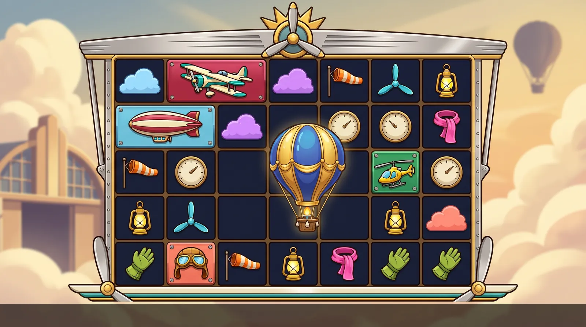

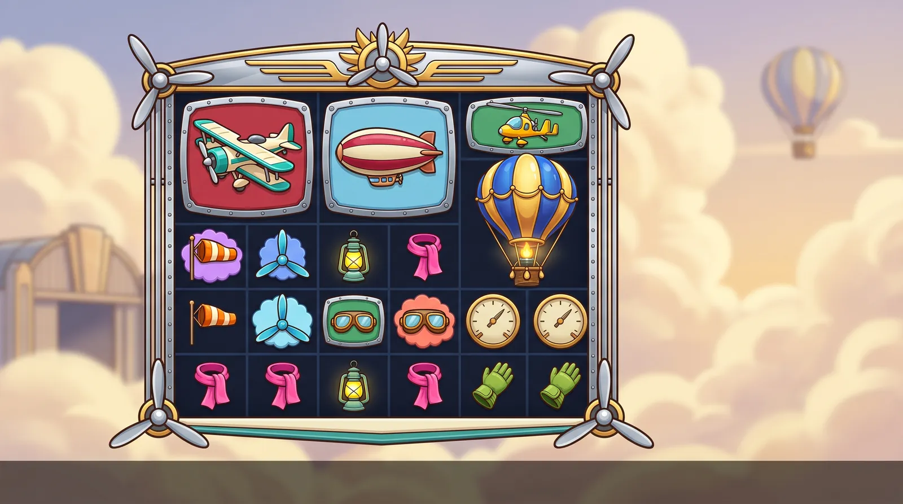

*Boards:* v1: close to 7×5 with the balloon scatter; v2 drifted to 5 columns.

**Title ideas:** Barnstorm Skies, Golden Air Derby, Gilded Balloon Fair

**Hook.** A golden-hour 1930s air race where every winning cluster leaves a puff of coloured contrail in the sky behind the board. Repeat hits on a cell swell the puff into a sunlit gold cumulus and double its multiplier, while brass altimeter multipliers float in under small parachutes. 'The sky's the limit' is the max-win story.

**World.** A 1930s Art Deco air-race festival at golden hour above patchwork fields: polished aluminium and brass, Deco speed lines, a sleek racing biplane, a crimson blimp, a gyrocopter, windsocks and aviator gear, with a gilded balloon on the horizon. It is civil-aviation luxury for adults, with grown-up proportions and closed, empty canopies, not a pastel nursery sky. No pilots or figures, no faces on aircraft or suns, and no military insignia, roundels, crosses, registration letters, numbers, flags or wartime schemes.

**Palette.** #1F9E9A air-race teal, #C8203A crimson, #F4F0E2 cream, #FFC21A sunflower, #FFE05A lemon, #FF8B2B windsock orange, #3FD6E0 aqua, #8FE3F2 sky cyan, #1FAE6B emerald, #FF7B6B coral, #8E5CFF dusk violet, #FF4FA3 scarf pink, #9BE22D lime, #2B4FC8 royal blue, #D9A441 brass, #C9D3E0 polished aluminium, #FFD9A8 golden-hour apricot, #121A2C night well

**Premium symbols (framed tiles)**
- **Air-Race Biplane** (cream and teal (crimson plate)): A chunky cream-and-teal racing biplane in three-quarter view with polished aluminium cowling, brass trim, a wooden propeller, Deco speed lines, two thick wing struts and a closed, empty canopy, with no markings, centred on a riveted crimson instrument-panel plate with a polished brass bezel.
- **Crimson Blimp** (crimson and cream (sky-cyan plate)): A plump crimson-and-cream blimp with plain rounded tail fins and a small gold gondola with empty windows, with no markings, numbers or symbols anywhere, centred on a riveted sky-cyan instrument-panel plate with a polished brass bezel.
- **Gyrocopter** (sunflower yellow (emerald plate)): A chunky, glossy sunflower-yellow vintage gyrocopter with a big polished-gold two-blade rotor on top, a small rear propeller and a closed, empty rounded canopy, with no markings, centred on a riveted emerald instrument-panel plate with a polished brass bezel.
- **Flight Goggles** (violet and amber (coral plate)): A pair of empty brass-rimmed aviator goggles with big amber lenses on a padded violet leather strap, seen from the front, centred on a riveted coral instrument-panel plate with a polished brass bezel.

**Low symbols (frameless)**
- **Windsock** (windsock orange): An orange-and-white striped windsock, fully inflated, on a short brass pole, angled to the right.
- **Propeller** (aqua): An aqua-blue three-blade propeller with a polished chrome hub, seen face-on.
- **Storm Lantern** (lemon yellow): A lemon-yellow glass storm lantern with a polished brass cap, base and carrying hoop, glowing softly from inside.
- **Silk Scarf** (hot pink): A hot-pink silk aviator scarf with fringed ends, fluttering in a loose S-curve.
- **Flight Gauntlet** (lime green): An empty lime-green leather flight gauntlet with a flared cuff and a brass buckle strap, in side view.

**Scatter ("hidden bonus").** Hidden bonus = THE GILDED BALLOON: an oversized, frameless, ornate Montgolfier-style hot-air balloon with royal-blue-and-gold baroque panels, gold swags, a glowing burner flame and a woven basket, wrapped in a warm aura, filling about 112% of the cell. No faces and no faced suns in the ornament. Idle: it bobs and the burner flickers. Anticipation (driven by the book): the clouds part and the remaining reels drift slightly upward. Trigger (3 or more): every burner roars, the balloons rise and a front cloud layer sweeps up across the screen (a cloud wipe) to reveal the balloon-glow plate. Miss: the burner throttles down to a pilot flame and the balloon settles gently on its basket.

**Multiplier symbol.** ALTIMETER: a round polished-brass aircraft gauge with a riveted bezel, a glass dome highlight and a smooth, blank cream face with no numerals and no ticks; a short gold pointer is parked at 12 o'clock behind the number. The live value sits on the face in cobalt numerals with a thick dark outline. It reads as a gauge, not a coin. It drops in under a small red-and-cream striped parachute (the only parachute in the game) that detaches on landing, and then the pointer whirls once. Value tiers change the bezel: brass (low), silver (mid), gold with a glowing face (high). Collect: it zooms to the win meter, leaving a white contrail. Miss: the pointer eases back and the glass fogs.

**Board spot tiles (background multipliers).** Flat, matte contrail clouds pressed into the dark well under the symbols. SpotGrid draws behind the symbols, so each tier is a full-bleed colour plus a cloud-scalloped rim that shows around the symbol. T1 (marked): a pale scalloped rim on navy, no number. T2 (x2-x16): sky blue. T3 (x32-x64): dusk violet. T4 (x128-x256): sunset coral with a gold scalloped rim. T5 (x512+): sunlit gold with a slow sunburst sheen at the rim. Numerals are live text in a deeper tint of the cloud. Upgrade: a contrail ring blooms into the cell and the scalloped rim swells (one flash). Apply: the rims under the cluster puff up on win_peak. Reset: a breeze thins them back to clear navy sky.

**Frame.** A polished-aluminium and cartoon-gold Art Deco air-race surround. Crown: a flat gold band with a gentle upward bow (not an arch) carrying Deco speed lines and a centred gold propeller-and-sunburst crest with no face. Sides: slim riveted aluminium struts with gold speed-line inlay (rails, never columns, no bracing wires). Corners: gold propeller-blade flourishes. Sill: a thin cream-and-teal striped wing-edge bar with gold rivets. Well: navy lanes. Thick dark outline, built as 9-slice pieces. Emissive layer: the crest's sunburst and the rivets, which glint on connect and feature.

**Background.** A soft-focus, high-key golden-hour sky festival (21:9, only moderately soft): a warm cream-and-apricot sky fading to pale turquoise, with towering sunlit cumulus clouds above patchwork green-and-gold fields far below. Far left: a cream Art Deco hangar with a teal roof and a striped windsock mast. Far right: a distant gilded balloon rising from a hill. Top: a far-off biplane trailing a coloured smoke ribbon. Bottom corners: a blurred polished-aluminium wingtip and a big woven balloon basket. The centre is calm, light sky (bright-style value overrides). No people, pilots, markings, roundels, flags, numbers or text.

**Feature backgrounds.** Free spins: an evening balloon glow, with a peach-violet sky, the gilded balloon lit from inside and contrails turning gold. Super bonus: high above a sea of clouds at golden hour, under a gold-rimmed sun with no face. Both are section-E edits of the base plate (same shapes, new light). The swap is hidden by a front cloud layer that wipes upward; a camera tilt is only possible if the 21:9 plate is first outpainted about 40% upward.

**Animation ideas (spin, land, miss, connect, explode).** SPIN: symbols whoosh down with Deco speed lines and the background clouds scroll faster. LAND: the biplane banks in and levels with a wobble, the blimp bobs on the air, the gyrocopter rotor spins down and the goggles bounce on their strap. The lows flutter in as if caught by the wind: the windsock fills, the propeller ticks a third of a turn, the storm lantern swings on its hoop, the scarf flicks and the gauntlet flexes its cuff. MISS: non-winners throttle back to idle: propellers and rotors slow to a lazy turn, the windsock relaxes and the lantern dims (never a sputter, drop or dive). CONNECT: the winners hover and bob on a thermal. Propellers and rotors spin up, the goggle lenses flash, the windsock snaps taut, the lantern glows bright and the scarf streams out. A white contrail ribbon links the cluster's cells, and they all lift together on win_peak. EXPLODE: a 100 ms hit-stop, then a signature burst per symbol: the windsock tears into stripes, the lantern's glass shatters with a spark, the scarf unravels into ribbon, the gauntlet's buckle pops off in a puff of leather scraps, the propeller flings its blades, the biplane rolls and bursts into rivets, the blimp deflates with a pop and fabric scraps, the gyrocopter flings its rotor and the goggles' lenses pop out. A contrail ring blooms into the cell below (spot mark or upgrade). BACKGROUND: idle = the clouds drift and the balloon bobs. Spin = a wind gust and faster clouds. Land = the windsock mast snaps and the fields ripple at each column impact. Connect = the distant biplane loops and trails smoke in the winner's colour. Explode = a sun flare and a puff of confetti cloud. Miss = a passing cloud shadow. Anticipation = the clouds part and shafts of light sweep the board. Big win = a sky full of coloured smoke loops. Feature = the cloud wipe into the balloon glow.

**Lobby appeal.** It is the closest in mood to the reference's dreamy painted world without being candy: warm, optimistic Art Deco glamour for adults, with a natural 'sky's the limit' max-win story, and nothing similar is prominent in the lobby. Game tile: the gilded balloon rising through gold clouds against a golden-hour sky. Social-safe menu: Extra Chance becomes 'Tailwind', the 100x spin 'Loop Spin', the 1000x spin 'Jetstream Spin', the bonus 'Air Race Bonus' and the super bonus 'Gilded Balloon Bonus'.

**Risks and guardrails.** Appeal to minors is the main risk: chunky aircraft, balloons and puffy clouds are the stock nursery set, so the Deco air-race look, polished aluminium and brass, adult proportions and a golden-hour (not pastel nursery) sky are mandatory, with no gold-star stickers and no faces on aircraft or suns. NBP fills open cockpits with goggled pilots, so every canopy is closed and empty and every prompt says 'no pilot, no person, no figure, no registration letters, no numbers, no roundels, no insignia, no flags'. No red biplane (a famous flying-ace brand and comic-strip association), no blue-yellow-silver blimp (a tyre brand's trade dress), no wartime colours. Avoid 'Aviator', 'crash' and any crash-game look: a miss throttles back to idle, never sputters, drops or dives, and smoke stays in festival colours. The altimeter face is blank with no ticks. Vehicles stay chunky in three-quarter view, with struts as two thick posts and no bracing wires inside symbols. 64 px gate pairs: the aqua propeller against the blimp's sky-cyan plate, the sunflower gyrocopter against the lemon storm lantern, and the lime gauntlet against the gyrocopter's emerald plate. 'Barnstorm Skies' is close to an aviation marketplace name (low risk); run a title search.

**Why it ranked here.** Its painted sky is the closest match to the reference's soft, dreamy backdrop, and the contrail-cloud spots are a light, original metaphor that keeps a bright, high-key board. The aviation domain is unused among the finalists. The fixes: the pennant had the same silhouette as the windsock (a flag on a pole), so a fluttering silk aviator scarf replaces it. The parachute now carries a cargo crate, because a canopy with nobody under it read oddly. The gyrocopter was recoloured ivory on an emerald tile so the lime parachute owns green. The airship became a plain-finned blimp to avoid historical associations. The altimeter carries cobalt numerals on cream for legibility. Brand is the weakest of the six, and 'Barnstorm Skies' is the strongest title; lobby pull is a step below the top three because aviation is gentler than spice, gold or flame.

Vetting (compliance + production)

**Compliance review: adjust**

Issues:
- Appeal to minors (the strongest such risk among the six): chunky glossy biplanes, a blimp, hot-air balloons, puffy pastel clouds, a gold star and a parachute make up the stock nursery and children's-book aviation set. The 'Air Star' medal also reads as a school gold-star sticker.
- A crimson biplane points to the Red Baron and to Snoopy vs the Red Baron (Peanuts), and 'Red Baron' is a registered brand.
- A silver-and-cobalt blimp on a sunflower-yellow tile matches the Goodyear Blimp's trade dress (blue, yellow and silver).
- NBP fills open cockpits with a goggled pilot, which breaks the no-characters rule.
- Crash-game adjacency: Stake's lobby carries Aviator-style crash games. Sputtering engines and a sagging balloon on miss, plus smoke trails, read as 'crash'.
- NBP adds text in several places: registration letters and roundels on wings and fins, numerals on the altimeter dial, and hangar signage.
- Titles: 'Barnstorm Skies' is close to barnstormers.com, an aviation marketplace (low risk). Run a title search.

Applied in the board prompt and brief:
- M
- o
- v
- e
-  
- t
- o
-  
- a
-  
- 1
- 9
- 3
- 0
- s
-  
- A
- r
- t
-  
- D
- e
- c
- o
-  
- a
- i
- r
- -
- r
- a
- c
- e
-  
- l
- u
- x
- u
- r
- y
-  
- l
- o
- o
- k
- :
-  
- p
- o
- l
- i
- s
- h
- e
- d
-  
- a
- l
- u
- m
- i
- n
- i
- u
- m
-  
- a
- n
- d
-  
- b
- r
- a
- s
- s
- ,
-  
- D
- e
- c
- o
-  
- s
- p
- e
- e
- d
-  
- l
- i
- n
- e
- s
-  
- a
- n
- d
-  
- a
-  
- g
- o
- l
- d
- e
- n
- -
- h
- o
- u
- r
-  
- s
- k
- y
-  
- i
- n
- s
- t
- e
- a
- d
-  
- o
- f
-  
- a
-  
- p
- a
- s
- t
- e
- l
-  
- n
- u
- r
- s
- e
- r
- y
-  
- s
- k
- y
- .
-  
- S
- c
- a
- t
- t
- e
- r
- :
-  
- a
- n
-  
- o
- r
- n
- a
- t
- e
-  
- g
- i
- l
- d
- e
- d
-  
- M
- o
- n
- t
- g
- o
- l
- f
- i
- e
- r
- -
- s
- t
- y
- l
- e
-  
- b
- a
- l
- l
- o
- o
- n
-  
- w
- i
- t
- h
-  
- r
- o
- y
- a
- l
- -
- b
- l
- u
- e
- -
- a
- n
- d
- -
- g
- o
- l
- d
-  
- b
- a
- r
- o
- q
- u
- e
-  
- p
- a
- n
- e
- l
- s
- ,
-  
- w
- i
- t
- h
-  
- n
- o
-  
- f
- a
- c
- e
- s
-  
- a
- n
- d
-  
- n
- o
-  
- f
- a
- c
- e
- d
-  
- s
- u
- n
- s
- .
-  
- R
- e
- p
- l
- a
- c
- e
-  
- t
- h
- e
-  
- A
- i
- r
-  
- S
- t
- a
- r
-  
- w
- i
- t
- h
-  
- a
-  
- L
- e
- m
- o
- n
-  
- S
- t
- o
- r
- m
-  
- L
- a
- n
- t
- e
- r
- n
-  
- (
- a
-  
- b
- r
- a
- s
- s
- -
- c
- a
- p
- p
- e
- d
-  
- s
- t
- o
- r
- m
-  
- l
- a
- n
- t
- e
- r
- n
-  
- w
- i
- t
- h
-  
- y
- e
- l
- l
- o
- w
-  
- g
- l
- a
- s
- s
- )
- .
-  
- R
- e
- p
- l
- a
- c
- e
-  
- t
- h
- e
-  
- C
- a
- r
- g
- o
-  
- P
- a
- r
- a
- c
- h
- u
- t
- e
-  
- w
- i
- t
- h
-  
- a
-  
- L
- i
- m
- e
-  
- F
- l
- i
- g
- h
- t
-  
- G
- a
- u
- n
- t
- l
- e
- t
-  
- (
- a
-  
- l
- i
- m
- e
- -
- g
- r
- e
- e
- n
-  
- l
- e
- a
- t
- h
- e
- r
-  
- g
- a
- u
- n
- t
- l
- e
- t
-  
- w
- i
- t
- h
-  
- a
-  
- b
- r
- a
- s
- s
-  
- b
- u
- c
- k
- l
- e
- )
- .
-  
- B
- i
- p
- l
- a
- n
- e
- :
-  
- c
- r
- e
- a
- m
-  
- a
- n
- d
-  
- t
- e
- a
- l
- ,
-  
- n
- e
- v
- e
- r
-  
- r
- e
- d
- .
-  
- B
- l
- i
- m
- p
- :
-  
- c
- r
- i
- m
- s
- o
- n
-  
- a
- n
- d
-  
- c
- r
- e
- a
- m
-  
- w
- i
- t
- h
-  
- p
- l
- a
- i
- n
-  
- f
- i
- n
- s
- ,
-  
- o
- n
-  
- a
-  
- s
- k
- y
- -
- c
- y
- a
- n
-  
- t
- i
- l
- e
- ,
-  
- w
- i
- t
- h
-  
- n
- o
-  
- y
- e
- l
- l
- o
- w
- .
-  
- E
- v
- e
- r
- y
-  
- v
- e
- h
- i
- c
- l
- e
-  
- h
- a
- s
-  
- a
-  
- c
- l
- o
- s
- e
- d
- ,
-  
- e
- m
- p
- t
- y
-  
- c
- a
- n
- o
- p
- y
- ,
-  
- a
- n
- d
-  
- e
- v
- e
- r
- y
-  
- p
- r
- o
- m
- p
- t
-  
- s
- a
- y
- s
-  
- '
- n
- o
-  
- p
- i
- l
- o
- t
- ,
-  
- n
- o
-  
- p
- e
- r
- s
- o
- n
- ,
-  
- n
- o
-  
- f
- i
- g
- u
- r
- e
- ,
-  
- n
- o
-  
- r
- e
- g
- i
- s
- t
- r
- a
- t
- i
- o
- n
-  
- l
- e
- t
- t
- e
- r
- s
- ,
-  
- n
- o
-  
- n
- u
- m
- b
- e
- r
- s
- ,
-  
- n
- o
-  
- r
- o
- u
- n
- d
- e
- l
- s
- ,
-  
- n
- o
-  
- i
- n
- s
- i
- g
- n
- i
- a
- ,
-  
- n
- o
-  
- f
- l
- a
- g
- s
- '
- .
-  
- M
- i
- s
- s
- :
-  
- t
- h
- r
- o
- t
- t
- l
- e
-  
- b
- a
- c
- k
-  
- t
- o
-  
- i
- d
- l
- e
- ,
-  
- n
- e
- v
- e
- r
-  
- a
-  
- s
- p
- u
- t
- t
- e
- r
- ,
-  
- d
- r
- o
- p
-  
- o
- r
-  
- d
- i
- v
- e
- .
-  
- A
- l
- t
- i
- m
- e
- t
- e
- r
- :
-  
- '
- b
- l
- a
- n
- k
-  
- c
- r
- e
- a
- m
-  
- f
- a
- c
- e
- ,
-  
- n
- o
-  
- n
- u
- m
- e
- r
- a
- l
- s
- '
- .
-  
- P
- r
- e
- m
- i
- u
- m
-  
- t
- i
- l
- e
- s
- :
-  
- r
- i
- v
- e
- t
- e
- d
-  
- i
- n
- s
- t
- r
- u
- m
- e
- n
- t
- -
- p
- a
- n
- e
- l
-  
- p
- l
- a
- t
- e
- s
-  
- i
- n
- s
- t
- e
- a
- d
-  
- o
- f
-  
- r
- o
- u
- n
- d
- e
- d
-  
- s
- q
- u
- a
- r
- e
- s
- .

**Production review: adjust**

Issues:
- The aqua three-blade propeller (face-on, radial) and the lemon five-point star medal (radial spikes) are confusable radial silhouettes in greyscale.
- The cargo-parachute low and the altimeter's arrival parachute look alike, so a multiplier arrival reads as a low symbol landing.
- The aqua propeller vs the biplane's sky-cyan tile, and the lime parachute vs the gyrocopter's emerald tile (both noted in the pitch).
- Vehicles have fine parts (struts, bracing wires, rotors, gondola) that collapse at 64 px, and the gyrocopter reads as a helicopter.
- Spots: soft-edged cloud puffs at the cell centre are hidden by the symbols (src/board/SpotGrid.ts:13-16). T1 is a centre-only white wisp, and soft edges give no tier shape, so only colour is left.
- Altimeter: NBP paints numerals and ticks on the dial, which clutter the live number. The pointer competes with the value.
- The feature trigger's 'camera tilts up past the clouds' cannot work as planned: a section-E edit keeps the same framing, so there is no plate above the top edge.
- Explode: the same coloured smoke puff for all 11 symbols is the generic-explosion trait under P3.
- The background's nine states are easy here: parallax clouds, a balloon sprite and a looping biplane env rig.

Applied in the board prompt and brief:
- T
- h
- e
-  
- S
- t
- o
- r
- m
-  
- L
- a
- n
- t
- e
- r
- n
-  
- a
- n
- d
-  
- F
- l
- i
- g
- h
- t
-  
- G
- a
- u
- n
- t
- l
- e
- t
-  
- s
- w
- a
- p
- s
-  
- r
- e
- s
- o
- l
- v
- e
-  
- b
- o
- t
- h
-  
- c
- o
- n
- f
- u
- s
- a
- b
- l
- e
-  
- l
- o
- w
-  
- p
- a
- i
- r
- s
-  
- a
- n
- d
-  
- t
- h
- e
-  
- p
- a
- r
- a
- c
- h
- u
- t
- e
-  
- c
- o
- l
- l
- i
- s
- i
- o
- n
- ;
-  
- k
- e
- e
- p
-  
- t
- h
- e
-  
- p
- a
- r
- a
- c
- h
- u
- t
- e
-  
- o
- n
- l
- y
-  
- f
- o
- r
-  
- t
- h
- e
-  
- m
- u
- l
- t
- i
- p
- l
- i
- e
- r
- .
-  
- R
- e
- c
- o
- l
- o
- u
- r
-  
- t
- h
- e
-  
- b
- i
- p
- l
- a
- n
- e
-  
- t
- o
-  
- c
- r
- e
- a
- m
-  
- a
- n
- d
-  
- t
- e
- a
- l
-  
- o
- n
-  
- a
-  
- c
- r
- i
- m
- s
- o
- n
-  
- t
- i
- l
- e
- ,
-  
- t
- h
- e
-  
- b
- l
- i
- m
- p
-  
- t
- o
-  
- c
- r
- i
- m
- s
- o
- n
-  
- a
- n
- d
-  
- c
- r
- e
- a
- m
-  
- o
- n
-  
- a
-  
- s
- k
- y
- -
- c
- y
- a
- n
-  
- t
- i
- l
- e
-  
- a
- n
- d
-  
- t
- h
- e
-  
- g
- y
- r
- o
- c
- o
- p
- t
- e
- r
-  
- t
- o
-  
- s
- u
- n
- f
- l
- o
- w
- e
- r
-  
- y
- e
- l
- l
- o
- w
-  
- o
- n
-  
- t
- h
- e
-  
- e
- m
- e
- r
- a
- l
- d
-  
- t
- i
- l
- e
- ;
-  
- t
- h
- e
-  
- g
- o
- g
- g
- l
- e
- s
-  
- s
- t
- a
- y
- .
-  
- D
- r
- a
- w
-  
- t
- h
- e
-  
- v
- e
- h
- i
- c
- l
- e
- s
-  
- c
- h
- u
- n
- k
- y
-  
- a
- t
-  
- t
- h
- r
- e
- e
- -
- q
- u
- a
- r
- t
- e
- r
-  
- v
- i
- e
- w
- ,
-  
- w
- i
- t
- h
-  
- s
- t
- r
- u
- t
- s
-  
- a
- s
-  
- t
- w
- o
-  
- t
- h
- i
- c
- k
-  
- p
- o
- s
- t
- s
-  
- a
- n
- d
-  
- n
- o
-  
- b
- r
- a
- c
- i
- n
- g
-  
- w
- i
- r
- e
- s
-  
- i
- n
- s
- i
- d
- e
-  
- s
- y
- m
- b
- o
- l
- s
- .
-  
- S
- p
- o
- t
- s
- :
-  
- c
- a
- r
- r
- y
-  
- t
- h
- e
-  
- t
- i
- e
- r
-  
- i
- n
-  
- f
- u
- l
- l
- -
- b
- l
- e
- e
- d
-  
- c
- o
- l
- o
- u
- r
-  
- p
- l
- u
- s
-  
- a
-  
- c
- l
- o
- u
- d
- -
- s
- c
- a
- l
- l
- o
- p
- e
- d
-  
- r
- i
- m
-  
- v
- i
- s
- i
- b
- l
- e
-  
- a
- r
- o
- u
- n
- d
-  
- t
- h
- e
-  
- s
- y
- m
- b
- o
- l
- ;
-  
- T
- 1
-  
- i
- s
-  
- a
-  
- p
- a
- l
- e
-  
- s
- c
- a
- l
- l
- o
- p
- e
- d
-  
- r
- i
- m
-  
- o
- n
-  
- n
- a
- v
- y
- .
-  
- A
- l
- t
- i
- m
- e
- t
- e
- r
- :
-  
- a
-  
- b
- l
- a
- n
- k
-  
- c
- r
- e
- a
- m
-  
- f
- a
- c
- e
-  
- w
- i
- t
- h
-  
- n
- o
-  
- t
- i
- c
- k
- s
- ,
-  
- t
- h
- e
-  
- p
- o
- i
- n
- t
- e
- r
-  
- p
- a
- r
- k
- e
- d
-  
- a
- t
-  
- 1
- 2
-  
- o
- '
- c
- l
- o
- c
- k
-  
- b
- e
- h
- i
- n
- d
-  
- t
- h
- e
-  
- n
- u
- m
- b
- e
- r
- ,
-  
- a
- n
- d
-  
- c
- o
- b
- a
- l
- t
-  
- n
- u
- m
- e
- r
- a
- l
- s
-  
- w
- i
- t
- h
-  
- a
-  
- d
- a
- r
- k
-  
- o
- u
- t
- l
- i
- n
- e
- .
-  
- F
- e
- a
- t
- u
- r
- e
- :
-  
- a
-  
- c
- l
- o
- u
- d
- -
- w
- i
- p
- e
-  
- t
- r
- a
- n
- s
- i
- t
- i
- o
- n
-  
- (
- a
-  
- f
- r
- o
- n
- t
-  
- c
- l
- o
- u
- d
-  
- l
- a
- y
- e
- r
-  
- s
- w
- e
- e
- p
- s
-  
- u
- p
- )
- ,
-  
- o
- r
-  
- o
- u
- t
- p
- a
- i
- n
- t
-  
- t
- h
- e
-  
- 2
- 1
- :
- 9
-  
- p
- l
- a
- t
- e
-  
- a
- b
- o
- u
- t
-  
- 4
- 0
- %
-  
- u
- p
- w
- a
- r
- d
-  
- b
- e
- f
- o
- r
- e
-  
- t
- h
- e
-  
- t
- i
- l
- t
- .
-  
- E
- x
- p
- l
- o
- d
- e
-  
- s
- i
- g
- n
- a
- t
- u
- r
- e
- s
- :
-  
- t
- h
- e
-  
- w
- i
- n
- d
- s
- o
- c
- k
-  
- t
- e
- a
- r
- s
-  
- i
- n
- t
- o
-  
- s
- t
- r
- i
- p
- e
- s
- ,
-  
- t
- h
- e
-  
- l
- a
- n
- t
- e
- r
- n
- '
- s
-  
- g
- l
- a
- s
- s
-  
- s
- h
- a
- t
- t
- e
- r
- s
-  
- w
- i
- t
- h
-  
- a
-  
- s
- p
- a
- r
- k
- ,
-  
- t
- h
- e
-  
- s
- c
- a
- r
- f
-  
- u
- n
- r
- a
- v
- e
- l
- s
-  
- i
- n
- t
- o
-  
- r
- i
- b
- b
- o
- n
-  
- a
- n
- d
-  
- t
- h
- e
-  
- g
- a
- u
- n
- t
- l
- e
- t
- '
- s
-  
- b
- u
- c
- k
- l
- e
-  
- p
- o
- p
- s
-  
- o
- f
- f
- .
-  
- T
- h
- e
-  
- b
- i
- p
- l
- a
- n
- e
-  
- r
- o
- l
- l
- s
-  
- a
- n
- d
-  
- b
- u
- r
- s
- t
- s
-  
- i
- n
- t
- o
-  
- r
- i
- v
- e
- t
- s
- ,
-  
- t
- h
- e
-  
- b
- l
- i
- m
- p
-  
- d
- e
- f
- l
- a
- t
- e
- s
-  
- w
- i
- t
- h
-  
- a
-  
- p
- o
- p
-  
- a
- n
- d
-  
- f
- a
- b
- r
- i
- c
-  
- s
- c
- r
- a
- p
- s
- ,
-  
- t
- h
- e
-  
- g
- y
- r
- o
- c
- o
- p
- t
- e
- r
-  
- f
- l
- i
- n
- g
- s
-  
- i
- t
- s
-  
- r
- o
- t
- o
- r
-  
- a
- n
- d
-  
- t
- h
- e
-  
- g
- o
- g
- g
- l
- e
- s
- '
-  
- l
- e
- n
- s
- e
- s
-  
- p
- o
- p
-  
- o
- u
- t
- .

---

## 5. CHROME: *Hubcap Heat*

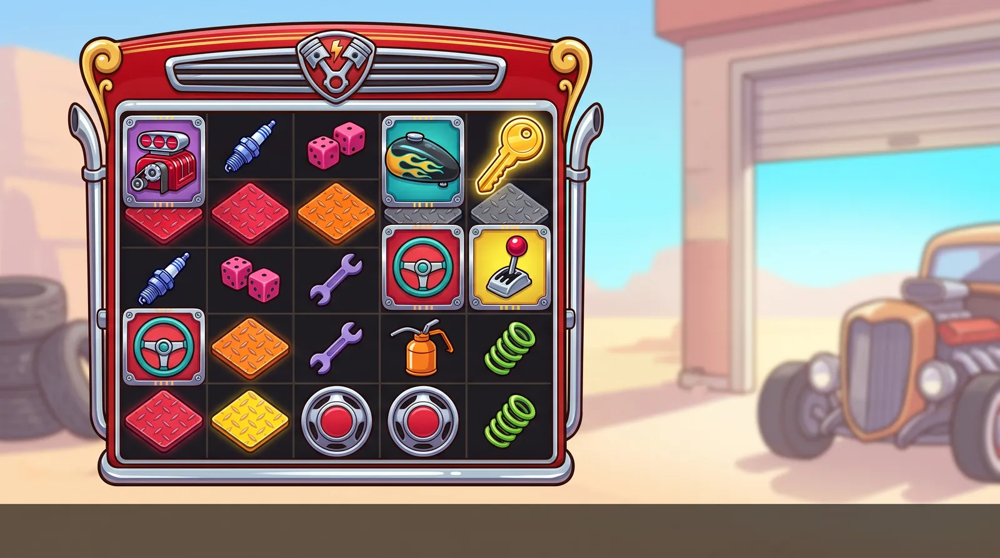

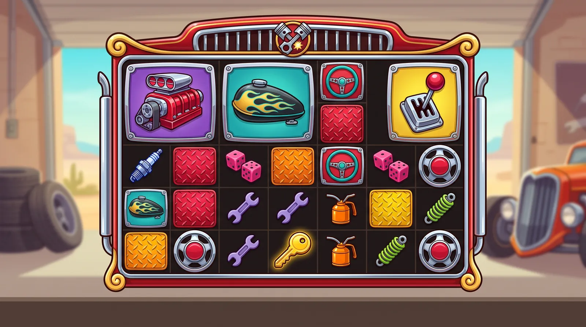

*Boards:* Both drifted to 5–6 columns with oversized premium tiles; use for material and palette, not layout.

**Title ideas:** Hubcap Heat, Ghost Flame Garage, White-Hot Garage

**Hook.** A sun-baked custom-car garage where every winning cluster scorches the diamond-plate floor under it. The plates heat from a cherry glow through orange and yellow to white-hot gold, doubling as they go, and chrome spinner-hubcap multipliers roll in. The heat tier is literal heat: 'the floor gets hotter' needs no explanation.

**World.** A 1950s-style custom-car shop on a sunny desert highway, with a strip of roadside motels and blank abstract starburst sign shapes in the distance. It is shown through glossy parts only: a supercharged engine, gold-and-teal pinstripe ghost flames, pinstripe scrolls, candy-apple lacquer and a golden ignition key. No whole cars as symbols, no drivers, no faces on vehicles, and no letters, badges, brand plates, licence plates or tyre lettering anywhere. Adult car culture without street racing, crashes or drink-driving.

**Palette.** #E3242B candy-apple red, #FF8A1F flame orange, #FFD23F lemon gold, #1FB5C9 surf turquoise, #2F5BEA cobalt, #FF4FA3 hot pink, #7B3FE4 metal-flake violet, #8BD630 lime, #B0122E ruby, #C9D3E0 chrome, #FFF1DC cream enamel, #15161A gloss black, #14161C oil-black well

**Premium symbols (framed tiles)**
- **Supercharger** (candy-apple red (violet plaque)): A front view of a candy-red supercharger blower with twin polished-chrome air scoops on a chunky black engine block, in big simple shapes with no badges or markings, centred on a pinstriped metal-flake violet enamel plaque with a chrome bezel and four bolts.
- **Ghost-Flame Tank** (gloss black with gold-and-teal flames (turquoise plaque)): A teardrop-shaped custom fuel tank in gloss black with gold-and-teal pinstripe ghost flames trailing back from the nose and a chrome filler cap, centred on a pinstriped turquoise enamel plaque with a chrome bezel and four bolts.
- **Steering Wheel** (surf turquoise (cherry-red plaque)): A chrome three-spoke steering wheel with a glossy turquoise-and-white banded rim and a plain chrome centre boss, tilted toward the viewer, centred on a pinstriped cherry-red enamel plaque with a chrome bezel and four bolts.
- **Ruby Shifter** (chrome and ruby (lemon plaque)): A tall chrome gear-shift lever topped with a big faceted ruby crystal knob, rising from a chrome boot plate, centred on a pinstriped lemon-gold enamel plaque with a chrome bezel and four bolts.

**Low symbols (frameless)**
- **Spark Plug** (cobalt blue): A chunky spark plug with a glossy cobalt-blue ceramic body and a chrome hex base, standing upright, with no markings.
- **Lucky Dice** (hot pink): A pair of glossy hot-pink dice with round white pips, tumbling at different angles.
- **Wrench** (metal-flake violet): A fat, chunky, violet metal-flake combination wrench lying diagonally, with chrome jaws at both ends.
- **Oil Can** (tangerine orange): A tangerine-orange vintage oil can with a round body, a thumb pump and a long thin spout, with no labels.
- **Coil Spring** (lime green): A chunky lime-green anodised suspension coil spring standing upright, a bold vertical zigzag of thick rounded coils.

**Scatter ("hidden bonus").** Hidden bonus = THE GOLDEN KEY: an oversized, frameless, polished-gold ignition key with a chunky gold fob set with a faceted white crystal on a small gold loop, wrapped in a warm glow, filling about 112% of the cell. The gold rod-and-fob shape belongs to the key alone (the shifter is chrome and ruby). Idle: the fob swings and glints. Anticipation (driven by the book): the remaining reels shake with engine idle and the floor plates brighten with heat. Trigger (3 or more): every key turns a quarter in an invisible ignition, an engine roars, the half-closed garage door rolls fully up and the dusk plate slides in. Miss: the key jiggles but does not turn, and the engine coughs.

**Multiplier symbol.** SPINNER HUBCAP: a round chrome hubcap with a fluted polished rim, a ring of chrome rivets and a smooth, blank, glossy deep candy-red centre cap that holds the live value in white numerals with a thick dark outline. Chrome and red keep it clear of the reference's gold-and-green coin. It drops and rolls in on its edge, spins flat and settles with a wobble and a ring of sparks. Value tiers change the rim: chrome (low), gold (mid), gold with a chasing glint (high). Collect: it rolls into the win meter, leaving a trail of sparks. Miss: the cap dulls and the spin dies away.

**Board spot tiles (background multipliers).** Diamond-plate steel floor plates in the oil-black well under the symbols. They are flat and matte, the heat glows only inside the tread pattern, and every plate keeps a dark 3 px steel border so the glow never touches a symbol's outline (warm glow behind red, orange and gold symbols would otherwise lose contrast). T1 (marked): dull steel with a faint warm scorch ring at the edge, no number. T2 (x2-x16): a cherry-red tread glow. T3 (x32-x64): an orange glow with a flame lick at each corner. T4 (x128-x256): a yellow-hot glow. T5 (x512+): a white-gold forge glow with drifting embers. Numerals are live, chunky and outlined, tinted to the heat colour. Upgrade: the plate flares (one flash) and cools slightly to its tier colour. Apply: the plates under the cluster pulse with heat on win_peak. Reset: the plates cool to dull steel. Any heat shimmer is a UV-scrolled overlay sprite (or a keyed video loop on the high tier), never a displacement filter.

**Frame.** A candy-apple red enamel, chrome and cartoon-gold custom-shop surround with no columns (not cream). Crown: a shallow chrome grille band (no manufacturer grille shape) edged with gold pinstripe scrollwork and carrying a centred gold piston-and-spark crest with no wings and no badge text. Sides: slim chrome exhaust-pipe rails banded in gold over red enamel. Corners: gold pinstripe-scroll flourishes curling outward. Sill: a thin chrome bumper bar with a turquoise pinstripe. Well: oil-black lanes. Thick dark outline, built as 9-slice pieces. Emissive layer: the pinstripes and the crest, which glow white-hot on connect and feature.

**Background.** A soft-focus, high-key desert custom shop at noon (21:9, only moderately soft). The roll-up door is half-closed, showing a wide strip of turquoise sky, red mesas and palm trees, with roadside motels and blank abstract starburst sign shapes far down the highway. Far left: stacked blackwall tyres with a plain white band and a red rolling toolbox. Far right: the gleaming, faceless, blurred nose of a hot rod under a work light. Top: unlettered pennant strings. Bottom corners: a big stack of plain tyres and a chrome air-compressor tank. The centre is calm, light concrete (bright-style value overrides). No people, badges, lettered signs, licence plates, tyre lettering or text.

**Feature backgrounds.** Free spins: the same shop at dusk with the door rolled fully up under a peach-and-violet sky. The blank starburst signs down the road blaze hot pink and aqua, neon tube outlines glow, the work lights are on and grinder sparks fly deep in the shop. Super bonus: night, with every sign and the floor glowing gold and bursts of flame along the horizon. Both are section-E edits of the base plate; the door is its own decomposed layer, so the roll-up animation covers the one area that changes.

**Animation ideas (spin, land, miss, connect, explode).** SPIN: symbols streak with chrome glints and the background heat haze rises. LAND: the supercharger thuds down with a suspension bounce, the tank rocks, the wheel spins a half turn and settles, and the shifter clunks into neutral. The lows clink down with a small spark: the plug bounces, the dice tumble once, the wrench rattles, the oil can sloshes and drips, and the coil spring boings and settles. MISS: a small exhaust puff; the chrome dulls and the piece settles one pixel. CONNECT: a chrome glint sweeps across every winner. The supercharger revs (the belt spins and the block shakes), the tank's ghost flames shimmer and slide, the wheel turns and the shifter slams into gear with a ruby flash. The plug sparks, the dice roll in place, the wrench twirls, the oil can squirts and the spring compresses and rebounds. A gold pinstripe traces the cluster, and they all rev together on win_peak. EXPLODE: a 100 ms hit-stop, then a signature burst per symbol: the supercharger backfires and snaps its belt, the tank's ghost flames whoosh out, the wheel spins off, the shifter launches its knob, the plug sparks out, the dice shatter into pips, the wrench spins off, the oil can bursts a gold splash and the coil spring springs apart. A scorch ring brands the steel plate below (spot mark or upgrade). BACKGROUND: idle = heat haze (UV-scrolled overlay sprite) and swaying pennants. Spin = the shop lights flicker on and a work-light sweep crosses the floor. Land = tools on the pegboard rattle at each column impact. Connect = the work lights and the distant signs glow in the winner's colour. Explode = an orange light pulse and a camera bump. Miss = a smoky dim. Anticipation = the engine-idle shake, and the signs flicker on one by one. Big win = bursts of flame along the horizon. Feature = the door rolls up into dusk. Heat flashes count toward the limit of 3 flashes per second, and no displacement filter is used.

**Lobby appeal.** It has strong pull for the core 25-45 audience and is the visual opposite of pastel candy: chrome, ghost flames and heat under a bright turquoise sky. 'The floor gets hotter' explains the multiplier instantly. Game tile: the golden key over white-hot plates under a turquoise sky. Social-safe menu: Extra Chance becomes 'Extra Heat', the 100x spin 'Pinstripe Spin', the 1000x spin 'Golden Key Spin', the bonus 'Garage Bonus' and the super bonus 'White-Hot Bonus'.

**Risks and guardrails.** The main IP risk is toy-car trade dress (the die-cast red-orange-yellow flame logo and the orange track), so the flames are gold-and-teal pinstripe ghost flames on a black tank, the crest is a piston-and-spark, and there are no toy-scale cars. No manufacturer grilles, badges or model silhouettes, no vehicles with faces, and no named pinstripe artists. Avoid 'Chrome', 'Kustom', 'Full Throttle', 'Nitro' and 'Hot Lap' in names. Do not glamorise street racing, crashes or drink-driving; keep road and racing scenes out. NBP writes tyre lettering, brand plates, licence plates, 'MOTEL' on signs and gauge numerals, so every prompt says 'no lettering on tyres, no badges, no brand plates, no licence plates, no signs with letters, no gauge numerals, no people'; tyres are blackwalls with a plain white band and every plate gets a text check. Chrome is grey, so every part carries a saturated paint colour or plaque field. Red is the theme colour (frame, supercharger, hubcap, ruby knob, cherry plaque), so the 64 px gate checks the supercharger against the hubcap, the black tank on turquoise against the turquoise wheel, and the spark plug against the coil spring. Heat shimmer is an overlay sprite, never a filter. Hot-rod slot names exist, so run a title search.

**Why it ranked here.** It merges CHROME with NEON MIRAGE, which shared the same 1950s desert-Americana world and an identical chrome-hubcap multiplier. It keeps CHROME's heat-plate spots, the most self-explanatory spot metaphor of all, and takes NEON MIRAGE's blank starburst roadside strip for the background and the dusk feature. NEON MIRAGE's light-board spots were dropped because they overlap MIRRORBALL's dance floor. This is the hot, high-energy option for Stake's male-skewing core audience, and it balances the calmer craft themes above it. The fixes: a candy-apple palette and coloured tile fields so the chrome never greys the board out; the lug nut moved to lime (the shifter owns yellow) and the dice to hot pink, giving nine distinct colours; and the wrench is drawn fat so it reads at 64 px. VibeFit and readability score a point lower than the top picks because chrome tends toward grey and the hardware silhouettes need care.

Vetting (compliance + production)

**Compliance review: adjust**

Issues:
- Hot Wheels trade dress: a candy-red tank with red-orange-yellow flame licks, a flame-emblem crest and chunky glossy car parts read as the Hot Wheels flame logo, which is also a children's toy brand.
- Titles and names: 'Chrome & Flame' uses 'Chrome' (a Google mark; Chrome Hearts too). 'Kustom' is the Kustom Amplification mark and a subculture term. The social name 'Full Throttle' is the LucasArts game and an energy-drink trademark. 'Hubcap Heat' is the cleanest.
- Glamour of speed: 'Nitro', 'Hot Lap', a horizon of flames and roaring engines lean toward street racing. Keep road and racing scenes out (the pitch already says so).
- NBP adds text in several places: tyre sidewall lettering (especially on whitewalls), blower and valve-cover brand plates, spark-plug branding, the oil-can label, licence plates, 'MOTEL' on the starburst signs and gauge numerals.
- Frame: a cream enamel and gold body is the reference's cream-and-gold palette.
- Lucky dice are acceptable casino imagery, and nothing appeals to minors once the toy flame logo is gone.

Applied in the board prompt and brief:
- D
- r
- a
- w
-  
- t
- h
- e
-  
- f
- l
- a
- m
- e
- s
-  
- a
- s
-  
- g
- o
- l
- d
- -
- a
- n
- d
- -
- t
- e
- a
- l
-  
- p
- i
- n
- s
- t
- r
- i
- p
- e
-  
- g
- h
- o
- s
- t
-  
- f
- l
- a
- m
- e
- s
- ,
-  
- n
- o
- t
-  
- a
-  
- r
- e
- d
- -
- o
- r
- a
- n
- g
- e
- -
- y
- e
- l
- l
- o
- w
-  
- f
- l
- a
- m
- e
-  
- l
- i
- c
- k
- .
-  
- R
- e
- p
- l
- a
- c
- e
-  
- t
- h
- e
-  
- f
- r
- a
- m
- e
- '
- s
-  
- f
- l
- a
- m
- e
-  
- e
- m
- b
- l
- e
- m
-  
- w
- i
- t
- h
-  
- a
-  
- g
- o
- l
- d
-  
- p
- i
- s
- t
- o
- n
- -
- a
- n
- d
- -
- s
- p
- a
- r
- k
-  
- c
- r
- e
- s
- t
- .
-  
- L
- e
- a
- d
-  
- w
- i
- t
- h
-  
- '
- H
- u
- b
- c
- a
- p
-  
- H
- e
- a
- t
- '
-  
- a
- n
- d
-  
- d
- r
- o
- p
-  
- '
- C
- h
- r
- o
- m
- e
-  
- &
-  
- F
- l
- a
- m
- e
- '
-  
- a
- n
- d
-  
- '
- K
- u
- s
- t
- o
- m
-  
- H
- e
- a
- t
- '
- .
-  
- C
- h
- a
- n
- g
- e
-  
- '
- F
- u
- l
- l
-  
- T
- h
- r
- o
- t
- t
- l
- e
-  
- B
- o
- n
- u
- s
- '
-  
- t
- o
-  
- '
- W
- h
- i
- t
- e
- -
- H
- o
- t
-  
- B
- o
- n
- u
- s
- '
-  
- a
- n
- d
-  
- '
- N
- i
- t
- r
- o
- '
-  
- t
- o
-  
- '
- E
- x
- t
- r
- a
-  
- H
- e
- a
- t
- '
- .
-  
- E
- v
- e
- r
- y
-  
- p
- r
- o
- m
- p
- t
-  
- s
- a
- y
- s
-  
- '
- n
- o
-  
- l
- e
- t
- t
- e
- r
- i
- n
- g
-  
- o
- n
-  
- t
- y
- r
- e
- s
- ,
-  
- n
- o
-  
- b
- a
- d
- g
- e
- s
- ,
-  
- n
- o
-  
- b
- r
- a
- n
- d
-  
- p
- l
- a
- t
- e
- s
- ,
-  
- n
- o
-  
- l
- i
- c
- e
- n
- c
- e
-  
- p
- l
- a
- t
- e
- s
- ,
-  
- n
- o
-  
- s
- i
- g
- n
- s
-  
- w
- i
- t
- h
-  
- l
- e
- t
- t
- e
- r
- s
- ,
-  
- n
- o
-  
- g
- a
- u
- g
- e
-  
- n
- u
- m
- e
- r
- a
- l
- s
- ,
-  
- n
- o
-  
- p
- e
- o
- p
- l
- e
- '
- .
-  
- D
- r
- a
- w
-  
- t
- h
- e
-  
- t
- y
- r
- e
- s
-  
- a
- s
-  
- b
- l
- a
- c
- k
- w
- a
- l
- l
- s
-  
- w
- i
- t
- h
-  
- a
-  
- p
- l
- a
- i
- n
-  
- w
- h
- i
- t
- e
-  
- b
- a
- n
- d
- .
-  
- F
- r
- a
- m
- e
-  
- b
- o
- d
- y
- :
-  
- c
- a
- n
- d
- y
- -
- a
- p
- p
- l
- e
-  
- r
- e
- d
-  
- e
- n
- a
- m
- e
- l
-  
- w
- i
- t
- h
-  
- c
- h
- r
- o
- m
- e
-  
- a
- n
- d
-  
- g
- o
- l
- d
- .
-  
- P
- r
- e
- m
- i
- u
- m
-  
- t
- i
- l
- e
- s
- :
-  
- p
- i
- n
- s
- t
- r
- i
- p
- e
- d
-  
- e
- n
- a
- m
- e
- l
-  
- p
- l
- a
- q
- u
- e
- s
-  
- w
- i
- t
- h
-  
- a
-  
- c
- h
- r
- o
- m
- e
-  
- b
- e
- z
- e
- l
-  
- a
- n
- d
-  
- f
- o
- u
- r
-  
- b
- o
- l
- t
- s
- ,
-  
- n
- o
- t
-  
- t
- h
- e
-  
- r
- e
- f
- e
- r
- e
- n
- c
- e
- '
- s
-  
- r
- o
- u
- n
- d
- e
- d
-  
- s
- q
- u
- a
- r
- e
- .

**Production review: adjust**

Issues:
- The Golden Key scatter (a gold rod with a round fob) and the Flame Shifter (a chrome rod with a lemon-gold ball) share the same rod-and-ball silhouette in gold.
- The chrome V8 (supercharger, scoops, pulleys) turns into a grey lump at 64 px. H1 should be the most readable symbol, not the least. The V8 vs the chrome hubcap was already noted in the pitch.
- Hubcap: white-gold numerals on a flame-orange centre are low contrast.
- The lug nut (hex) and the spark plug (hex base) are both small hex hardware.
- Spot heat glows (cherry, orange, yellow) behind the red tank, the orange oil can and the gold shifter put warm on warm, so contrast is low at T2-T4.
- The heat shimmer in idle and anticipation implies a displacement filter. The filter budget is 3 (1 on the low tier), and the background is meant to be filter-free (ANIMATION_STATES.md §2.3, §3).
- The base plate already shows the roll-up door open onto the sky, so the feature's 'garage door rolls up' contradicts it.
- Explode: the same flame puff and bolts for all 11 symbols is the generic-explosion trait under P3.

Applied in the board prompt and brief:
- S
- h
- i
- f
- t
- e
- r
- :
-  
- a
-  
- t
- a
- l
- l
-  
- c
- h
- r
- o
- m
- e
-  
- l
- e
- v
- e
- r
-  
- t
- o
- p
- p
- e
- d
-  
- w
- i
- t
- h
-  
- a
-  
- f
- a
- c
- e
- t
- e
- d
-  
- r
- u
- b
- y
-  
- c
- r
- y
- s
- t
- a
- l
-  
- k
- n
- o
- b
- ,
-  
- o
- n
-  
- a
-  
- l
- e
- m
- o
- n
-  
- t
- i
- l
- e
- .
-  
- T
- h
- e
-  
- g
- o
- l
- d
-  
- r
- o
- d
- -
- a
- n
- d
- -
- b
- a
- l
- l
-  
- s
- h
- a
- p
- e
-  
- t
- h
- e
- n
-  
- b
- e
- l
- o
- n
- g
- s
-  
- t
- o
-  
- t
- h
- e
-  
- k
- e
- y
-  
- a
- l
- o
- n
- e
- .
-  
- V
- 8
- :
-  
- a
-  
- f
- r
- o
- n
- t
-  
- v
- i
- e
- w
-  
- o
- f
-  
- a
-  
- c
- a
- n
- d
- y
- -
- r
- e
- d
-  
- s
- u
- p
- e
- r
- c
- h
- a
- r
- g
- e
- r
-  
- b
- l
- o
- w
- e
- r
-  
- w
- i
- t
- h
-  
- t
- w
- i
- n
-  
- c
- h
- r
- o
- m
- e
-  
- s
- c
- o
- o
- p
- s
-  
- o
- n
-  
- a
-  
- c
- h
- u
- n
- k
- y
-  
- b
- l
- a
- c
- k
-  
- b
- l
- o
- c
- k
- ,
-  
- i
- n
-  
- b
- i
- g
-  
- s
- h
- a
- p
- e
- s
-  
- o
- n
- l
- y
- .
-  
- H
- u
- b
- c
- a
- p
- :
-  
- a
-  
- d
- e
- e
- p
-  
- c
- a
- n
- d
- y
- -
- r
- e
- d
-  
- c
- e
- n
- t
- r
- e
-  
- c
- a
- p
-  
- w
- i
- t
- h
-  
- w
- h
- i
- t
- e
-  
- n
- u
- m
- e
- r
- a
- l
- s
-  
- a
- n
- d
-  
- a
-  
- d
- a
- r
- k
-  
- o
- u
- t
- l
- i
- n
- e
- .
-  
- I
- t
- s
-  
- t
- i
- e
- r
- s
-  
- c
- h
- a
- n
- g
- e
-  
- t
- h
- r
- o
- u
- g
- h
-  
- t
- h
- e
-  
- r
- i
- m
- :
-  
- c
- h
- r
- o
- m
- e
- ,
-  
- t
- h
- e
- n
-  
- g
- o
- l
- d
- ,
-  
- t
- h
- e
- n
-  
- g
- o
- l
- d
-  
- w
- i
- t
- h
-  
- a
-  
- c
- h
- a
- s
- i
- n
- g
-  
- g
- l
- i
- n
- t
- .
-  
- R
- e
- p
- l
- a
- c
- e
-  
- t
- h
- e
-  
- L
- u
- g
-  
- N
- u
- t
-  
- w
- i
- t
- h
-  
- a
-  
- L
- i
- m
- e
-  
- C
- o
- i
- l
-  
- S
- p
- r
- i
- n
- g
-  
- (
- a
-  
- c
- h
- u
- n
- k
- y
-  
- l
- i
- m
- e
- -
- g
- r
- e
- e
- n
-  
- a
- n
- o
- d
- i
- s
- e
- d
-  
- s
- u
- s
- p
- e
- n
- s
- i
- o
- n
-  
- c
- o
- i
- l
- ,
-  
- a
-  
- v
- e
- r
- t
- i
- c
- a
- l
-  
- z
- i
- g
- z
- a
- g
- )
- .
-  
- S
- p
- o
- t
- s
- :
-  
- k
- e
- e
- p
-  
- t
- h
- e
-  
- g
- l
- o
- w
-  
- i
- n
- s
- i
- d
- e
-  
- t
- h
- e
-  
- t
- r
- e
- a
- d
-  
- p
- a
- t
- t
- e
- r
- n
-  
- w
- i
- t
- h
-  
- a
-  
- d
- a
- r
- k
-  
- 3
-  
- p
- x
-  
- s
- t
- e
- e
- l
-  
- b
- o
- r
- d
- e
- r
- ,
-  
- a
- n
- d
-  
- k
- e
- e
- p
-  
- t
- h
- e
-  
- s
- y
- m
- b
- o
- l
- s
- '
-  
- t
- h
- i
- c
- k
-  
- o
- u
- t
- l
- i
- n
- e
- s
- .
-  
- H
- e
- a
- t
-  
- s
- h
- i
- m
- m
- e
- r
- :
-  
- a
-  
- U
- V
- -
- s
- c
- r
- o
- l
- l
- e
- d
-  
- o
- v
- e
- r
- l
- a
- y
-  
- s
- p
- r
- i
- t
- e
- ,
-  
- o
- r
-  
- a
-  
- k
- e
- y
- e
- d
-  
- v
- i
- d
- e
- o
-  
- l
- o
- o
- p
-  
- o
- n
-  
- t
- h
- e
-  
- h
- i
- g
- h
-  
- t
- i
- e
- r
-  
- o
- n
- l
- y
- ,
-  
- w
- i
- t
- h
-  
- n
- o
-  
- d
- i
- s
- p
- l
- a
- c
- e
- m
- e
- n
- t
-  
- f
- i
- l
- t
- e
- r
- .
-  
- B
- a
- s
- e
-  
- p
- l
- a
- t
- e
- :
-  
- t
- h
- e
-  
- d
- o
- o
- r
-  
- i
- s
-  
- h
- a
- l
- f
- -
- c
- l
- o
- s
- e
- d
- ,
-  
- s
- o
-  
- t
- h
- e
-  
- f
- e
- a
- t
- u
- r
- e
-  
- c
- a
- n
-  
- r
- o
- l
- l
-  
- i
- t
-  
- u
- p
- .
-  
- E
- x
- p
- l
- o
- d
- e
-  
- s
- i
- g
- n
- a
- t
- u
- r
- e
- s
- :
-  
- t
- h
- e
-  
- V
- 8
-  
- b
- a
- c
- k
- f
- i
- r
- e
- s
-  
- a
- n
- d
-  
- s
- n
- a
- p
- s
-  
- i
- t
- s
-  
- b
- e
- l
- t
- ,
-  
- t
- h
- e
-  
- t
- a
- n
- k
- '
- s
-  
- f
- l
- a
- m
- e
- s
-  
- w
- h
- o
- o
- s
- h
-  
- o
- u
- t
- ,
-  
- t
- h
- e
-  
- w
- h
- e
- e
- l
-  
- s
- p
- i
- n
- s
-  
- o
- f
- f
- ,
-  
- t
- h
- e
-  
- s
- h
- i
- f
- t
- e
- r
-  
- l
- a
- u
- n
- c
- h
- e
- s
-  
- i
- t
- s
-  
- k
- n
- o
- b
- ,
-  
- t
- h
- e
-  
- p
- l
- u
- g
-  
- s
- p
- a
- r
- k
- s
-  
- o
- u
- t
- ,
-  
- t
- h
- e
-  
- d
- i
- c
- e
-  
- s
- h
- a
- t
- t
- e
- r
-  
- i
- n
- t
- o
-  
- p
- i
- p
- s
- ,
-  
- t
- h
- e
-  
- w
- r
- e
- n
- c
- h
-  
- s
- p
- i
- n
- s
-  
- o
- f
- f
- ,
-  
- t
- h
- e
-  
- o
- i
- l
-  
- c
- a
- n
-  
- b
- u
- r
- s
- t
- s
-  
- a
-  
- g
- o
- l
- d
-  
- s
- p
- l
- a
- s
- h
-  
- a
- n
- d
-  
- t
- h
- e
-  
- c
- o
- i
- l
-  
- s
- p
- r
- i
- n
- g
-  
- s
- p
- r
- i
- n
- g
- s
-  
- a
- p
- a
- r
- t
- .

---

## 6. MIRRORBALL: *Mirrorball Nights*

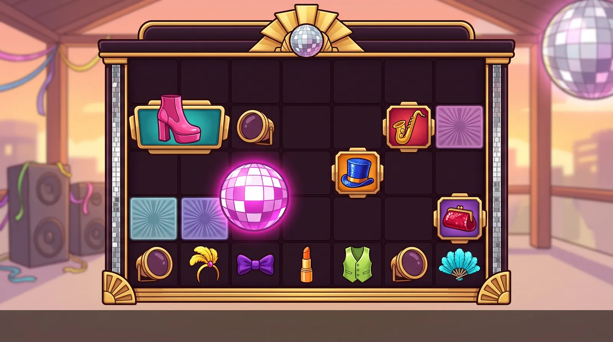

*Boards:* v1: 7×5 with sunburst spot tiles; v2 is sparse (half-empty grid).

**Title ideas:** Mirrorball Nights, Glitter Floor Groove, Gold Floor Glam

**Hook.** Every winning cluster lights the etched-glass dance-floor panel under it. Each later hit grows the Art Deco sunburst etched into that panel, from one corner chevron to a full gold sunburst with a mirror inlay, doubling its multiplier, while gold-bezelled spotlight-lens multipliers drop in spinning. It turns the board-multiplier mechanic into a glowing Deco dance floor that anyone understands at a glance.

**World.** A glam 1970s-style rooftop disco pavilion at sunset: mirrorballs, an etched-glass Art Deco dance floor, glitter platform ankle boots, sequins, feathers, satin and a gold horn. The floor is empty, with no dancers, DJ or crowd, so the player is the one on the floor. It is adult nightlife-fashion nostalgia without alcohol, drugs, skates, balloons or party favours, uses no real venue, song or film, and has no vinyl records, microphones, cassettes, cowbells or note glyphs, because Bass Drop already owns the music props.

**Palette.** #FF3EA5 hot pink, #8A3FFC electric violet, #21D4FD cyan, #FFC531 disco gold, #FF7A1A tangerine, #FFE135 lemon, #9BE22D lime, #2E5BFF cobalt, #E8273C cherry red, #1A9C9C teal, #E8EEF7 mirror silver, #2A1238 plum-black lacquer, #1A1030 plum-black well

**Premium symbols (framed tiles)**
- **Platform Ankle Boot** (hot pink (teal plaque)): A single empty hot-pink patent-leather platform ankle boot with a chunky stacked heel and sole and a gold star buckle, seen from the side with no leg, centred on a teal enamel Art Deco plaque with stepped corners and a bevelled gold border.
- **Gold Saxophone** (gold (crimson plaque)): A polished gold saxophone with pearly key buttons, angled diagonally with its bell facing the upper right, centred on a crimson enamel Art Deco plaque with stepped corners and a bevelled gold border.
- **Sequin Top Hat** (cobalt blue (tangerine plaque)): A tall top hat covered in glittering cobalt-blue sequins with a wide polished gold band and a slightly tilted brim, centred on a tangerine enamel Art Deco plaque with stepped corners and a bevelled gold border.
- **Sequin Clutch** (cherry red (violet plaque)): A plump, rounded evening clutch covered in cherry-red sequins with a big polished-gold kiss-lock clasp and a short gold chain, centred on a violet enamel Art Deco plaque with stepped corners and a bevelled gold border.

**Low symbols (frameless)**
- **Feather Headband** (lemon yellow): An empty lemon-yellow sequinned headband loop with one tall curled ostrich plume rising from a gold jewel at the front.
- **Velvet Bow Tie** (electric violet): A plump violet velvet bow tie with a soft rounded knot, seen from the front.
- **Lipstick** (tangerine orange): A tangerine-orange lipstick bullet twisted up out of a ribbed polished-gold case, standing upright.
- **Satin Waistcoat** (lime green): An empty lime-green satin waistcoat with a deep V-neck and a row of round gold buttons, laid flat in front view.
- **Ostrich Fan** (cyan): A half-open cyan hand fan of fluffy ostrich feathers on a gold pivot rivet with a small tassel.

**Scatter ("hidden bonus").** Hidden bonus = THE MIRRORBALL: an oversized, frameless mirrorball with large white highlight facets and rainbow glints, a gold mounting cap and a short gold chain, wrapped in a soft magenta aura, filling about 115% of the cell so it breaks the cell edges. Land: it drops on its chain, swings and throws dots of light across the board. Anticipation (driven by the book): any balls already on the board spin faster and the floor panels brighten steadily. Trigger (3 or more): every ball fires a beam to the board centre, the beams merge into a white flash and the night variant crossfades in. Miss: the ball swings, slows and fades.

**Multiplier symbol.** SPOTLIGHT LENS: a round stage-spotlight lens with a polished gold bezel, four chrome bolts and a smooth, blank, dark plum glass centre that holds the live value in white numerals with a thick dark outline; the glow sits on the gold bezel, not the glass. Tiers are shown by a coloured gel ring inside the bezel: pink (low), violet (mid), white-gold (high). It is round and glowing, unlike the square plaques and the small lows, and does not copy the reference's gold-and-green coin. Land: a lens flare and a quarter turn. Hold: a slow beam sweep. Collect: it fires a beam into the win meter. Miss: the bezel glow dims and the glass frosts over.

**Board spot tiles (background multipliers).** Etched Art Deco glass floor panels under the symbols: flat, matte, frosted squares in the dark well with no bevel and no gloss, whose etched sunburst grows each tier with its rays reaching the cell edges so the tier shows around the symbol. T1 (marked): a single etched chevron in one corner with a thin cyan edge glow, no number. T2 (x2-x16): a cyan quarter-sunburst from one corner. T3 (x32-x64): a violet half-sunburst. T4 (x128-x256): a pink full sunburst. T5 (x512+): a gold sunburst with a mirror inlay. The glow is steady with no beat pulse; it pulses only on the win_peak apply. Numerals are live text in a stronger tint of the panel hue. Upgrade: the etched rays extend with a radial ring of light when the symbol above explodes (one flash). Apply: the panels under the cluster pulse once on win_peak. Reset: the floor dims to frosted dark at the next base spin.

**Frame.** A plum-black lacquer and cartoon-gold Art Deco stage surround with no columns and no arch (not cream). Crown: a flat stepped band with a centred gold sunburst fan holding a small mirrorball. Sides: slim plum-black lacquer rails edged in gold with an inset strip of small square mirror tiles (no marquee bulbs, which would echo Bass Drop's jukebox). Corners: gold fan-shaped Deco flourishes. Sill: a thin stepped gold bar. Thick near-black warm-brown outline, built as 9-slice pieces so it stretches to 7 columns. Emissive layer (in code): the mirror strip and the crown sunburst, which glint on spin, flash on bursts and glow in the winner's colour on connect; any pink under-glow on the sill is a code light, not painted.

**Background.** A soft-focus rooftop disco pavilion at sunset (21:9, only moderately soft): a peach-to-violet pastel sky above a generic city skyline far below, with no landmarks. Far left: speaker towers with plain grilles draped in glitter streamers. Far right: a big blurred mirrorball high up, scattering dots of light. An etched-glass Art Deco floor recedes behind the board. Bottom corners: chrome stage lights on the left and a curved velvet booth on the right. The centre is calm and light, with sparkle motes on top (bright-style value overrides). No people, legs or hands, signs, logos on speakers, lettering or text.

**Feature backgrounds.** Free spins: the same pavilion after dark, with an indigo night sky, a fully lit rainbow floor, slowly sweeping spotlight beams, a blazing mirrorball and drifting confetti. Super bonus: a gold-tinted version with gold streamers and gold-white beams. Both are section-E edits of the base plate, so the crossfade keeps every shape in place.

**Animation ideas (spin, land, miss, connect, explode).** SPIN: symbols streak with a short motion smear, the floor panels under the falling columns run a slow chase, and the background spotlight beams sweep in tempo. LAND: the boot stomps with a squash and stretch, the sax tips and settles, the top hat bounces and its brim wobbles, and the clutch clicks down with its chain swinging. The lows pop in with a small light glint and a floor blip under their cell: the headband plume sways, the bow tie bounces, the lipstick clicks down, the waistcoat settles and the fan flutters. MISS: non-winning symbols give a small shrug and dim slightly. CONNECT: the winners groove on the beat. The boot taps its heel, the sax bell flares, the hat tips and spins on its brim, the clutch clasp snaps open with a glint, the plume curls, the bow tie wiggles, the lipstick twists up, the waistcoat buttons gleam in turn and the fan snaps open. The cluster outline traces in gold, and the background mirrorball spins faster as the beams converge on the board. EXPLODE: a 100 ms hit-stop, then a signature burst per symbol: the boot stomps a shockwave into a sequin shower, the sax blows a ring of brass shards, the hat pops a confetti fountain, the clutch snaps open spilling rhinestones, the headband plume bursts into floating feathers, the bow tie unties into a ribbon, the lipstick twists up and sparkles out, the fan snaps shut into feathers and the waistcoat's buttons pop. A ring of light stamps into the floor panel (spot ignite or upgrade) and the camera bumps on the bass hit. BACKGROUND: idle = a slow mirrorball spin. Spin = a light chase. Land = the floor blips at each column impact. Connect = a beat pulse with the beams converging. Explode = a flash and a puff of confetti. Miss = the beams lower and dim. Anticipation = the beams lock onto the board. Big win = every light blazes. Feature = the crossfade to the night plate. Keep every flash under 3 per second, run an IRIS check on every chase pattern, and offer a reduced-motion option.

**Lobby appeal.** It looks like nothing else among the pastel candy and marble clones: glam nightlife fashion for 25-55 year olds, with an etched gold floor that reads in a thumbnail and builds hype as the board fills. Game tile: the mirrorball over a glowing gold sunburst floor in bright daytime pastel. Social-safe menu: Extra Chance becomes 'Encore', the 100x spin 'Spotlight Spin', the 1000x spin 'Mirrorball Spin', the bonus 'Dance Floor Bonus' and the super bonus 'Gold Floor Bonus'.

**Risks and guardrails.** This is the studio's third music-adjacent world after Swamp Funk and Bass Drop, so keep it disco-glam fashion rather than music props: the sax is the only instrument, there are no records, microphones, cassettes, cowbells or note glyphs, and the frame uses mirror tiles, not Bass Drop's marquee bulbs. Avoid trade dress from famous disco films (the white-suit pose, the coloured lit floor), song titles in names and marketing, go-go or fetish boot cues (the boot is an empty ankle boot with no leg), party favours such as star sunglasses, roller-rink and kids'-party cues, glow sticks and drinks, meme objects, and recognisable instrument models. NBP adds 'DISCO' or 'BAR' neon, speaker logos and marquee letters, so every prompt says 'no lettering, no signs, no logos on speakers, no people, no legs or hands'. Photosensitivity: the mirror sparkle and floor chases stay under 3 flashes per second with an IRIS check and a reduced-motion option, and the spots glow steadily. 64 px gate pairs: the cherry clutch against the sax's crimson plaque, the tangerine lipstick against the hat's tangerine plaque, the violet bow tie against the clutch's violet plaque, and the two feather lows (plume headband against half-open fan). 'Mirrorball' is a well-known song title (low risk) and 'Floor Fillers' is dropped; run a title search.

**Why it ranked here.** The lit dance floor is an excellent spot metaphor, and the beat-driven connect and explode states give this idea the highest animation ceiling of the six, so it earns the last slot over CARNAVAL. That is the same music-and-party domain, with more cultural risk and a crowded carnival-slot field. It ranks last because the art bible shows Bass Drop already uses a vinyl record half out of a hot-pink sleeve, a golden microphone (its scatter) and a boombox with a cassette door, and three of MIRRORBALL's original symbols copied those. The fixes: the record, microphone and cassette became a sequin top hat, a sequin clutch and a sequin hand fan, which also gives nine clearly distinct colours. The multiplier lens now dims on a miss, and the frame bulbs became the emissive layer. Originality and brand stay modest because disco slots exist and it extends a music-led portfolio.

Vetting (compliance + production)

**Compliance review: adjust**

Issues:
- Portfolio self-similarity: this would be a third music-led world after Swamp Funk and Bass Drop. The sax, cowbell and beat note, plus a marquee-bulb Art Deco frame, echo Bass Drop's brass horn speakers and arched jukebox emblem (artbible bassDrop.props and emblems). That hurts pillar P2's 'ownable world'.
- Spot tiles: flat coloured squares with a number (cyan, violet, pink, gold) are almost exactly the reference's coloured spot squares (light-blue 4x, pink 32x, lime 128x) and the Saturday Night Fever lit floor.
- Star-shaped novelty sunglasses are a children's party favour.
- A hot-pink, knee-high, patent platform boot has a go-go or stripper-boot connotation ('explicit or poor taste'), risks KISS-boot trade dress, and NBP will draw a leg inside it, which is a character part.
- The cowbell is the 'more cowbell' SNL meme, and the playbook bans meme-adjacent designs.
- Titles: 'Floor Fillers' matches a UK dance-compilation brand (check), and 'Mirrorball' is a well-known song title (low risk).
- NBP adds text in several places: 'DISCO' or 'BAR' neon signs, speaker brand plates and marquee letters.
- Photosensitivity: mirror sparkle, floor chases, bulb chases and a T4 panel that pulses on every beat across many cells can exceed 3 flashes per second (IRIS).

Applied in the board prompt and brief:
- S
- p
- o
- t
- s
- :
-  
- e
- t
- c
- h
- e
- d
-  
- A
- r
- t
-  
- D
- e
- c
- o
-  
- g
- l
- a
- s
- s
-  
- p
- a
- n
- e
- l
- s
-  
- w
- h
- o
- s
- e
-  
- s
- u
- n
- b
- u
- r
- s
- t
-  
- g
- r
- o
- w
- s
-  
- e
- a
- c
- h
-  
- t
- i
- e
- r
- .
-  
- T
- 1
-  
- i
- s
-  
- a
-  
- s
- i
- n
- g
- l
- e
-  
- e
- t
- c
- h
- e
- d
-  
- c
- o
- r
- n
- e
- r
-  
- c
- h
- e
- v
- r
- o
- n
- ,
-  
- T
- 2
-  
- a
-  
- c
- y
- a
- n
-  
- q
- u
- a
- r
- t
- e
- r
- -
- s
- u
- n
- b
- u
- r
- s
- t
- ,
-  
- T
- 3
-  
- a
-  
- v
- i
- o
- l
- e
- t
-  
- h
- a
- l
- f
- -
- s
- u
- n
- b
- u
- r
- s
- t
- ,
-  
- T
- 4
-  
- a
-  
- p
- i
- n
- k
-  
- f
- u
- l
- l
-  
- s
- u
- n
- b
- u
- r
- s
- t
-  
- a
- n
- d
-  
- T
- 5
-  
- a
-  
- g
- o
- l
- d
-  
- s
- u
- n
- b
- u
- r
- s
- t
-  
- w
- i
- t
- h
-  
- a
-  
- m
- i
- r
- r
- o
- r
-  
- i
- n
- l
- a
- y
- ,
-  
- w
- i
- t
- h
-  
- t
- h
- e
-  
- r
- a
- y
- s
-  
- v
- i
- s
- i
- b
- l
- e
-  
- a
- t
-  
- t
- h
- e
-  
- c
- e
- l
- l
-  
- e
- d
- g
- e
- s
- .
-  
- T
- h
- e
-  
- g
- l
- o
- w
-  
- i
- s
-  
- s
- t
- e
- a
- d
- y
-  
- w
- i
- t
- h
-  
- n
- o
-  
- b
- e
- a
- t
-  
- p
- u
- l
- s
- e
- ;
-  
- i
- t
-  
- p
- u
- l
- s
- e
- s
-  
- o
- n
- l
- y
-  
- o
- n
-  
- w
- i
- n
- _
- p
- e
- a
- k
-  
- a
- p
- p
- l
- y
- .
-  
- R
- e
- p
- l
- a
- c
- e
-  
- t
- h
- e
-  
- S
- t
- a
- r
-  
- S
- h
- a
- d
- e
- s
-  
- w
- i
- t
- h
-  
- a
-  
- L
- e
- m
- o
- n
-  
- F
- e
- a
- t
- h
- e
- r
-  
- H
- e
- a
- d
- b
- a
- n
- d
-  
- (
- a
-  
- s
- e
- q
- u
- i
- n
- n
- e
- d
-  
- b
- a
- n
- d
-  
- w
- i
- t
- h
-  
- a
-  
- t
- a
- l
- l
-  
- c
- u
- r
- l
- e
- d
-  
- p
- l
- u
- m
- e
- )
- .
-  
- B
- o
- o
- t
- :
-  
- a
-  
- h
- o
- t
- -
- p
- i
- n
- k
-  
- p
- a
- t
- e
- n
- t
-  
- p
- l
- a
- t
- f
- o
- r
- m
-  
- a
- n
- k
- l
- e
-  
- b
- o
- o
- t
-  
- w
- i
- t
- h
-  
- a
-  
- c
- h
- u
- n
- k
- y
-  
- h
- e
- e
- l
- ,
-  
- e
- m
- p
- t
- y
- ,
-  
- '
- n
- o
-  
- l
- e
- g
- '
- .
-  
- R
- e
- p
- l
- a
- c
- e
-  
- t
- h
- e
-  
- c
- o
- w
- b
- e
- l
- l
-  
- w
- i
- t
- h
-  
- a
-  
- T
- a
- n
- g
- e
- r
- i
- n
- e
-  
- L
- i
- p
- s
- t
- i
- c
- k
-  
- (
- a
-  
- g
- o
- l
- d
- -
- c
- a
- s
- e
- d
-  
- l
- i
- p
- s
- t
- i
- c
- k
-  
- b
- u
- l
- l
- e
- t
- )
- .
-  
- R
- e
- p
- l
- a
- c
- e
-  
- t
- h
- e
-  
- b
- e
- a
- t
-  
- n
- o
- t
- e
-  
- w
- i
- t
- h
-  
- a
-  
- L
- i
- m
- e
-  
- S
- a
- t
- i
- n
-  
- W
- a
- i
- s
- t
- c
- o
- a
- t
-  
- w
- i
- t
- h
-  
- g
- o
- l
- d
-  
- b
- u
- t
- t
- o
- n
- s
- ;
-  
- t
- h
- a
- t
-  
- l
- e
- a
- v
- e
- s
-  
- o
- n
- l
- y
-  
- t
- h
- e
-  
- s
- a
- x
-  
- a
- s
-  
- a
- n
-  
- i
- n
- s
- t
- r
- u
- m
- e
- n
- t
- .
-  
- T
- i
- t
- l
- e
- s
- :
-  
- '
- M
- i
- r
- r
- o
- r
- b
- a
- l
- l
-  
- N
- i
- g
- h
- t
- s
- '
-  
- o
- r
-  
- '
- G
- l
- i
- t
- t
- e
- r
-  
- F
- l
- o
- o
- r
-  
- G
- r
- o
- o
- v
- e
- '
- ;
-  
- d
- r
- o
- p
-  
- '
- F
- l
- o
- o
- r
-  
- F
- i
- l
- l
- e
- r
- s
- '
- .
-  
- F
- r
- a
- m
- e
-  
- b
- o
- d
- y
- :
-  
- p
- l
- u
- m
- -
- b
- l
- a
- c
- k
-  
- l
- a
- c
- q
- u
- e
- r
-  
- a
- n
- d
-  
- g
- o
- l
- d
- ,
-  
- n
- o
- t
-  
- c
- r
- e
- a
- m
- ,
-  
- w
- i
- t
- h
-  
- a
-  
- f
- l
- a
- t
-  
- s
- t
- e
- p
- p
- e
- d
-  
- c
- r
- o
- w
- n
-  
- a
- n
- d
-  
- n
- o
-  
- a
- r
- c
- h
- e
- d
-  
- t
- o
- p
- .
-  
- E
- v
- e
- r
- y
-  
- p
- r
- o
- m
- p
- t
-  
- s
- a
- y
- s
-  
- '
- n
- o
-  
- l
- e
- t
- t
- e
- r
- i
- n
- g
- ,
-  
- n
- o
-  
- s
- i
- g
- n
- s
- ,
-  
- n
- o
-  
- l
- o
- g
- o
- s
-  
- o
- n
-  
- s
- p
- e
- a
- k
- e
- r
- s
- ,
-  
- n
- o
-  
- p
- e
- o
- p
- l
- e
- ,
-  
- n
- o
-  
- l
- e
- g
- s
-  
- o
- r
-  
- h
- a
- n
- d
- s
- '
- .
-  
- R
- u
- n
-  
- a
- n
-  
- I
- R
- I
- S
-  
- c
- h
- e
- c
- k
-  
- o
- n
-  
- t
- h
- e
-  
- c
- h
- a
- s
- e
-  
- p
- a
- t
- t
- e
- r
- n
- s
- .

**Production review: adjust**

Issues:
- Star shades vs bow tie: both are bilaterally symmetric, two lobes joined at the centre, and confusable in greyscale at 64 px.
- The tangerine cowbell (a trapezoid) vs the top hat (a trapezoid on a tangerine tile).
- The hot-pink boot vs the pink lens, and the cherry clutch vs the sax's crimson tile (both noted in the pitch).
- The beat note is a flat emoji-like glyph, not an object. It breaks the glossy-object formula and looks clip-art at 64 px.
- Multiplier: white-gold numerals on glowing magenta glass are bright on bright with low contrast, and a pink lens over a T4 hot-pink panel disappears.
- The Mirrorball scatter at 64 px is grey faceted noise, and silver on the navy well reads weakly without the aura.
- Four symbols are sequinned (top hat, clutch, bow tie, fan), and NBP renders them as the same noisy surface, so the materials converge.
- Explode: the same glitter-and-sequin burst for all 11 symbols is the generic-explosion trait under P3.
- The background's nine states are the best fit of the six for LayeredEnvironment's light layers (beams, floor and bulbs).

Applied in the board prompt and brief:
- T
- a
- k
- e
-  
- t
- h
- e
-  
- c
- o
- m
- p
- l
- i
- a
- n
- c
- e
-  
- s
- w
- a
- p
- s
-  
- (
- f
- e
- a
- t
- h
- e
- r
-  
- h
- e
- a
- d
- b
- a
- n
- d
- ,
-  
- l
- i
- p
- s
- t
- i
- c
- k
- ,
-  
- s
- a
- t
- i
- n
-  
- w
- a
- i
- s
- t
- c
- o
- a
- t
- )
- .
-  
- C
- h
- a
- n
- g
- e
-  
- t
- h
- e
-  
- b
- o
- w
-  
- t
- i
- e
-  
- t
- o
-  
- v
- e
- l
- v
- e
- t
-  
- a
- n
- d
-  
- t
- h
- e
-  
- f
- a
- n
-  
- t
- o
-  
- c
- y
- a
- n
-  
- o
- s
- t
- r
- i
- c
- h
-  
- f
- e
- a
- t
- h
- e
- r
- s
- ,
-  
- s
- o
-  
- o
- n
- l
- y
-  
- t
- h
- e
-  
- t
- o
- p
-  
- h
- a
- t
-  
- a
- n
- d
-  
- t
- h
- e
-  
- c
- l
- u
- t
- c
- h
-  
- k
- e
- e
- p
-  
- s
- e
- q
- u
- i
- n
- s
- .
-  
- L
- e
- n
- s
- :
-  
- a
-  
- d
- a
- r
- k
-  
- p
- l
- u
- m
-  
- g
- l
- a
- s
- s
-  
- c
- e
- n
- t
- r
- e
-  
- w
- i
- t
- h
-  
- w
- h
- i
- t
- e
-  
- n
- u
- m
- e
- r
- a
- l
- s
-  
- a
- n
- d
-  
- a
-  
- d
- a
- r
- k
-  
- o
- u
- t
- l
- i
- n
- e
- ,
-  
- t
- h
- e
-  
- g
- l
- o
- w
-  
- m
- o
- v
- e
- d
-  
- o
- n
- t
- o
-  
- t
- h
- e
-  
- g
- o
- l
- d
-  
- b
- e
- z
- e
- l
- ,
-  
- a
- n
- d
-  
- t
- i
- e
- r
- s
-  
- s
- h
- o
- w
- n
-  
- b
- y
-  
- a
-  
- c
- o
- l
- o
- u
- r
- e
- d
-  
- g
- e
- l
-  
- r
- i
- n
- g
-  
- (
- p
- i
- n
- k
- ,
-  
- t
- h
- e
- n
-  
- v
- i
- o
- l
- e
- t
- ,
-  
- t
- h
- e
- n
-  
- w
- h
- i
- t
- e
- -
- g
- o
- l
- d
- )
- .
-  
- M
- i
- r
- r
- o
- r
- b
- a
- l
- l
-  
- s
- c
- a
- t
- t
- e
- r
- :
-  
- l
- a
- r
- g
- e
-  
- w
- h
- i
- t
- e
-  
- h
- i
- g
- h
- l
- i
- g
- h
- t
-  
- f
- a
- c
- e
- t
- s
-  
- w
- i
- t
- h
-  
- r
- a
- i
- n
- b
- o
- w
-  
- g
- l
- i
- n
- t
- s
- ,
-  
- a
-  
- m
- a
- g
- e
- n
- t
- a
-  
- a
- u
- r
- a
- ,
-  
- a
-  
- g
- o
- l
- d
-  
- c
- r
- o
- w
- n
-  
- c
- a
- p
-  
- a
- n
- d
-  
- a
- b
- o
- u
- t
-  
- 1
- 1
- 5
- %
-  
- o
- f
-  
- t
- h
- e
-  
- c
- e
- l
- l
- .
-  
- E
- x
- p
- l
- o
- d
- e
-  
- s
- i
- g
- n
- a
- t
- u
- r
- e
- s
- :
-  
- t
- h
- e
-  
- b
- o
- o
- t
-  
- s
- t
- o
- m
- p
- s
-  
- a
-  
- s
- h
- o
- c
- k
- w
- a
- v
- e
-  
- i
- n
- t
- o
-  
- a
-  
- s
- e
- q
- u
- i
- n
-  
- s
- h
- o
- w
- e
- r
- ,
-  
- t
- h
- e
-  
- s
- a
- x
-  
- b
- l
- o
- w
- s
-  
- a
-  
- r
- i
- n
- g
-  
- o
- f
-  
- b
- r
- a
- s
- s
-  
- s
- h
- a
- r
- d
- s
- ,
-  
- t
- h
- e
-  
- h
- a
- t
-  
- p
- o
- p
- s
-  
- a
-  
- c
- o
- n
- f
- e
- t
- t
- i
-  
- f
- o
- u
- n
- t
- a
- i
- n
-  
- a
- n
- d
-  
- t
- h
- e
-  
- c
- l
- u
- t
- c
- h
-  
- s
- n
- a
- p
- s
-  
- o
- p
- e
- n
-  
- s
- p
- i
- l
- l
- i
- n
- g
-  
- r
- h
- i
- n
- e
- s
- t
- o
- n
- e
- s
- .
-  
- T
- h
- e
-  
- h
- e
- a
- d
- b
- a
- n
- d
-  
- p
- l
- u
- m
- e
-  
- b
- u
- r
- s
- t
- s
-  
- i
- n
- t
- o
-  
- f
- l
- o
- a
- t
- i
- n
- g
-  
- f
- e
- a
- t
- h
- e
- r
- s
- ,
-  
- t
- h
- e
-  
- b
- o
- w
-  
- t
- i
- e
-  
- u
- n
- t
- i
- e
- s
-  
- i
- n
- t
- o
-  
- a
-  
- r
- i
- b
- b
- o
- n
- ,
-  
- t
- h
- e
-  
- l
- i
- p
- s
- t
- i
- c
- k
-  
- t
- w
- i
- s
- t
- s
-  
- u
- p
-  
- a
- n
- d
-  
- s
- p
- a
- r
- k
- l
- e
- s
-  
- o
- u
- t
- ,
-  
- t
- h
- e
-  
- f
- a
- n
-  
- s
- n
- a
- p
- s
-  
- s
- h
- u
- t
-  
- i
- n
- t
- o
-  
- f
- e
- a
- t
- h
- e
- r
- s
-  
- a
- n
- d
-  
- t
- h
- e
-  
- w
- a
- i
- s
- t
- c
- o
- a
- t
- '
- s
-  
- b
- u
- t
- t
- o
- n
- s
-  
- p
- o
- p
- .

---

## Alternates (first ideation round, vetted, no boards yet)

The first run of the same workflow ranked a different six. They passed the same two reviews with **adjust**; their fixes are listed but not yet folded into prompts. Pick one of these instead and the art director writes its board prompt from the brief + fixes.

### 1. TRANSMUTO: Transmuto, Quicksilver Lab, Alembic Gold

The board is the experiment. When a cluster wins, its potions shatter and splash onto the plates under them, and each later splash moves that cell one metal up the ladder: lead, copper, silver, gold, then a glowing ruby. Players read the multiplier as a material before they read the number, so the pitch is simply 'turn the board to gold'. Emerald-faced gold seals drop in with the live multiplier values.

*World:* A sunlit fantasy alchemist's atelier at the top of a tower, above pastel morning clouds. It has copper stills with coiled glass tubing, shelves of glowing unlabelled jars, brass instruments, hanging herb bundles, drifting bubbles and a big round abstract stained-glass window. It feels scholarly and whimsical, not witchy. The lab runs itself: no alchemist, witch, cauldron, books, wands, owls or animals.

Symbols, look and vetting

**Premiums**
- **Transmutation Ruby** (ruby red): A large glowing octagon-cut ruby with bright internal facets, held in an ornate polished solid gold four-claw setting, centred on a rounded-square sapphire-blue enamel tile with a thick polished gold bevelled frame.
- **Copper Alembic** (copper on emerald): A round-bellied polished copper alembic still with a domed polished solid gold head and a long curved spout puffing a small white steam cloud, centred on a rounded-square emerald-green enamel tile with a thick polished gold bevelled frame.
- **Swan-Neck Retort** (violet): A glass retort flask with a round belly and a long neck bending down like a swan's, filled with swirling violet liquid flecked with tiny white stars and resting on a small brass ring stand, centred on a rounded-square deep-teal enamel tile with a thick polished gold bevelled frame.
- **Quicksilver Hourglass** (cyan): A chunky polished solid gold hourglass with spiral side posts and two round glass bulbs, with glowing cyan sand pouring from the top bulb into the bottom one, centred on a rounded-square crimson enamel tile with a thick polished gold bevelled frame.

**Lows**
- **Teardrop Vial** (hot pink): A glossy teardrop-shaped glass vial with a small gold-capped cork, filled with hot-pink potion and a few tiny rising bubbles.
- **Orb Flask** (tangerine orange): A fat, perfectly round glass flask with a short neck and a red wax-sealed cork, filled with glowing tangerine-orange potion.
- **Cone Flask** (lemon yellow): A squat triangular conical glass flask with a wide flat base and a cork, filled with lemon-yellow potion under a fizzing cap of foam.
- **Cube Bottle** (lime green): A chunky square glass bottle with bevelled edges and a round glass stopper, filled with glossy lime-green potion.
- **Coil Tube** (cobalt blue): A short, fat glass tube wound into three thick upright spiral loops with a cork at the top, filled with glowing cobalt-blue liquid.

**Scatter.** Hidden bonus: the Hermetic Egg, the biggest symbol on the board (drawn at 102-115% of the cell). Brief: 'a large egg-shaped golden glass vessel sealed with a crimson wax stopper and bound in polished gold wire, with swirling rainbow vapour inside and light leaking from the seal.' It has no glyphs and no text. During anticipation, which only the book drives, the vapour churns faster and the wax seal glows and cracks a little more with each scatter that lands. On trigger the seal pops, a rainbow plume floods the board, and the scene crossfades to the twilight plate. The egg shape, gold wire cage and size keep it apart from the round orange Orb Flask.

**Multiplier.** Elixir Seal: a thick polished solid gold coin whose raised rim carries simple sun-ray notches (no glyphs, letters or numbers), with a smooth, blank, glossy emerald-glass face for the live xN text. It nods to the reference's green coin without copying it, and the emerald never collides with the copper, silver or gold spot plates underneath. Value bands are runtime tints (emerald, then sapphire, then ruby for 100x and up), so it stays one asset. Land: the heaviest slam on the board, with a ripple of liquid light across the face and a puff of golden vapour. Hold: a slow shimmer sweeps the face. Collect: the coin flips and flies to the win meter on a gold vapour trail. Miss: the face tarnishes to dull pewter.

**Spot tiles.** The spots are transmutation plates set into a dark violet glass board well (#24163A). T0 is plain dark glass. T1 (marked) is a dull hammered lead plate with a faint chalk-white plain circle and a wisp of steam, no sigils and no number. T2 (x2-x16) is warm brushed copper, with the number cream over a dark-brown stroke. T3 (x32-x64) is polished silver with a cool sheen sweep, number deep violet with a white stroke. T4 (x128-x256) is polished gold with a soft ruby inner glow, number white with a thick black stroke. T5 (x512+) is a glowing faceted ruby plate in gold filigree, with prismatic sparkles and a slow heartbeat pulse. The additive band table maps onto the same five plates. Each upgrade plays as the exploding symbol's potion landing on the plate, soaking in and boiling off into the next metal, so the explode and the spot upgrade are one continuous beat.

**Compliance review: adjust**

Issues:
- The Elixir Seal is a round polished gold coin with an emerald-glass face. That is the reference coin's own formula (round gold medallion, green inset), and the concept's doNotCopy list bans it ('different object, shape language and inset colour'). The brief even says it 'nods to the reference's green coin'.
- Three alcohol reads, against the theme's own 'no alcohol' rule. The copper alembic plus the background's 'copper still with coiled tubes' is a whisky pot still with a moonshine coil. The Cone Flask's 'lemon-yellow potion under a fizzing cap of foam' is a glass of beer. The Cube Bottle's 'square bottle with bevelled edges and a round glass stopper' is a spirits decanter.
- Baked-text risk in the background. NBP reliably paints numerals on 'pressure gauges' and 'brass instruments', and pseudo-text labels on apothecary jars. Writing 'unlabelled' in a brief does not stop it.
- Title and name risk. 'Quicksilver' is a Marvel character name and one letter off the Quiksilver apparel mark. 'Alembic Gold' sits next to existing alchemy titles (Alchemy Blast, and 'Alchemy Gold'-style names), so it needs a search. 'Elixir' is Clash of Clans' pink-potion resource, a game with a large audience of minors.
- A big round stained-glass window high in the centre, casting light shafts, reads as a cathedral rose window: a religious motif in a gambling scene.
- Minor-appeal drift: rainbow potions in glossy cartoon bottles are a staple of kids' and mobile-RPG games (Minecraft and Clash potions). It stays adult only if brass, gold and jewel luxury dominate.
- Trade dress: vertical copper pipes topped by round 'flask-stopper finials' at the top corners read as columns with capitals beside a top beam. That is the Gates silhouette again.

Applied in the board prompt and brief:
- (
- 1
- )
-  
- M
- u
- l
- t
- i
- p
- l
- i
- e
- r
- :
-  
- r
- e
- p
- l
- a
- c
- e
-  
- t
- h
- e
-  
- E
- l
- i
- x
- i
- r
-  
- S
- e
- a
- l
-  
- w
- i
- t
- h
-  
- a
-  
- '
- C
- r
- u
- c
- i
- b
- l
- e
-  
- S
- e
- a
- l
- '
- ,
-  
- a
- n
-  
- O
- C
- T
- A
- G
- O
- N
- A
- L
-  
- p
- o
- l
- i
- s
- h
- e
- d
-  
- g
- o
- l
- d
-  
- s
- e
- a
- l
-  
- w
- i
- t
- h
-  
- s
- u
- n
- -
- r
- a
- y
-  
- n
- o
- t
- c
- h
- e
- s
-  
- a
- n
- d
-  
- a
-  
- b
- l
- a
- n
- k
-  
- d
- o
- m
- e
- d
-  
- q
- u
- i
- c
- k
- s
- i
- l
- v
- e
- r
- -
- m
- i
- r
- r
- o
- r
-  
- (
- c
- h
- r
- o
- m
- e
- )
-  
- f
- a
- c
- e
- .
-  
- N
- e
- v
- e
- r
-  
- g
- r
- e
- e
- n
- .
-  
- R
- e
- n
- a
- m
- e
-  
- i
- t
-  
- a
- w
- a
- y
-  
- f
- r
- o
- m
-  
- '
- E
- l
- i
- x
- i
- r
- '
- .
- 

- (
- 2
- )
-  
- C
- o
- p
- p
- e
- r
-  
- A
- l
- e
- m
- b
- i
- c
- :
-  
- b
- r
- i
- e
- f
-  
- i
- t
-  
- a
- s
-  
- '
- a
-  
- g
- l
- a
- s
- s
-  
- a
- l
- e
- m
- b
- i
- c
-  
- w
- i
- t
- h
-  
- a
-  
- p
- o
- l
- i
- s
- h
- e
- d
-  
- g
- o
- l
- d
-  
- d
- o
- m
- e
-  
- h
- e
- a
- d
-  
- a
- n
- d
-  
- s
- p
- o
- u
- t
-  
- o
- v
- e
- r
-  
- a
-  
- s
- m
- a
- l
- l
-  
- b
- r
- a
- s
- s
-  
- b
- u
- r
- n
- e
- r
- '
- ,
-  
- w
- i
- t
- h
-  
- n
- o
-  
- c
- o
- p
- p
- e
- r
-  
- p
- o
- t
-  
- b
- e
- l
- l
- y
-  
- a
- n
- d
-  
- n
- o
-  
- c
- o
- i
- l
- .
-  
- I
- n
-  
- t
- h
- e
-  
- b
- a
- c
- k
- g
- r
- o
- u
- n
- d
- ,
-  
- r
- e
- p
- l
- a
- c
- e
-  
- t
- h
- e
-  
- c
- o
- i
- l
- e
- d
-  
- s
- t
- i
- l
- l
-  
- w
- i
- t
- h
-  
- '
- a
-  
- c
- o
- p
- p
- e
- r
- -
- a
- n
- d
- -
- g
- l
- a
- s
- s
-  
- g
- l
- o
- b
- e
-  
- a
- p
- p
- a
- r
- a
- t
- u
- s
-  
- w
- i
- t
- h
-  
- s
- t
- r
- a
- i
- g
- h
- t
-  
- g
- l
- a
- s
- s
-  
- t
- u
- b
- e
- s
- '
- .
- 

- (
- 3
- )
-  
- C
- o
- n
- e
-  
- F
- l
- a
- s
- k
- :
-  
- d
- r
- o
- p
-  
- t
- h
- e
-  
- f
- o
- a
- m
- .
-  
- U
- s
- e
-  
- '
- l
- e
- m
- o
- n
- -
- y
- e
- l
- l
- o
- w
-  
- l
- i
- q
- u
- i
- d
-  
- w
- i
- t
- h
-  
- t
- h
- r
- e
- e
-  
- r
- i
- s
- i
- n
- g
-  
- s
- p
- a
- r
- k
- l
- e
- s
- '
- .
- 

- (
- 4
- )
-  
- C
- u
- b
- e
-  
- B
- o
- t
- t
- l
- e
- :
-  
- m
- a
- k
- e
-  
- i
- t
-  
- '
- a
-  
- c
- h
- u
- n
- k
- y
-  
- s
- q
- u
- a
- r
- e
-  
- g
- l
- a
- s
- s
-  
- j
- a
- r
-  
- w
- i
- t
- h
-  
- a
-  
- f
- l
- a
- t
-  
- g
- o
- l
- d
-  
- s
- c
- r
- e
- w
-  
- l
- i
- d
- '
- ,
-  
- w
- i
- t
- h
-  
- n
- o
-  
- g
- l
- a
- s
- s
-  
- s
- t
- o
- p
- p
- e
- r
- .
- 

- (
- 5
- )
-  
- G
- a
- u
- g
- e
- s
- :
-  
- r
- e
- p
- l
- a
- c
- e
-  
- t
- h
- e
- m
-  
- w
- i
- t
- h
-  
- v
- a
- l
- v
- e
-  
- h
- a
- n
- d
- w
- h
- e
- e
- l
- s
- .
- 

- (
- 6
- )
-  
- J
- a
- r
- s
- :
-  
- u
- s
- e
-  
- c
- o
- r
- k
- e
- d
-  
- r
- o
- u
- n
- d
-  
- f
- l
- a
- s
- k
- s
-  
- w
- i
- t
- h
-  
- n
- o
-  
- p
- a
- p
- e
- r
-  
- o
- n
-  
- t
- h
- e
- m
- .
-  
- R
- u
- n
-  
- t
- h
- e
-  
- O
- C
- R
-  
- g
- a
- t
- e
-  
- o
- n
-  
- e
- v
- e
- r
- y
-  
- p
- l
- a
- t
- e
- .
- 

- (
- 7
- )
-  
- W
- i
- n
- d
- o
- w
- :
-  
- r
- e
- p
- l
- a
- c
- e
-  
- i
- t
-  
- w
- i
- t
- h
-  
- '
- a
-  
- r
- o
- u
- n
- d
-  
- b
- r
- a
- s
- s
- -
- l
- a
- t
- t
- i
- c
- e
- d
-  
- s
- k
- y
- l
- i
- g
- h
- t
-  
- (
- o
- c
- u
- l
- u
- s
- )
-  
- w
- i
- t
- h
-  
- c
- l
- e
- a
- r
-  
- a
- n
- d
-  
- a
- m
- b
- e
- r
-  
- p
- a
- n
- e
- s
- '
- .
- 

- (
- 8
- )
-  
- T
- i
- t
- l
- e
- s
- :
-  
- l
- e
- a
- d
-  
- w
- i
- t
- h
-  
- T
- r
- a
- n
- s
- m
- u
- t
- o
- ,
-  
- d
- r
- o
- p
-  
- Q
- u
- i
- c
- k
- s
- i
- l
- v
- e
- r
-  
- L
- a
- b
-  
- a
- n
- d
-  
- s
- e
- a
- r
- c
- h
-  
- A
- l
- e
- m
- b
- i
- c
-  
- G
- o
- l
- d
- .
- 

- (
- 9
- )
-  
- F
- r
- a
- m
- e
- :
-  
- p
- i
- p
- e
- s
-  
- b
- e
- n
- d
-  
- h
- o
- r
- i
- z
- o
- n
- t
- a
- l
- l
- y
-  
- i
- n
- t
- o
-  
- e
- l
- b
- o
- w
-  
- j
- o
- i
- n
- t
- s
-  
- a
- t
-  
- t
- h
- e
-  
- c
- o
- r
- n
- e
- r
- s
- .
-  
- C
- o
- r
- n
- e
- r
-  
- c
- a
- p
- s
-  
- b
- e
- c
- o
- m
- e
-  
- f
- l
- a
- t
-  
- g
- o
- l
- d
-  
- f
- l
- a
- n
- g
- e
-  
- p
- l
- a
- t
- e
- s
-  
- w
- i
- t
- h
-  
- g
- e
- m
- s
- .
-  
- N
- o
-  
- f
- i
- n
- i
- a
- l
- s
-  
- o
- n
-  
- t
- o
- p
-  
- o
- f
-  
- v
- e
- r
- t
- i
- c
- a
- l
- s
- .

**Production review: adjust**

Issues:
- Confusable pair at 64 px: Teardrop Vial (round body tapering up to a gold-capped cork) and Orb Flask (round body, short neck, cork) have the same 'round bottom, narrow corked top' greyscale silhouette. The board also carries five round-bellied stoppered vessels (vial, orb flask, retort, alembic, Hermetic Egg).
- On the dark violet well, empty clear glass renders dark. Each silhouette shrinks to its liquid mass, and five liquid blobs read as similar rounded shapes at 64 px.
- The Coil Tube (thin glass wound into spirals) is the hardest object here for NBP. At 64 px it becomes a striped spring or blob.
- Spot plates collide with the lows: the tangerine Orb Flask sits on the copper T2 plate and the lemon Cone Flask on the gold T4 plate. 'Polished' or sheen-swept metal plates are also glossy, which breaks the reference rule: the spot layer is flat and matte, the symbol layer glossy.
- Tier cues are hidden. The T1 chalk circle and the T5 ruby centre sit under the symbol: premiums cover about 90% of the cell and coins about 93%, so only the rim shows. Numbers follow SpotGrid's edge-hugging 'x'/value layout (src/board/SpotGrid.ts), not a centred plate.
- Multiplier bands are planned as runtime tints, but a Pixi tint is multiplicative. An emerald face cannot be tinted to sapphire or ruby.
- The premium fields include emerald (Alembic) and deep teal (Retort), two adjacent greens. Violet on teal is also a weak complement.
- There is no explicit idle state. The other 8 background states are well covered.

Applied in the board prompt and brief:
- (
- 1
- )
-  
- L
- o
- w
-  
- s
- e
- t
- ,
-  
- f
- i
- v
- e
-  
- g
- e
- o
- m
- e
- t
- r
- i
- c
-  
- s
- i
- l
- h
- o
- u
- e
- t
- t
- e
- s
- :
- 

- -
-  
- L
- 1
-  
- h
- o
- t
-  
- p
- i
- n
- k
- :
-  
- '
- a
-  
- d
- i
- a
- m
- o
- n
- d
- -
- c
- u
- t
-  
- f
- a
- c
- e
- t
- e
- d
-  
- v
- i
- a
- l
-  
- s
- t
- a
- n
- d
- i
- n
- g
-  
- o
- n
-  
- i
- t
- s
-  
- p
- o
- i
- n
- t
- '
-  
- (
- r
- h
- o
- m
- b
- u
- s
- )
- .
- 

- -
-  
- L
- 2
-  
- t
- a
- n
- g
- e
- r
- i
- n
- e
- :
-  
- O
- r
- b
-  
- F
- l
- a
- s
- k
-  
- (
- c
- i
- r
- c
- l
- e
- )
- ,
-  
- k
- e
- p
- t
- .
- 

- -
-  
- L
- 3
-  
- l
- e
- m
- o
- n
- :
-  
- C
- o
- n
- e
-  
- F
- l
- a
- s
- k
-  
- w
- i
- t
- h
-  
- n
- o
-  
- f
- o
- a
- m
-  
- (
- t
- r
- i
- a
- n
- g
- l
- e
- )
- .
- 

- -
-  
- L
- 4
-  
- l
- i
- m
- e
- :
-  
- s
- q
- u
- a
- r
- e
-  
- j
- a
- r
-  
- w
- i
- t
- h
-  
- a
-  
- f
- l
- a
- t
-  
- l
- i
- d
-  
- (
- s
- q
- u
- a
- r
- e
- )
- .
- 

- -
-  
- L
- 5
-  
- c
- o
- b
- a
- l
- t
- :
-  
- '
- a
-  
- t
- a
- l
- l
-  
- s
- l
- i
- m
-  
- c
- o
- r
- k
- e
- d
-  
- t
- e
- s
- t
-  
- t
- u
- b
- e
-  
- t
- i
- l
- t
- e
- d
-  
- 1
- 5
-  
- d
- e
- g
- r
- e
- e
- s
- '
-  
- (
- r
- o
- d
- )
- .
-  
- T
- h
- i
- s
-  
- r
- e
- p
- l
- a
- c
- e
- s
-  
- t
- h
- e
-  
- c
- o
- i
- l
- .
- 

- (
- 2
- )
-  
- B
- r
- i
- e
- f
-  
- e
- v
- e
- r
- y
-  
- v
- e
- s
- s
- e
- l
-  
- a
- s
-  
- '
- f
- i
- l
- l
- e
- d
-  
- 8
- 5
- -
- 9
- 0
- %
-  
- w
- i
- t
- h
-  
- o
- p
- a
- q
- u
- e
-  
- g
- l
- o
- w
- i
- n
- g
-  
- l
- i
- q
- u
- i
- d
- ,
-  
- g
- l
- a
- s
- s
-  
- w
- i
- t
- h
-  
- a
-  
- b
- r
- i
- g
- h
- t
-  
- c
- r
- e
- a
- m
-  
- r
- i
- m
-  
- h
- i
- g
- h
- l
- i
- g
- h
- t
- '
- ,
-  
- s
- o
-  
- t
- h
- e
-  
- s
- i
- l
- h
- o
- u
- e
- t
- t
- e
-  
- i
- s
-  
- t
- h
- e
-  
- v
- e
- s
- s
- e
- l
- ,
-  
- n
- o
- t
-  
- t
- h
- e
-  
- l
- i
- q
- u
- i
- d
- .
- 

- (
- 3
- )
-  
- S
- p
- o
- t
- s
- :
-  
- m
- a
- t
- t
- e
-  
- a
- n
- d
-  
- d
- a
- r
- k
- e
- r
-  
- i
- n
-  
- v
- a
- l
- u
- e
- .
-  
- R
- e
- a
- d
-  
- t
- h
- e
-  
- t
- i
- e
- r
-  
- f
- r
- o
- m
-  
- a
-  
- 1
- 0
- -
- 1
- 2
- %
-  
- r
- i
- m
-  
- b
- a
- n
- d
-  
- p
- l
- u
- s
-  
- c
- o
- r
- n
- e
- r
-  
- r
- i
- v
- e
- t
- s
-  
- (
- T
- 1
-  
- d
- u
- l
- l
-  
- l
- e
- a
- d
- ,
-  
- T
- 2
-  
- b
- r
- u
- s
- h
- e
- d
-  
- c
- o
- p
- p
- e
- r
- ,
-  
- T
- 3
-  
- p
- e
- w
- t
- e
- r
- ,
-  
- T
- 4
-  
- g
- o
- l
- d
- ,
-  
- T
- 5
-  
- r
- u
- b
- y
-  
- r
- i
- m
-  
- g
- l
- o
- w
- )
- ,
-  
- w
- i
- t
- h
-  
- a
-  
- p
- l
- a
- i
- n
-  
- d
- a
- r
- k
- -
- g
- l
- a
- s
- s
-  
- c
- e
- n
- t
- r
- e
- .
-  
- R
- u
- n
-  
- a
-  
- c
- o
- n
- t
- r
- a
- s
- t
-  
- c
- h
- e
- c
- k
-  
- o
- f
-  
- t
- h
- e
-  
- o
- r
- a
- n
- g
- e
-  
- a
- n
- d
-  
- y
- e
- l
- l
- o
- w
-  
- l
- o
- w
- s
-  
- o
- n
-  
- T
- 2
-  
- a
- n
- d
-  
- T
- 4
- .
- 

- (
- 4
- )
-  
- R
- e
- t
- o
- r
- t
-  
- f
- i
- e
- l
- d
-  
- b
- e
- c
- o
- m
- e
- s
-  
- w
- a
- r
- m
-  
- a
- m
- b
- e
- r
- -
- g
- o
- l
- d
- ,
-  
- t
- h
- e
-  
- c
- o
- m
- p
- l
- e
- m
- e
- n
- t
-  
- o
- f
-  
- v
- i
- o
- l
- e
- t
- .
-  
- F
- i
- e
- l
- d
- s
-  
- a
- r
- e
-  
- t
- h
- e
- n
-  
- s
- a
- p
- p
- h
- i
- r
- e
- ,
-  
- e
- m
- e
- r
- a
- l
- d
- ,
-  
- a
- m
- b
- e
- r
-  
- a
- n
- d
-  
- c
- r
- i
- m
- s
- o
- n
- .
- 

- (
- 5
- )
-  
- P
- a
- i
- n
- t
-  
- t
- h
- e
-  
- m
- u
- l
- t
- i
- p
- l
- i
- e
- r
-  
- f
- a
- c
- e
-  
- a
- s
-  
- a
-  
- s
- e
- p
- a
- r
- a
- t
- e
-  
- n
- e
- a
- r
- -
- w
- h
- i
- t
- e
-  
- g
- r
- e
- y
- s
- c
- a
- l
- e
-  
- l
- a
- y
- e
- r
- ,
-  
- o
- r
-  
- b
- a
- k
- e
-  
- t
- h
- r
- e
- e
-  
- f
- a
- c
- e
-  
- v
- a
- r
- i
- a
- n
- t
- s
-  
- w
- i
- t
- h
-  
- N
- B
- P
-  
- e
- d
- i
- t
- s
- ,
-  
- s
- o
-  
- t
- h
- e
-  
- r
- u
- n
- t
- i
- m
- e
-  
- t
- i
- n
- t
- s
-  
- (
- c
- y
- a
- n
- ,
-  
- v
- i
- o
- l
- e
- t
- ,
-  
- r
- u
- b
- y
- )
-  
- w
- o
- r
- k
- .
- 

- (
- 6
- )
-  
- A
- d
- d
-  
- t
- h
- e
-  
- 6
- 4
-  
- p
- x
-  
- g
- a
- t
- e
-  
- p
- a
- i
- r
-  
- H
- e
- r
- m
- e
- t
- i
- c
-  
- E
- g
- g
-  
- v
- s
-  
- O
- r
- b
-  
- F
- l
- a
- s
- k
- .
- 

- (
- 7
- )
-  
- I
- d
- l
- e
- :
-  
- s
- l
- o
- w
-  
- b
- u
- b
- b
- l
- e
- s
-  
- i
- n
-  
- t
- h
- e
-  
- j
- a
- r
- s
-  
- p
- l
- u
- s
-  
- a
-  
- w
- i
- n
- d
- o
- w
- -
- l
- i
- g
- h
- t
-  
- b
- r
- e
- a
- t
- h
- .

### 2. SKYBURST: Flarefall, Fuse Finale, Skyburst Harbour

This is the only theme where the explode state is the theme itself. Every winning cluster goes off as a firework. Each blast scorches a star into the night-glass under the board, and the star burns hotter with every later blast on that cell. Gold star-rosette shells slam down carrying the multipliers. Nothing in the candy or marble-gods lobby looks like it.

*World:* A generic seaside summer fireworks festival on a fantasy harbour at dusk, tied to no real city, culture or holiday. Launch barges with mortar racks, sailboats strung with bulb lights, plain coloured bunting, and a cliff promenade with festoon lights and a small lighthouse sit under a pastel violet-to-peach sky full of distant glowing bursts. Props only: no people, flags, dragons, lamps of any specific festival, or bonfire imagery.

Symbols, look and vetting

**Premiums**
- **Crimson Sky Rocket** (crimson red): A chunky glossy crimson firework rocket with a polished solid gold nose cone and fins and a spiral gold stripe, tilted upward and spitting golden sparks from a short lit fuse, centred on a rounded-square deep-violet enamel tile with a thick polished gold bevelled frame.
- **Magenta Pinwheel** (magenta): A wheel firework of polished solid gold spokes ringed with eight glossy magenta cartridges, throwing a curved halo of pink and gold sparks as it spins, centred on a rounded-square teal enamel tile with a thick polished gold bevelled frame.
- **Cobalt Fountain** (cobalt blue): A stout glossy cobalt-blue cone fountain firework wrapped in gold bands, erupting a tall plume of white and gold sparks from its tip, centred on a rounded-square peach enamel tile with a thick polished gold bevelled frame.
- **Sparkler Bouquet** (emerald and gold): Three crossed sparklers tied with a big emerald-green satin bow, each tip blazing into a bright star-shaped burst of golden sparks, centred on a rounded-square navy enamel tile with a thick polished gold bevelled frame.

**Lows**
- **Spark Star** (lemon yellow): A plump glossy five-pointed star of lemon-yellow glass with rounded tips, a crisp white highlight and a few tiny sparks orbiting it.
- **Flame Drop** (orange): A single fat teardrop of glossy orange flame with a bright yellow inner core, curling to a soft point at the top.
- **Violet Pennant** (violet): A single glossy violet triangular bunting pennant with a gold rope edge, fluttering slightly, plain with no pattern or marks.
- **Comet** (aqua cyan): A glossy aqua-cyan comet orb flying diagonally up to the right with a sweeping three-strand tail of pale cyan flame curving behind it.
- **Festoon Bulb** (lime green): A plump pear-shaped glossy lime-green glass light bulb with a polished solid gold screw cap and a bright glowing filament core.

**Scatter.** Hidden bonus: the Finale Box, a chunky gift-wrapped crate of firework tubes in ruby and gold diamond-pattern paper, tied with a big gold bow, with rainbow sparks fizzing from the open tube tops. It is drawn at the special scale (102-115% of the cell). It replaces the original round 'Finale Shell', because a ball with a lit fuse reads as a cartoon bomb. During anticipation, which only the book drives, the paper seams glow and the sparks climb higher with each scatter that lands. On trigger every tube launches skyward, the sky fills with fireworks and the scene crossfades to the night plate.

**Multiplier.** Star Rosette: a heavy rosette of polished solid gold with twelve short rounded rays around a smooth, blank, glossy cobalt-enamel centre for the live xN text. The name deliberately avoids 'Starburst'. Value bands are runtime tints: cobalt, then magenta, then a white-gold glow for 100x and up. Land: it slams down with a ring of sparks and a dust ring, heavier than any premium. Hold: a glint sweeps around the rays. Collect: it rockets up to the win meter and bursts there. Miss: it fizzles grey and the rays dim.

**Spot tiles.** Night-sky glass cells (#1E1440 with faint star dust) under the symbols. T0: smoky violet glass. T1 (marked): a soft gold scorch ring where a firework popped, no number. T2 (x2-x16): a cool teal glow with a small sparkle ring, number white with an ink stroke. T3 (x32-x64): sky-blue glass with a starburst pattern etched into it. T4 (x128-x256): hot magenta with radiating rays and a heat shimmer. T5 (x512+): a blazing white-gold star with sparks orbiting it and a warm bloom. Each upgrade 'ignites' the tile with an expanding ring rather than a full-cell white flash, capped at 3 flashes per second across the whole board.

**Compliance review: adjust**

Issues:
- The 'no one culture' intent is undercut by the art: red-and-gold fireworks, a crimson rocket with gold bands, and a ruby-and-gold diamond-paper crate of tubes read as Lunar New Year firecracker packaging.
- Party and minor coding: a satin bow on the sparklers, a gift-wrapped box with a big bow, bunting pennants and bulb strings make a birthday-party kit. 'Pinwheel' is the paper toy's name, and NBP will draw the toy.
- Weapon words in the briefs: 'mortar racks' and 'launch barges'. A rocket with a nose cone and fins and no guide stick can render as a missile.
- Baked text: firework wrappers and 'stacked festival crates' almost always carry print (brand text, hanzi, warning labels), and NBP paints it.
- 'Skyburst' is the same '-burst' compound as NetEnt's Starburst trademark. A Star Rosette multiplier, a star low and starburst spot art add to that adjacency.
- Photosensitivity: every win becomes a firework, alongside sky bursts and spot ignitions. It is not a Stake rule, but it is a poor-taste and quality-review exposure and depends entirely on the IRIS cap holding.

Applied in the board prompt and brief:
- (
- 1
- )
-  
- L
- e
- a
- d
-  
- t
- h
- e
-  
- p
- a
- l
- e
- t
- t
- e
-  
- w
- i
- t
- h
-  
- v
- i
- o
- l
- e
- t
- ,
-  
- t
- e
- a
- l
-  
- a
- n
- d
-  
- m
- a
- g
- e
- n
- t
- a
-  
- p
- l
- u
- s
-  
- g
- o
- l
- d
- .
-  
- N
- o
-  
- r
- e
- d
- -
- a
- n
- d
- -
- g
- o
- l
- d
-  
- d
- i
- a
- m
- o
- n
- d
-  
- p
- a
- p
- e
- r
-  
- a
- n
- y
- w
- h
- e
- r
- e
- .
- 

- (
- 2
- )
-  
- S
- c
- a
- t
- t
- e
- r
- :
-  
- r
- e
- p
- l
- a
- c
- e
-  
- t
- h
- e
-  
- g
- i
- f
- t
-  
- b
- o
- x
-  
- w
- i
- t
- h
-  
- a
-  
- '
- F
- i
- n
- a
- l
- e
-  
- D
- r
- u
- m
- '
- ,
-  
- a
-  
- s
- h
- o
- r
- t
-  
- f
- a
- t
-  
- d
- r
- u
- m
-  
- o
- f
-  
- f
- i
- r
- e
- w
- o
- r
- k
-  
- t
- u
- b
- e
- s
-  
- i
- n
-  
- v
- i
- o
- l
- e
- t
- -
- a
- n
- d
- -
- t
- e
- a
- l
-  
- l
- a
- c
- q
- u
- e
- r
-  
- w
- i
- t
- h
-  
- g
- o
- l
- d
-  
- b
- a
- n
- d
- s
- ,
-  
- s
- e
- e
- n
-  
- t
- h
- r
- e
- e
- -
- q
- u
- a
- r
- t
- e
- r
- s
-  
- f
- r
- o
- m
-  
- a
- b
- o
- v
- e
-  
- s
- o
-  
- t
- h
- e
-  
- g
- l
- o
- w
- i
- n
- g
-  
- t
- u
- b
- e
-  
- m
- o
- u
- t
- h
- s
-  
- f
- o
- r
- m
-  
- a
-  
- h
- o
- n
- e
- y
- c
- o
- m
- b
- ,
-  
- t
- h
- r
- o
- w
- i
- n
- g
-  
- r
- a
- i
- n
- b
- o
- w
-  
- s
- p
- a
- r
- k
- s
- .
-  
- N
- o
-  
- p
- a
- p
- e
- r
- ,
-  
- n
- o
-  
- b
- o
- w
- ,
-  
- n
- o
-  
- p
- r
- i
- n
- t
- .
- 

- (
- 3
- )
-  
- S
- p
- a
- r
- k
- l
- e
- r
-  
- B
- o
- u
- q
- u
- e
- t
- :
-  
- b
- i
- n
- d
-  
- i
- t
-  
- w
- i
- t
- h
-  
- a
-  
- g
- o
- l
- d
-  
- w
- i
- r
- e
-  
- b
- a
- n
- d
- ,
-  
- n
- o
- t
-  
- a
-  
- s
- a
- t
- i
- n
-  
- b
- o
- w
- .
- 

- (
- 4
- )
-  
- P
- i
- n
- w
- h
- e
- e
- l
- :
-  
- r
- e
- n
- a
- m
- e
-  
- i
- t
-  
- '
- W
- h
- i
- r
- l
-  
- W
- h
- e
- e
- l
- '
-  
- a
- n
- d
-  
- b
- r
- i
- e
- f
-  
- '
- a
-  
- f
- i
- r
- e
- w
- o
- r
- k
-  
- w
- h
- e
- e
- l
- :
-  
- p
- o
- l
- i
- s
- h
- e
- d
-  
- g
- o
- l
- d
-  
- h
- u
- b
-  
- a
- n
- d
-  
- r
- i
- m
-  
- w
- i
- t
- h
-  
- e
- i
- g
- h
- t
-  
- g
- l
- o
- s
- s
- y
-  
- m
- a
- g
- e
- n
- t
- a
-  
- c
- a
- r
- t
- r
- i
- d
- g
- e
-  
- t
- u
- b
- e
- s
-  
- m
- o
- u
- n
- t
- e
- d
-  
- t
- a
- n
- g
- e
- n
- t
- i
- a
- l
- l
- y
- ,
-  
- n
- o
-  
- p
- a
- p
- e
- r
-  
- v
- a
- n
- e
- s
- '
- .
- 

- (
- 5
- )
-  
- R
- o
- c
- k
- e
- t
- :
-  
- b
- r
- i
- e
- f
-  
- '
- a
-  
- f
- i
- r
- e
- w
- o
- r
- k
-  
- r
- o
- c
- k
- e
- t
-  
- o
- n
-  
- a
-  
- l
- o
- n
- g
-  
- t
- h
- i
- n
-  
- g
- u
- i
- d
- e
-  
- s
- t
- i
- c
- k
- '
- .
- 

- (
- 6
- )
-  
- B
- r
- i
- e
- f
- s
- :
-  
- r
- e
- p
- l
- a
- c
- e
-  
- '
- m
- o
- r
- t
- a
- r
-  
- r
- a
- c
- k
- s
- '
-  
- w
- i
- t
- h
-  
- '
- r
- o
- w
- s
-  
- o
- f
-  
- l
- a
- u
- n
- c
- h
-  
- t
- u
- b
- e
- s
-  
- o
- n
-  
- a
-  
- w
- o
- o
- d
- e
- n
-  
- b
- a
- r
- g
- e
- '
- .
-  
- A
- d
- d
-  
- '
- p
- l
- a
- i
- n
-  
- u
- n
- p
- r
- i
- n
- t
- e
- d
-  
- w
- r
- a
- p
- p
- e
- r
- s
-  
- a
- n
- d
-  
- c
- r
- a
- t
- e
- s
- ,
-  
- n
- o
-  
- w
- r
- i
- t
- i
- n
- g
- '
-  
- t
- o
-  
- e
- v
- e
- r
- y
-  
- b
- r
- i
- e
- f
- ,
-  
- p
- l
- u
- s
-  
- a
- n
-  
- O
- C
- R
-  
- g
- a
- t
- e
- .
- 

- (
- 7
- )
-  
- T
- i
- t
- l
- e
- :
-  
- F
- l
- a
- r
- e
- f
- a
- l
- l
-  
- l
- e
- a
- d
- s
- .
-  
- D
- r
- o
- p
-  
- S
- k
- y
- b
- u
- r
- s
- t
- ,
-  
- a
- n
- d
-  
- n
- e
- v
- e
- r
-  
- u
- s
- e
-  
- '
- -
- b
- u
- r
- s
- t
- '
-  
- i
- n
-  
- a
- n
- y
-  
- n
- a
- m
- e
- .

**Production review: adjust**

Issues:
- Confusable pair at 64 px: the Flame Drop (round bottom, point up) and the Festoon Bulb hung cap-up (round globe, narrowing to the cap) share an inverted-teardrop silhouette, and orange and lime have similar luminance.
- The Spark Star low (yellow 5-point) and the Star Rosette multiplier (gold radial rays) share a hue family and a radial-star shape. Stars also appear on the frame medallions, the T3 etched starburst, the T5 star tile and the sparkler tips, so a star stops meaning anything.
- The scatter Finale Box is a square at 102-115% of the cell. At 64 px it reads as one more rounded-square premium tile.
- Spot ladder problems:
- T2 teal and T3 sky-blue are adjacent hues.
- T1 gold scorch and T5 white-gold share a family.
- A white number on the T5 white-gold blaze is illegible.
- The star-dust well texture adds noise behind the frameless lows.
- The centred scorch ring and star motifs are hidden under the symbols.
- The multiplier's top band is a 'white-gold glow' under gold-gradient numerals, so the most important value has no contrast. The runtime tint is also multiplicative.
- Sparkler Bouquet: three thin sticks vanish at 64 px and leave three floating bursts.
- The explode set risks reading as one effect, since everything becomes sparks. Up to 35 simultaneous bursts plus sky fireworks also need strict pooling for the particle budget and the IRIS limit.

Applied in the board prompt and brief:
- (
- 1
- )
-  
- L
- o
- w
- s
- :
-  
- r
- e
- p
- l
- a
- c
- e
-  
- t
- h
- e
-  
- F
- l
- a
- m
- e
-  
- D
- r
- o
- p
-  
- w
- i
- t
- h
-  
- a
-  
- '
- R
- o
- m
- a
- n
-  
- C
- a
- n
- d
- l
- e
- '
- ,
-  
- a
-  
- s
- i
- n
- g
- l
- e
-  
- t
- a
- l
- l
-  
- s
- l
- i
- m
-  
- g
- l
- o
- s
- s
- y
-  
- o
- r
- a
- n
- g
- e
-  
- t
- u
- b
- e
-  
- w
- i
- t
- h
-  
- g
- o
- l
- d
-  
- b
- a
- n
- d
- s
-  
- p
- o
- p
- p
- i
- n
- g
-  
- a
-  
- b
- a
- l
- l
-  
- o
- f
-  
- l
- i
- g
- h
- t
-  
- (
- r
- o
- d
-  
- s
- i
- l
- h
- o
- u
- e
- t
- t
- e
- )
- .
-  
- T
- h
- e
-  
- l
- o
- w
- s
-  
- b
- e
- c
- o
- m
- e
-  
- s
- t
- a
- r
- ,
-  
- r
- o
- d
- ,
-  
- t
- r
- i
- a
- n
- g
- l
- e
-  
- (
- p
- e
- n
- n
- a
- n
- t
- )
- ,
-  
- c
- o
- m
- e
- t
-  
- a
- n
- d
-  
- p
- e
- a
- r
-  
- (
- b
- u
- l
- b
- )
- .
- 

- (
- 2
- )
-  
- M
- u
- l
- t
- i
- p
- l
- i
- e
- r
- :
-  
- a
-  
- 1
- 2
- -
- l
- o
- b
- e
- d
-  
- s
- c
- a
- l
- l
- o
- p
- e
- d
-  
- g
- o
- l
- d
-  
- r
- o
- s
- e
- t
- t
- e
-  
- w
- i
- t
- h
-  
- r
- o
- u
- n
- d
- e
- d
-  
- l
- o
- b
- e
- s
- ,
-  
- n
- o
-  
- p
- o
- i
- n
- t
- e
- d
-  
- r
- a
- y
- s
- ,
-  
- a
- n
- d
-  
- a
-  
- b
- l
- a
- n
- k
-  
- f
- a
- c
- e
-  
- p
- a
- i
- n
- t
- e
- d
-  
- a
- s
-  
- a
-  
- g
- r
- e
- y
- s
- c
- a
- l
- e
-  
- l
- a
- y
- e
- r
- .
-  
- B
- a
- n
- d
- s
-  
- a
- r
- e
-  
- c
- o
- b
- a
- l
- t
- ,
-  
- m
- a
- g
- e
- n
- t
- a
-  
- a
- n
- d
-  
- c
- r
- i
- m
- s
- o
- n
-  
- (
- n
- o
-  
- w
- h
- i
- t
- e
- -
- g
- o
- l
- d
- )
- ,
-  
- w
- i
- t
- h
-  
- w
- h
- i
- t
- e
-  
- n
- u
- m
- e
- r
- a
- l
- s
-  
- a
- n
- d
-  
- a
-  
- t
- h
- i
- c
- k
-  
- i
- n
- k
-  
- s
- t
- r
- o
- k
- e
- .
- 

- (
- 3
- )
-  
- R
- e
- m
- o
- v
- e
-  
- s
- t
- a
- r
-  
- m
- o
- t
- i
- f
- s
-  
- f
- r
- o
- m
-  
- t
- h
- e
-  
- f
- r
- a
- m
- e
-  
- m
- e
- d
- a
- l
- l
- i
- o
- n
- s
-  
- (
- u
- s
- e
-  
- p
- l
- a
- i
- n
-  
- g
- e
- m
-  
- b
- o
- s
- s
- e
- s
- )
-  
- a
- n
- d
-  
- f
- r
- o
- m
-  
- t
- h
- e
-  
- T
- 3
-  
- a
- n
- d
-  
- T
- 5
-  
- s
- p
- o
- t
-  
- a
- r
- t
- ,
-  
- s
- o
-  
- t
- h
- e
-  
- y
- e
- l
- l
- o
- w
-  
- l
- o
- w
-  
- i
- s
-  
- t
- h
- e
-  
- o
- n
- l
- y
-  
- s
- t
- a
- r
- .
- 

- (
- 4
- )
-  
- S
- c
- a
- t
- t
- e
- r
- :
-  
- t
- h
- e
-  
- F
- i
- n
- a
- l
- e
-  
- D
- r
- u
- m
-  
- (
- c
- y
- l
- i
- n
- d
- e
- r
-  
- w
- i
- t
- h
-  
- a
-  
- h
- o
- n
- e
- y
- c
- o
- m
- b
-  
- t
- o
- p
- )
- .
- 

- (
- 5
- )
-  
- S
- p
- o
- t
- s
- :
-  
- m
- a
- t
- t
- e
- ,
-  
- r
- e
- a
- d
-  
- a
- t
-  
- t
- h
- e
-  
- r
- i
- m
- :
- 

- -
-  
- T
- 1
-  
- a
- s
- h
- -
- g
- r
- e
- y
-  
- s
- c
- o
- r
- c
- h
-  
- r
- i
- n
- g
-  
- a
- t
-  
- t
- h
- e
-  
- e
- d
- g
- e
- 

- -
-  
- T
- 2
-  
- t
- e
- a
- l
- 

- -
-  
- T
- 3
-  
- a
- m
- b
- e
- r
- -
- o
- r
- a
- n
- g
- e
- 

- -
-  
- T
- 4
-  
- m
- a
- g
- e
- n
- t
- a
- 

- -
-  
- T
- 5
-  
- w
- h
- i
- t
- e
- -
- h
- o
- t
-  
- c
- o
- r
- e
-  
- w
- i
- t
- h
-  
- a
-  
- v
- i
- o
- l
- e
- t
-  
- r
- i
- m
- 

- O
- n
-  
- T
- 5
-  
- u
- s
- e
-  
- d
- a
- r
- k
- -
- i
- n
- k
-  
- n
- u
- m
- e
- r
- a
- l
- s
-  
- w
- i
- t
- h
-  
- a
-  
- w
- h
- i
- t
- e
-  
- s
- t
- r
- o
- k
- e
- .
-  
- T
- h
- e
-  
- w
- e
- l
- l
-  
- i
- s
-  
- p
- l
- a
- i
- n
-  
- s
- m
- o
- k
- y
-  
- v
- i
- o
- l
- e
- t
-  
- w
- i
- t
- h
-  
- n
- o
-  
- s
- t
- a
- r
- f
- i
- e
- l
- d
- .
- 

- (
- 6
- )
-  
- S
- p
- a
- r
- k
- l
- e
- r
- s
- :
-  
- '
- t
- h
- r
- e
- e
-  
- s
- p
- a
- r
- k
- l
- e
- r
- s
-  
- a
- s
-  
- t
- h
- i
- c
- k
-  
- a
- s
-  
- p
- e
- n
- c
- i
- l
- s
-  
- f
- a
- n
- n
- e
- d
-  
- w
- i
- d
- e
- ,
-  
- o
- n
- e
-  
- b
- i
- g
-  
- b
- u
- r
- s
- t
- '
- .
- 

- (
- 7
- )
-  
- E
- x
- p
- l
- o
- d
- e
- s
- :
-  
- g
- i
- v
- e
-  
- e
- a
- c
- h
-  
- s
- y
- m
- b
- o
- l
-  
- i
- t
- s
-  
- o
- w
- n
-  
- d
- e
- b
- r
- i
- s
-  
- s
- h
- a
- p
- e
-  
- (
- c
- r
- i
- m
- s
- o
- n
-  
- s
- t
- a
- r
- s
- ,
-  
- s
- p
- i
- r
- a
- l
-  
- s
- p
- a
- r
- k
-  
- r
- i
- n
- g
- ,
-  
- v
- i
- o
- l
- e
- t
-  
- c
- o
- n
- f
- e
- t
- t
- i
- ,
-  
- l
- i
- m
- e
-  
- g
- l
- i
- t
- t
- e
- r
- ,
-  
- c
- y
- a
- n
-  
- s
- t
- r
- e
- a
- k
- )
- .
- 

- (
- 8
- )
-  
- I
- d
- l
- e
- :
-  
- s
- l
- o
- w
-  
- d
- i
- s
- t
- a
- n
- t
-  
- b
- o
- k
- e
- h
-  
- b
- u
- r
- s
- t
- s
-  
- a
- t
-  
- o
- n
- e
-  
- p
- e
- r
-  
- 2
- -
- 3
-  
- s
- .

### 3. ORRERY: Orrery Overdrive, Starfall Orrery, Starmap Surge

Every winning cluster burns a star into the sky glass behind the board. Later bursts heat that star from blue to violet to white-gold to a pink supernova. When a new cluster wins over lit stars, gold constellation lines join them before the multipliers apply, so the board draws your tumble chain as a constellation.

*World:* A brass-and-gold observatory terrace floating in a pastel twilight nebula, with giant brass telescopes, orrery rings, a huge ringed planet, crystal-studded asteroid islands and soft pink, lavender and cyan cloud banks. It is the luxurious world of a celestial instrument maker, not sci-fi and not kid space: no rockets, UFOs, astronauts, aliens, or faces on planets, moons or stars.

Symbols, look and vetting

**Premiums**
- **Ringed Gas Giant** (tangerine orange): A plump tangerine-orange gas-giant planet with soft swirling cream cloud bands, circled by a wide tilted ring of polished solid gold set with tiny cyan crystals, a smooth sphere with no face, centred on a rounded-square midnight-teal enamel tile with a thick polished gold bevelled frame.
- **Brass Telescope** (cobalt blue): An ornate refracting telescope with a long cobalt-blue lacquered barrel, polished brass bands and a glinting glass lens, pointing diagonally up to the right on a short three-legged stand, centred on a rounded-square plum enamel tile with a thick polished gold bevelled frame.
- **Crystal Meteorite** (hot magenta): A chunky charcoal-black cratered meteorite split open to show a hollow of glowing hot-magenta crystals, its shell flecked with tiny gold specks, centred on a rounded-square deep-teal enamel tile with a thick polished gold bevelled frame.
- **Armillary Sphere** (emerald green): An armillary sphere of three crossed polished solid gold rings inlaid with emerald-green enamel around a small glowing cream-white star core, on a short ornate gold pedestal, centred on a rounded-square crimson enamel tile with a thick polished gold bevelled frame.

**Lows**
- **Red Planet** (brick red): A small glossy brick-red rocky planet with three soft round craters and a pale rim highlight, a smooth sphere with no face.
- **Ice Comet** (ice blue): A glossy ice-blue comet head shaped like a fat teardrop, trailing a short swept tail of pale blue frost streaks toward the upper left.
- **Star Shard** (lemon yellow): A chunky five-pointed star with softly rounded tips, made of glossy lemon-yellow crystal with a bright white glint at its centre.
- **Moonstone Crescent** (pearl white): A thick glossy crescent moon of pearly moonstone, milky white with a soft lilac sheen and faint pale craters, no face.
- **Spiral Galaxy** (violet): A flat tilted oval disc of swirling violet and pink nebula clouds spiralling into a bright white core.

**Scatter.** Hidden bonus: the Eclipse Medallion, the sun hidden behind the moon. Brief: 'a black sun disc in total eclipse with a blazing gold-and-magenta corona and eight sharp gold rays, set inside a thin polished gold ring.' It is the largest symbol, at the special scale, and its sharp rays separate it from the smooth-rimmed multiplier coin. During anticipation, which only the book drives, the corona flickers wider with each scatter that lands. On trigger the corona flares, the gold ring spins and the sky behind the board darkens into the eclipse plate.

**Multiplier.** Star Coin: a thick polished solid gold coin with a smooth rounded rim studded with eight tiny raised star dots, and a blank, glowing cyan enamel face for the live xN text. It has no ray points, so its round silhouette never matches the rayed eclipse scatter. Value bands are runtime tints: cyan, then violet, then magenta for 100x and up. Land: a gravity slam like a small meteor, with a gold stardust shockwave, heavier than any premium. Hold: a sparkle orbits the rim while the value pulses. Collect: it launches to the win meter as a shooting star. Miss: it cools to dull bronze.

**Spot tiles.** The spots are stars igniting in a deep-indigo night-glass well (#1E1650) with a faint, very low-contrast starfield. T0: dark glass. T1 (marked): a faint silver star-dot with a soft halo ring, no number. T2 (x2-x16): a cool blue starlight tile with a soft glowing core. T3 (x32-x64): a violet tile with a brighter four-point twinkle. T4 (x128-x256): a white-gold tile with a slowly turning corona ring. T5 (x512+): a hot-pink supernova with a pulsing shockwave ring and drifting stardust. Numbers are white with a dark indigo stroke. APPLY is the signature beat: gold constellation lines draw between every lit spot under the winning cluster and pulse on its win_peak, at one additive line sprite per pair, so even a hot board costs almost nothing.

**Compliance review: adjust**

Issues:
- The Eclipse Medallion is briefed as 'a black sun disc ... eight sharp gold rays ... inside a thin polished gold ring'. Both the name and the form echo the Schwarze Sonne ('Black Sun') far-right emblem.
- On a cluster board the Star Shard (5-point star) and the Moonstone Crescent will regularly sit side by side, forming the star-and-crescent (Islamic and Ottoman symbol, several national flags) in a gambling context.
- 'Starfall' (in the title idea 'Starfall Orrery') is Starfall Education's children's reading brand, a minor-appeal and trademark hit. 'Star Coin' is Nintendo's Mario collectible (a big gold coin with a star), child-coded IP.
- A pastel night sky with a crescent moon, stars and plump round planets drifts into a nursery or bedtime look.
- Armillary and orrery rings are traditionally engraved with zodiac glyphs and degree numerals, and NBP adds them. That brings baked glyphs plus an astrology read. The armillary sphere is also the central emblem on Portugal's flag (minor).
- A yellow crystal star among gem-like objects on a space theme adds to Starburst adjacency.

Applied in the board prompt and brief:
- (
- 1
- )
-  
- S
- c
- a
- t
- t
- e
- r
- :
-  
- r
- e
- p
- l
- a
- c
- e
-  
- t
- h
- e
-  
- E
- c
- l
- i
- p
- s
- e
-  
- M
- e
- d
- a
- l
- l
- i
- o
- n
-  
- w
- i
- t
- h
-  
- a
-  
- '
- D
- i
- a
- m
- o
- n
- d
- -
- R
- i
- n
- g
-  
- E
- c
- l
- i
- p
- s
- e
- '
- ,
-  
- a
-  
- g
- o
- l
- d
-  
- o
- r
- r
- e
- r
- y
-  
- r
- i
- n
- g
-  
- h
- o
- l
- d
- i
- n
- g
-  
- a
-  
- d
- e
- e
- p
- -
- v
- i
- o
- l
- e
- t
-  
- m
- o
- o
- n
-  
- d
- i
- s
- c
-  
- s
- l
- i
- d
- i
- n
- g
-  
- a
- c
- r
- o
- s
- s
-  
- a
-  
- b
- l
- a
- z
- i
- n
- g
-  
- s
- u
- n
- ,
-  
- w
- i
- t
- h
-  
- a
-  
- s
- o
- f
- t
-  
- f
- l
- o
- w
- i
- n
- g
-  
- m
- a
- g
- e
- n
- t
- a
- -
- g
- o
- l
- d
-  
- c
- o
- r
- o
- n
- a
-  
- a
- n
- d
-  
- o
- n
- e
-  
- b
- r
- i
- g
- h
- t
-  
- d
- i
- a
- m
- o
- n
- d
- -
- r
- i
- n
- g
-  
- f
- l
- a
- r
- e
-  
- a
- t
-  
- t
- h
- e
-  
- e
- d
- g
- e
- .
-  
- N
- o
-  
- s
- t
- r
- a
- i
- g
- h
- t
-  
- r
- a
- y
- s
- ,
-  
- n
- o
-  
- s
- p
- i
- k
- e
-  
- r
- i
- n
- g
- ,
-  
- n
- e
- v
- e
- r
-  
- d
- e
- s
- c
- r
- i
- b
- e
- d
-  
- a
- s
-  
- '
- b
- l
- a
- c
- k
-  
- s
- u
- n
- '
- .
- 

- (
- 2
- )
-  
- R
- e
- p
- l
- a
- c
- e
-  
- t
- h
- e
-  
- S
- t
- a
- r
-  
- S
- h
- a
- r
- d
-  
- l
- o
- w
-  
- w
- i
- t
- h
-  
- '
- a
-  
- l
- e
- m
- o
- n
- -
- y
- e
- l
- l
- o
- w
-  
- d
- i
- a
- m
- o
- n
- d
- -
- c
- u
- t
-  
- g
- e
- m
-  
- (
- r
- h
- o
- m
- b
- u
- s
- )
- '
- ,
-  
- s
- o
-  
- n
- o
-  
- 5
- -
- p
- o
- i
- n
- t
-  
- s
- t
- a
- r
-  
- e
- v
- e
- r
-  
- s
- i
- t
- s
-  
- b
- e
- s
- i
- d
- e
-  
- t
- h
- e
-  
- c
- r
- e
- s
- c
- e
- n
- t
- .
-  
- S
- t
- a
- r
- s
-  
- l
- i
- v
- e
-  
- o
- n
- l
- y
-  
- i
- n
-  
- t
- h
- e
-  
- s
- p
- o
- t
-  
- a
- n
- d
-  
- c
- o
- n
- s
- t
- e
- l
- l
- a
- t
- i
- o
- n
-  
- l
- a
- y
- e
- r
- .
- 

- (
- 3
- )
-  
- T
- i
- t
- l
- e
- s
- :
-  
- d
- r
- o
- p
-  
- S
- t
- a
- r
- f
- a
- l
- l
-  
- O
- r
- r
- e
- r
- y
- .
-  
- L
- e
- a
- d
-  
- w
- i
- t
- h
-  
- O
- r
- r
- e
- r
- y
-  
- O
- v
- e
- r
- d
- r
- i
- v
- e
-  
- a
- n
- d
-  
- k
- e
- e
- p
-  
- S
- t
- a
- r
- m
- a
- p
-  
- S
- u
- r
- g
- e
-  
- a
- s
-  
- t
- h
- e
-  
- b
- a
- c
- k
- u
- p
- .
- 

- (
- 4
- )
-  
- R
- e
- n
- a
- m
- e
-  
- t
- h
- e
-  
- S
- t
- a
- r
-  
- C
- o
- i
- n
-  
- '
- O
- r
- b
- i
- t
-  
- M
- e
- d
- a
- l
- l
- i
- o
- n
- '
- ,
-  
- w
- i
- t
- h
-  
- n
- o
-  
- s
- t
- a
- r
-  
- e
- m
- b
- l
- e
- m
- .
- 

- (
- 5
- )
-  
- R
- i
- n
- g
-  
- b
- r
- i
- e
- f
- s
- :
-  
- '
- t
- h
- i
- c
- k
-  
- p
- l
- a
- i
- n
-  
- p
- o
- l
- i
- s
- h
- e
- d
-  
- g
- o
- l
- d
-  
- b
- a
- n
- d
- s
- ,
-  
- n
- o
-  
- m
- a
- r
- k
- i
- n
- g
- s
- ,
-  
- s
- y
- m
- b
- o
- l
- s
- ,
-  
- g
- l
- y
- p
- h
- s
-  
- o
- r
-  
- n
- u
- m
- b
- e
- r
- s
- '
- .
-  
- A
- d
- d
-  
- a
- n
-  
- O
- C
- R
-  
- a
- n
- d
-  
- g
- l
- y
- p
- h
-  
- g
- a
- t
- e
- .
- 

- (
- 6
- )
-  
- K
- e
- e
- p
-  
- a
- d
- u
- l
- t
-  
- b
- r
- a
- s
- s
-  
- l
- u
- x
- u
- r
- y
- ,
-  
- p
- u
- s
- h
-  
- t
- h
- e
-  
- n
- e
- b
- u
- l
- a
-  
- t
- o
- w
- a
- r
- d
-  
- j
- e
- w
- e
- l
-  
- m
- a
- g
- e
- n
- t
- a
-  
- a
- n
- d
-  
- t
- e
- a
- l
- ,
-  
- a
- n
- d
-  
- g
- i
- v
- e
-  
- t
- h
- e
-  
- p
- l
- a
- n
- e
- t
- s
-  
- n
- o
-  
- p
- l
- u
- m
- p
-  
- c
- u
- t
- e
-  
- r
- e
- n
- d
- e
- r
- i
- n
- g
- .

**Production review: adjust**

Issues:
- The Spiral Galaxy is a soft nebula smudge with no hard edge. It fights the thick-outline style, reads as a blur at 64 px, and sits violet-on-violet over the T3 spot.
- Too many circles: Red Planet, Gas Giant, Meteorite, Armillary, the multiplier coin and the eclipse. Red Planet (brick red) and Gas Giant (tangerine) are two round orange-red planets.
- Pearl-white Moonstone is a weak hue in the colour gate and close to the T4 white-gold spot.
- Spot ladder: T2 blue and T3 violet are low-contrast on the indigo well and next to each other. The T4 white-gold tile under a white number is weak. Centred star-dots are hidden under the symbols, which cover 70-93% of the cell.
- Armillary Sphere: three thin crossed rings become a wire tangle at 64 px.
- Multiplier band tints are multiplicative, so a cyan face cannot become violet or magenta.
- Strength: the constellation-line APPLY beat is cheap and readable. All 8 active background states are covered; idle is implicit.

Applied in the board prompt and brief:
- (
- 1
- )
-  
- G
- a
- l
- a
- x
- y
- :
-  
- r
- e
- p
- l
- a
- c
- e
-  
- i
- t
-  
- w
- i
- t
- h
-  
- a
-  
- '
- V
- i
- o
- l
- e
- t
-  
- P
- r
- i
- s
- m
-  
- S
- h
- a
- r
- d
- '
- ,
-  
- a
-  
- l
- o
- n
- g
-  
- g
- l
- o
- s
- s
- y
-  
- h
- e
- x
- a
- g
- o
- n
- a
- l
-  
- v
- i
- o
- l
- e
- t
-  
- c
- r
- y
- s
- t
- a
- l
-  
- p
- r
- i
- s
- m
-  
- w
- i
- t
- h
-  
- a
-  
- p
- o
- i
- n
- t
- e
- d
-  
- t
- i
- p
- ,
-  
- t
- i
- l
- t
- e
- d
-  
- 3
- 0
-  
- d
- e
- g
- r
- e
- e
- s
-  
- a
- n
- d
-  
- o
- u
- t
- l
- i
- n
- e
- d
- .
-  
- L
- o
- w
- s
-  
- b
- e
- c
- o
- m
- e
-  
- c
- i
- r
- c
- l
- e
-  
- (
- R
- e
- d
-  
- P
- l
- a
- n
- e
- t
- )
- ,
-  
- t
- e
- a
- r
- d
- r
- o
- p
-  
- (
- c
- o
- m
- e
- t
- )
- ,
-  
- r
- h
- o
- m
- b
- u
- s
-  
- (
- y
- e
- l
- l
- o
- w
-  
- g
- e
- m
- )
- ,
-  
- C
-  
- (
- c
- r
- e
- s
- c
- e
- n
- t
- )
-  
- a
- n
- d
-  
- l
- o
- n
- g
-  
- r
- o
- d
-  
- (
- p
- r
- i
- s
- m
- )
- .
- 

- (
- 2
- )
-  
- G
- a
- s
-  
- G
- i
- a
- n
- t
- :
-  
- b
- r
- i
- e
- f
-  
- '
- a
-  
- w
- i
- d
- e
-  
- s
- t
- e
- e
- p
- l
- y
-  
- t
- i
- l
- t
- e
- d
-  
- g
- o
- l
- d
-  
- r
- i
- n
- g
-  
- t
- h
- a
- t
-  
- b
- r
- e
- a
- k
- s
-  
- t
- h
- e
-  
- t
- i
- l
- e
-  
- e
- d
- g
- e
- '
- ,
-  
- s
- o
-  
- i
- t
- s
-  
- s
- i
- l
- h
- o
- u
- e
- t
- t
- e
-  
- i
- s
-  
- a
-  
- r
- i
- n
- g
- e
- d
-  
- o
- v
- a
- l
- ,
-  
- n
- o
- t
-  
- a
-  
- d
- i
- s
- c
- .
-  
- R
- e
- c
- o
- l
- o
- u
- r
-  
- t
- h
- e
-  
- R
- e
- d
-  
- P
- l
- a
- n
- e
- t
-  
- l
- o
- w
-  
- t
- o
-  
- d
- e
- e
- p
-  
- r
- o
- s
- e
- -
- r
- e
- d
-  
- a
- n
- d
-  
- v
- e
- r
- i
- f
- y
-  
- i
- t
-  
- a
- t
-  
- 6
- 4
-  
- p
- x
-  
- a
- g
- a
- i
- n
- s
- t
-  
- t
- h
- e
-  
- t
- a
- n
- g
- e
- r
- i
- n
- e
-  
- g
- i
- a
- n
- t
- .
- 

- (
- 3
- )
-  
- S
- p
- o
- t
-  
- l
- a
- d
- d
- e
- r
-  
- a
- t
-  
- t
- h
- e
-  
- r
- i
- m
- :
- 

- -
-  
- T
- 1
-  
- s
- i
- l
- v
- e
- r
-  
- r
- i
- m
-  
- d
- o
- t
- 

- -
-  
- T
- 2
-  
- c
- y
- a
- n
- 

- -
-  
- T
- 3
-  
- a
- m
- b
- e
- r
- -
- o
- r
- a
- n
- g
- e
- 

- -
-  
- T
- 4
-  
- m
- a
- g
- e
- n
- t
- a
- 

- -
-  
- T
- 5
-  
- w
- h
- i
- t
- e
- -
- h
- o
- t
-  
- c
- o
- r
- e
-  
- w
- i
- t
- h
-  
- a
-  
- p
- i
- n
- k
-  
- r
- i
- m
- 

- W
- h
- i
- t
- e
-  
- n
- u
- m
- e
- r
- a
- l
- s
-  
- w
- i
- t
- h
-  
- a
-  
- t
- h
- i
- c
- k
-  
- i
- n
- d
- i
- g
- o
-  
- s
- t
- r
- o
- k
- e
- ;
-  
- o
- n
-  
- T
- 4
-  
- a
- n
- d
-  
- T
- 5
-  
- u
- s
- e
-  
- i
- n
- d
- i
- g
- o
-  
- n
- u
- m
- e
- r
- a
- l
- s
-  
- w
- i
- t
- h
-  
- a
-  
- w
- h
- i
- t
- e
-  
- s
- t
- r
- o
- k
- e
- .
- 

- (
- 4
- )
-  
- A
- r
- m
- i
- l
- l
- a
- r
- y
- :
-  
- '
- t
- h
- r
- e
- e
-  
- t
- h
- i
- c
- k
-  
- c
- h
- u
- n
- k
- y
-  
- g
- o
- l
- d
-  
- r
- i
- n
- g
- s
- ,
-  
- e
- a
- c
- h
-  
- a
- s
-  
- w
- i
- d
- e
-  
- a
- s
-  
- a
-  
- f
- i
- n
- g
- e
- r
- '
- .
- 

- (
- 5
- )
-  
- P
- a
- i
- n
- t
-  
- t
- h
- e
-  
- m
- u
- l
- t
- i
- p
- l
- i
- e
- r
-  
- f
- a
- c
- e
-  
- a
- s
-  
- a
-  
- s
- e
- p
- a
- r
- a
- t
- e
-  
- g
- r
- e
- y
- s
- c
- a
- l
- e
-  
- l
- a
- y
- e
- r
- .
- 

- (
- 6
- )
-  
- I
- d
- l
- e
- :
-  
- s
- l
- o
- w
-  
- n
- e
- b
- u
- l
- a
-  
- d
- r
- i
- f
- t
-  
- p
- l
- u
- s
-  
- a
-  
- t
- w
- i
- n
- k
- l
- e
-  
- b
- r
- e
- a
- t
- h
- .

### 4. GEODE: Quartz Quake, Geode Fault, Crackstone Canyon

Every burst cracks the stone behind the board, and every later burst on that cell splits the crack wider and digs deeper: a turquoise glow, an amethyst hollow, a citrine geode, then a white diamond. A hot board literally cracks open into treasure. The hidden bonus is a sealed geode that splits open on trigger.

*World:* A sunlit red-rock canyon where giant geodes have cracked open in the cliffs, spilling amethyst, turquoise and citrine crystals beside a turquoise waterfall pool, under a bright blue sky with painted clouds. Warm sandstone sits against cool crystal glow. It is bright, physical, luxurious and grown-up. No miners, pickaxes, mine carts, dynamite, cowboys, tribal patterns or characters.

Symbols, look and vetting

**Premiums**
- **Amethyst Cluster** (deep violet): A big glossy cluster of jagged amethyst crystal points in deep violet fading to lilac at the tips, rising from a small polished solid gold base, centred on a rounded-square citrine-gold enamel tile with a thick polished gold bevelled frame.
- **Diamond Lantern** (white-gold glow): An ornate polished brass lantern with a gold filigree cage and a large glowing white faceted diamond crystal inside it in place of a flame, centred on a rounded-square deep plum enamel tile with a thick polished gold bevelled frame.
- **Rose Opal Egg** (rose pink): A glossy pink opal egg flashing rose, violet and gold iridescent fire, held upright in a small polished solid gold claw stand, centred on a rounded-square deep-teal enamel tile with a thick polished gold bevelled frame.
- **Turquoise Ammolite** (turquoise): A polished ammonite fossil coiled in a thick spiral, its glossy surface shimmering with turquoise and teal iridescence and a thin gold edge, centred on a rounded-square terracotta-red enamel tile with a thick polished gold bevelled frame.

**Lows**
- **Ruby Point** (ruby red): A single tall glossy ruby-red hexagonal crystal point with a sharp faceted tip and a rough frosted base.
- **Fluorite Cube** (cobalt blue): A chunky glossy cobalt-blue fluorite cube with slightly bevelled edges and a soft violet glow inside.
- **Emerald Octahedron** (emerald green): A glossy emerald-green octahedron crystal standing on one point like a double pyramid, with clean bright facets.
- **Citrine Spikes** (sunshine yellow): A fan of three glossy sunshine-yellow citrine crystal spikes growing from a small rough grey stone base.
- **Agate Slice** (tangerine orange): A thin polished slice of tangerine-orange and cream banded agate with concentric wavy rings and a sparkling crystal-lined hollow at its centre.

**Scatter.** Hidden bonus: the Sealed Geode. Brief: 'a large round rough grey-brown stone geode with a single jagged crack across its middle, brilliant golden light and crystal sparkles bursting out through the crack.' It is drawn at the special scale and is the only dull-stone symbol, so it stands out. During anticipation, which only the book drives, the crack spreads and glows brighter with each scatter that lands. On trigger the geode splits into two halves to show its glowing crystals, and a prismatic light burst wipes the board into the night plate.

**Multiplier.** Gem Coin: a thick polished solid gold coin whose rim is set with a ring of tiny cut gems, and whose smooth, flat, polished turquoise stone face is left completely blank for the live xN text. Value bands are runtime tints (turquoise, violet, rose-gold), so the art stays one asset. Land: a rock-crack slam with a ring of grit, heavier than any premium. Hold: a light glint rolls across the rim gems while the value pulses. Collect: it shoots to the win meter as a prismatic streak. Miss: the face dims to milky.

**Spot tiles.** The board well is smooth dark slate stone (#2A2433) with faint strata lines. T1 (marked): a hairline crack glowing ember-orange, with a puff of settling dust, no number. T2 (x2-x16): the crack widens and glows turquoise from within. T3 (x32-x64): the crack opens into a violet hollow lined with amethyst. T4 (x128-x256): a rose-gold citrine geode tile sparkling at its edges. T5 (x512+): a brilliant white diamond-facet tile throwing small rainbow refraction glints. Three crack variants are rotated and mirrored per cell so the board never looks tiled. The live xN text sits on a soft dark plate in the tile centre. Every upgrade plays as crack-and-reveal (taken from FUSE_CANYON): rock chips fly and the next crystal shows through, so a tier change reads as digging deeper rather than a bare flash.

**Compliance review: adjust**

Issues:
- A turquoise waterfall plunging into a pool in a red-rock canyon with mesas is Havasu Falls, on Havasupai tribal land. Turquoise, red rock and mesas together read as Indigenous Southwest coding, beyond the 'no tribal patterns' note.
- Minecraft read: an emerald octahedron, a cube, a white diamond and 'digging deeper' map straight onto Minecraft's emerald, diamond and block. Minecraft is heavily minor-coded.
- The 'Rose Opal Egg' held in a gold claw stand reads as a Fabergé egg, and Fabergé is a registered mark.
- Title problems: 'Crackstone Canyon' reads as crack-rock drug slang. 'Quartz Quake' uses QUAKE, a video-game mark held by id Software and ZeniMax.
- The Gem Coin is a round gold coin with a patterned rim and a flat turquoise face, close to the reference coin (gold rim, green inset), which doNotCopy bans.
- White crystal shards with 'crack' and 'ice' imagery add to the drug read. Keep the top-tier sparkle colourful.
- The gem genre is crowded (Starburst, Gemix, Mining Rush). That is an originality risk, not an approval one.

Applied in the board prompt and brief:
- (
- 1
- )
-  
- S
- e
- t
- t
- i
- n
- g
- :
-  
- a
-  
- f
- a
- n
- t
- a
- s
- y
-  
- c
- r
- y
- s
- t
- a
- l
-  
- c
- a
- n
- y
- o
- n
-  
- o
- f
-  
- r
- o
- s
- e
- -
- a
- n
- d
- -
- c
- r
- e
- a
- m
-  
- s
- a
- n
- d
- s
- t
- o
- n
- e
-  
- a
- n
- d
-  
- v
- i
- o
- l
- e
- t
- -
- g
- r
- e
- y
-  
- c
- l
- i
- f
- f
- s
- ,
-  
- w
- i
- t
- h
-  
- a
-  
- c
- l
- e
- a
- r
-  
- a
- q
- u
- a
-  
- w
- a
- t
- e
- r
- f
- a
- l
- l
-  
- s
- p
- i
- l
- l
- i
- n
- g
-  
- o
- v
- e
- r
-  
- c
- r
- y
- s
- t
- a
- l
-  
- l
- e
- d
- g
- e
- s
- .
-  
- N
- o
-  
- m
- e
- s
- a
- s
- ,
-  
- n
- o
-  
- r
- e
- d
- -
- r
- o
- c
- k
- -
- a
- n
- d
- -
- t
- u
- r
- q
- u
- o
- i
- s
- e
-  
- p
- a
- i
- r
- i
- n
- g
- ,
-  
- n
- o
-  
- S
- o
- u
- t
- h
- w
- e
- s
- t
-  
- m
- o
- t
- i
- f
- s
- .
-  
- T
- u
- r
- q
- u
- o
- i
- s
- e
-  
- b
- e
- c
- o
- m
- e
- s
-  
- a
- n
-  
- a
- c
- c
- e
- n
- t
-  
- o
- n
- l
- y
- .
- 

- (
- 2
- )
-  
- E
- m
- e
- r
- a
- l
- d
-  
- O
- c
- t
- a
- h
- e
- d
- r
- o
- n
- :
-  
- b
- e
- c
- o
- m
- e
- s
-  
- '
- a
-  
- g
- l
- o
- s
- s
- y
-  
- e
- m
- e
- r
- a
- l
- d
- -
- g
- r
- e
- e
- n
-  
- p
- o
- l
- i
- s
- h
- e
- d
-  
- t
- e
- a
- r
- d
- r
- o
- p
-  
- c
- a
- b
- o
- c
- h
- o
- n
- '
- .
- 

- (
- 3
- )
-  
- F
- l
- u
- o
- r
- i
- t
- e
-  
- C
- u
- b
- e
- :
-  
- b
- e
- c
- o
- m
- e
- s
-  
- '
- a
-  
- c
- o
- b
- a
- l
- t
-  
- f
- l
- u
- o
- r
- i
- t
- e
-  
- o
- c
- t
- a
- h
- e
- d
- r
- o
- n
-  
- s
- t
- a
- n
- d
- i
- n
- g
-  
- o
- n
-  
- i
- t
- s
-  
- p
- o
- i
- n
- t
- '
-  
- (
- f
- l
- u
- o
- r
- i
- t
- e
-  
- g
- r
- o
- w
- s
-  
- t
- h
- a
- t
-  
- w
- a
- y
- )
- .
-  
- N
- o
-  
- c
- u
- b
- e
-  
- a
- n
- y
- w
- h
- e
- r
- e
- .
- 

- (
- 4
- )
-  
- O
- p
- a
- l
-  
- E
- g
- g
- :
-  
- '
- a
-  
- r
- o
- s
- e
- -
- o
- p
- a
- l
-  
- e
- g
- g
-  
- r
- e
- s
- t
- i
- n
- g
-  
- i
- n
-  
- a
-  
- c
- r
- a
- d
- l
- e
-  
- o
- f
-  
- r
- a
- w
-  
- c
- i
- t
- r
- i
- n
- e
-  
- c
- r
- y
- s
- t
- a
- l
- s
- '
- ,
-  
- w
- i
- t
- h
-  
- n
- o
-  
- g
- o
- l
- d
-  
- s
- t
- a
- n
- d
-  
- o
- r
-  
- j
- e
- w
- e
- l
- l
- e
- d
-  
- b
- a
- n
- d
- s
- .
- 

- (
- 5
- )
-  
- T
- i
- t
- l
- e
- s
- :
-  
- G
- e
- o
- d
- e
-  
- F
- a
- u
- l
- t
-  
- l
- e
- a
- d
- s
- ,
-  
- w
- i
- t
- h
-  
- '
- F
- a
- u
- l
- t
- l
- i
- n
- e
-  
- G
- e
- m
- s
- '
-  
- a
- s
-  
- t
- h
- e
-  
- b
- a
- c
- k
- u
- p
- .
-  
- D
- r
- o
- p
-  
- C
- r
- a
- c
- k
- s
- t
- o
- n
- e
-  
- C
- a
- n
- y
- o
- n
-  
- a
- n
- d
-  
- Q
- u
- a
- r
- t
- z
-  
- Q
- u
- a
- k
- e
- .
- 

- (
- 6
- )
-  
- M
- u
- l
- t
- i
- p
- l
- i
- e
- r
- :
-  
- a
-  
- h
- e
- x
- a
- g
- o
- n
- a
- l
-  
- g
- o
- l
- d
-  
- b
- e
- z
- e
- l
-  
- s
- e
- t
-  
- w
- i
- t
- h
-  
- t
- i
- n
- y
-  
- c
- u
- t
-  
- g
- e
- m
- s
- ,
-  
- w
- i
- t
- h
-  
- a
-  
- b
- l
- a
- n
- k
-  
- d
- e
- e
- p
- -
- s
- a
- p
- p
- h
- i
- r
- e
-  
- f
- a
- c
- e
- .
-  
- N
- e
- v
- e
- r
-  
- t
- u
- r
- q
- u
- o
- i
- s
- e
-  
- o
- r
-  
- g
- r
- e
- e
- n
- .

**Production review: adjust**

Issues:
- Figure-ground collapse: crystal symbols sit on crystal-hollow spot tiles, inside a crystal-studded frame, in front of a crystal canyon. Every layer shares one material and loses the glossy-symbol versus matte-spot split.
- The spot ladder reuses symbol hues: T2 turquoise under the Turquoise Ammolite, T3 amethyst under the Amethyst Cluster, T4 citrine under the Citrine Spikes.
- The 'live xN text on a soft dark plate in the tile centre' is hidden whenever a symbol sits on the cell, which is nearly always in a tumble. SpotGrid puts the 'x' and the value at the tile edges.
- Shape conflicts:
- At 64 px the cube (a hexagon outline in three-quarter view) is flagged against the octahedron.
- The Ruby Point (one crystal point) and the Citrine Spikes (three points) are both spiky crystals.
- The Amethyst Cluster premium repeats the Citrine Spikes' jagged-points silhouette.
- Every symbol 'shatters into shards', which is one generic explosion for all symbols and triggers the P3 penalty.
- The multiplier's top band is rose-gold under gold-gradient numerals, which has low contrast. The tint is also multiplicative.
- Thick outlines on translucent crystals are hard for NBP; brief them as opaque-edged, which the plan already notes.

Applied in the board prompt and brief:
- (
- 1
- )
-  
- S
- p
- o
- t
- s
- :
-  
- f
- l
- a
- t
-  
- a
- n
- d
-  
- m
- a
- t
- t
- e
- .
-  
- D
- r
- a
- w
-  
- t
- h
- e
-  
- c
- r
- a
- c
- k
-  
- i
- n
-  
- c
- o
- d
- e
-  
- a
- s
-  
- a
-  
- g
- l
- o
- w
-  
- l
- i
- n
- e
-  
- o
- v
- e
- r
-  
- p
- l
- a
- i
- n
-  
- s
- l
- a
- t
- e
- .
-  
- S
- h
- o
- w
-  
- t
- h
- e
-  
- t
- i
- e
- r
-  
- b
- y
-  
- c
- r
- a
- c
- k
-  
- w
- i
- d
- t
- h
-  
- p
- l
- u
- s
-  
- a
-  
- h
- e
- a
- t
-  
- r
- a
- m
- p
-  
- t
- h
- a
- t
-  
- n
- o
-  
- s
- y
- m
- b
- o
- l
-  
- u
- s
- e
- s
-  
- (
- T
- 1
-  
- e
- m
- b
- e
- r
-  
- o
- r
- a
- n
- g
- e
- ,
-  
- T
- 2
-  
- a
- m
- b
- e
- r
- ,
-  
- T
- 3
-  
- h
- o
- t
-  
- p
- i
- n
- k
- ,
-  
- T
- 4
-  
- w
- h
- i
- t
- e
- -
- h
- o
- t
- ,
-  
- T
- 5
-  
- w
- h
- i
- t
- e
-  
- p
- l
- u
- s
-  
- r
- a
- i
- n
- b
- o
- w
-  
- g
- l
- i
- n
- t
- s
-  
- a
- n
- d
-  
- c
- r
- y
- s
- t
- a
- l
-  
- c
- l
- u
- s
- t
- e
- r
- s
-  
- a
- t
-  
- t
- h
- e
-  
- c
- o
- r
- n
- e
- r
- s
-  
- o
- n
- l
- y
- )
- .
-  
- R
- e
- a
- d
-  
- i
- t
-  
- a
- t
-  
- t
- h
- e
-  
- r
- i
- m
- .
-  
- N
- u
- m
- b
- e
- r
- s
-  
- f
- o
- l
- l
- o
- w
-  
- t
- h
- e
-  
- e
- d
- g
- e
-  
- l
- a
- y
- o
- u
- t
- .
- 

- (
- 2
- )
-  
- A
- m
- e
- t
- h
- y
- s
- t
-  
- C
- l
- u
- s
- t
- e
- r
- :
-  
- b
- e
- c
- o
- m
- e
- s
-  
- '
- a
-  
- h
- a
- l
- f
- -
- g
- e
- o
- d
- e
-  
- b
- o
- w
- l
-  
- b
- r
- i
- m
- m
- i
- n
- g
-  
- w
- i
- t
- h
-  
- v
- i
- o
- l
- e
- t
-  
- c
- r
- y
- s
- t
- a
- l
- s
- '
-  
- (
- b
- o
- w
- l
-  
- s
- i
- l
- h
- o
- u
- e
- t
- t
- e
- )
- .
- 

- (
- 3
- )
-  
- L
- o
- w
-  
- s
- i
- l
- h
- o
- u
- e
- t
- t
- e
- s
- :
-  
- s
- p
- i
- k
- e
-  
- (
- r
- u
- b
- y
- )
- ,
-  
- r
- h
- o
- m
- b
- u
- s
-  
- (
- c
- o
- b
- a
- l
- t
-  
- o
- c
- t
- a
- h
- e
- d
- r
- o
- n
- )
- ,
-  
- t
- e
- a
- r
- d
- r
- o
- p
-  
- (
- e
- m
- e
- r
- a
- l
- d
- )
- ,
-  
- f
- a
- n
-  
- (
- c
- i
- t
- r
- i
- n
- e
- )
- ,
-  
- d
- i
- s
- c
-  
- (
- a
- g
- a
- t
- e
- )
- .
- 

- (
- 4
- )
-  
- U
- n
- i
- q
- u
- e
-  
- e
- x
- p
- l
- o
- d
- e
- s
- :
- 

- -
-  
- T
- h
- e
-  
- a
- g
- a
- t
- e
-  
- s
- p
- l
- i
- t
- s
-  
- a
- l
- o
- n
- g
-  
- i
- t
- s
-  
- b
- a
- n
- d
- s
- .
- 

- -
-  
- T
- h
- e
-  
- o
- c
- t
- a
- h
- e
- d
- r
- o
- n
-  
- c
- l
- e
- a
- v
- e
- s
-  
- i
- n
- t
- o
-  
- t
- w
- o
-  
- p
- y
- r
- a
- m
- i
- d
- s
- .
- 

- -
-  
- T
- h
- e
-  
- s
- p
- i
- k
- e
- s
-  
- s
- n
- a
- p
-  
- o
- f
- f
-  
- o
- n
- e
-  
- b
- y
-  
- o
- n
- e
- .
- 

- -
-  
- T
- h
- e
-  
- r
- u
- b
- y
-  
- c
- l
- e
- a
- v
- e
- s
-  
- l
- e
- n
- g
- t
- h
- w
- i
- s
- e
- .
- 

- -
-  
- T
- h
- e
-  
- c
- a
- b
- o
- c
- h
- o
- n
-  
- p
- o
- p
- s
-  
- i
- n
- t
- o
-  
- g
- r
- e
- e
- n
-  
- d
- r
- o
- p
- l
- e
- t
- s
- .
- 

- -
-  
- T
- h
- e
-  
- a
- m
- m
- o
- l
- i
- t
- e
-  
- u
- n
- r
- o
- l
- l
- s
-  
- a
- l
- o
- n
- g
-  
- i
- t
- s
-  
- s
- p
- i
- r
- a
- l
- .
- 

- (
- 5
- )
-  
- M
- u
- l
- t
- i
- p
- l
- i
- e
- r
-  
- b
- a
- n
- d
- s
-  
- s
- a
- p
- p
- h
- i
- r
- e
- ,
-  
- v
- i
- o
- l
- e
- t
-  
- a
- n
- d
-  
- r
- u
- b
- y
-  
- o
- n
-  
- a
-  
- g
- r
- e
- y
- s
- c
- a
- l
- e
-  
- f
- a
- c
- e
-  
- l
- a
- y
- e
- r
- ,
-  
- w
- i
- t
- h
-  
- w
- h
- i
- t
- e
-  
- n
- u
- m
- e
- r
- a
- l
- s
-  
- a
- n
- d
-  
- a
-  
- t
- h
- i
- c
- k
-  
- s
- t
- r
- o
- k
- e
- .
- 

- (
- 6
- )
-  
- I
- d
- l
- e
- :
-  
- d
- u
- s
- t
-  
- m
- o
- t
- e
- s
-  
- p
- l
- u
- s
-  
- t
- h
- e
-  
- w
- a
- t
- e
- r
- f
- a
- l
- l
-  
- s
- h
- i
- m
- m
- e
- r
- .

### 5. CORALUME: Coralume, Tidebloom, Nacre Reef

Every winning cluster feeds the reef. Blasted cells grow living coral that blooms from a sand ripple to pink polyps, flame coral, mother-of-pearl and finally a glowing golden pearl, with bubbles streaming up through every multiplied cell. Spot upgrades grow instead of flashing, which makes the theme safe for photosensitive players by design, and pearl doubloons sink onto the board carrying the multipliers.

*World:* A sunlit shallow tropical lagoon just below the surface: crystal turquoise water, god rays through rippling light, caustics on white sand, giant soft corals, sea fans, giant clams, pearls and sea glass. Strictly no fish, mermaids, creatures with faces, divers, ships, ruins, columns or fishing gear.

Symbols, look and vetting

**Premiums**
- **Golden Nautilus** (ruby red): A large glossy nautilus shell coiled in a tight spiral, striped ruby red and cream, with its opening lined with pearly gold nacre and a polished solid gold rim, centred on a rounded-square royal-blue enamel tile with a thick polished gold bevelled frame.
- **Black Pearl Clam** (teal): A big open fluted clam shell in glossy teal with frilled wavy edges, cradling one large shining black-violet pearl with a bright white highlight, centred on a rounded-square coral-pink enamel tile with a thick polished gold bevelled frame.
- **Queen Conch** (hot pink): A chunky queen conch shell with a flaring glossy hot-pink lip, a sandy spiked crown and a soft peach inner glow, centred on a rounded-square deep-violet enamel tile with a thick polished gold bevelled frame.
- **Pearl Crown** (gold and pearl white): An ornate polished solid gold crown set with big glossy white pearls, with small branches of pink coral rising from its points, centred on a rounded-square deep-teal enamel tile with a thick polished gold bevelled frame.

**Lows**
- **Starfish** (tangerine orange): A plump glossy tangerine-orange starfish with five softly rounded arms covered in small pale bumps, lying flat, no face.
- **Scallop** (sunshine yellow): A fan-shaped glossy sunshine-yellow scallop shell with deep radiating ribs, a scalloped edge and two small ear tabs at the hinge.
- **Sea Urchin** (violet): A round glossy violet sea urchin covered in short, thick, rounded spines with pale pink tips.
- **Sea-Glass Drop** (emerald green): A smooth frosted emerald-green sea-glass pebble shaped like a fat teardrop, glossy at the edges, with a soft glow inside.
- **Cowrie** (cobalt blue): A glossy domed cowrie shell in deep cobalt blue speckled with white dots, seen from its smooth rounded back.

**Scatter.** Hidden bonus: the Sealed Oyster, a large closed golden oyster bound by a ring of glowing pearls, with warm light and rainbow bubbles leaking from its seam, sitting on a small mound of pearls. It is drawn at the special scale. Because it is closed and gold, it reads apart from the open teal clam premium. During anticipation, which only the book drives, the seam pulses wider and bubbles stream out with each scatter that lands. On trigger the oyster opens to a blinding pearl light that washes over the board, and the scene crossfades to the bioluminescent plate.

**Multiplier.** Pearl Doubloon: a thick polished solid gold coin with a rim of tiny embossed scallop shells and a smooth, flat, blank, pearlescent aqua enamel face for the live xN text. Value bands are runtime tints: aqua, then rose, then black pearl with a gold glow for 100x and up. Land: it sinks fast (no float) and lands with a heavy clink, a sand-puff ring and a bubble burst. Hold: a slow pearl-sheen sweep while the value pulses. Collect: it rides a bubble column up to the win meter. Miss: the face frosts over and dulls.

**Spot tiles.** The spots are reef growth in a deep teal water panel (#0B3B52) with a soft baked caustic shimmer. T0: plain deep water over sand. T1 (marked): a pale sand-ripple ring with tiny rising bubbles, no number. T2 (x2-x16): a soft pink coral-polyp tile. T3 (x32-x64): a vivid orange-red flame-coral tile with a frilly anemone rim. T4 (x128-x256): an iridescent mother-of-pearl tile with a shifting rainbow sheen. T5 (x512+): a glowing golden pearl set in nacre, with caustic light rings and a constant stream of rising bubbles. Numbers are white with a thick navy stroke. Upgrades grow outward from the centre (the coral blooms) instead of flashing.

**Compliance review: adjust**

Issues:
- The Scallop low is briefed as a 'sunshine-yellow fan, radiating ribs, scalloped edge, two small ear tabs at the hinge'. That is the Shell plc Pecten logo.
- The Pearl Crown is a crown, which the concept's own doNotCopy list bans as part of the Olympus kit (crowns, chalices, rings, helmets).
- 'Black Pearl' is the ship in Disney's Pirates of the Caribbean. 'Doubloon' is pirate-coded, the very association the merge removed props to avoid.
- Minor appeal: a starfish, a clam cradling a pearl, bubbles and a sunny reef make a Little Mermaid, SpongeBob or Finding Nemo kit. It is the most kid-adjacent world on the list, even without fish.
- The cowrie is a ritual and divination object (Ifá and West African traditions, Hindu practice) and a historical currency. Its underside slit also has an anatomical read, so only the back view is safe.
- The Pearl Doubloon is a gold coin with an aqua face, close to the reference coin's gold-and-green inset.
- 'Pearl Lagoon' and other 'Pearl ...' titles exist, so the title needs a search. Coralume and Tidebloom look clean so far.

Applied in the board prompt and brief:
- (
- 1
- )
-  
- S
- w
- a
- p
-  
- c
- o
- l
- o
- u
- r
- s
-  
- b
- e
- t
- w
- e
- e
- n
-  
- t
- w
- o
-  
- l
- o
- w
- s
- :
-  
- t
- h
- e
-  
- U
- r
- c
- h
- i
- n
-  
- b
- e
- c
- o
- m
- e
- s
-  
- s
- u
- n
- s
- h
- i
- n
- e
-  
- y
- e
- l
- l
- o
- w
-  
- a
- n
- d
-  
- t
- h
- e
-  
- S
- c
- a
- l
- l
- o
- p
-  
- b
- e
- c
- o
- m
- e
- s
-  
- v
- i
- o
- l
- e
- t
-  
- w
- i
- t
- h
-  
- a
-  
- w
- a
- v
- y
-  
- e
- d
- g
- e
-  
- a
- n
- d
-  
- n
- o
-  
- e
- a
- r
-  
- t
- a
- b
- s
- ,
-  
- w
- h
- i
- c
- h
-  
- k
- i
- l
- l
- s
-  
- t
- h
- e
-  
- P
- e
- c
- t
- e
- n
-  
- r
- e
- a
- d
- .
- 

- (
- 2
- )
-  
- P
- e
- a
- r
- l
-  
- C
- r
- o
- w
- n
- :
-  
- b
- e
- c
- o
- m
- e
- s
-  
- '
- G
- o
- l
- d
- e
- n
-  
- A
- b
- a
- l
- o
- n
- e
- '
- ,
-  
- a
- n
-  
- e
- a
- r
- -
- s
- h
- a
- p
- e
- d
-  
- g
- l
- o
- s
- s
- y
-  
- a
- b
- a
- l
- o
- n
- e
-  
- s
- h
- e
- l
- l
-  
- w
- i
- t
- h
-  
- a
-  
- r
- a
- i
- n
- b
- o
- w
- -
- n
- a
- c
- r
- e
-  
- i
- n
- t
- e
- r
- i
- o
- r
- ,
-  
- a
-  
- p
- o
- l
- i
- s
- h
- e
- d
-  
- g
- o
- l
- d
-  
- r
- i
- m
-  
- a
- n
- d
-  
- a
-  
- r
- o
- w
-  
- o
- f
-  
- p
- e
- a
- r
- l
-  
- b
- e
- a
- d
- s
- .
- 

- (
- 3
- )
-  
- R
- e
- n
- a
- m
- e
-  
- t
- h
- e
-  
- '
- B
- l
- a
- c
- k
-  
- P
- e
- a
- r
- l
-  
- C
- l
- a
- m
- '
-  
- t
- o
-  
- '
- M
- i
- d
- n
- i
- g
- h
- t
-  
- P
- e
- a
- r
- l
-  
- C
- l
- a
- m
- '
-  
- a
- n
- d
-  
- t
- h
- e
-  
- '
- P
- e
- a
- r
- l
-  
- D
- o
- u
- b
- l
- o
- o
- n
- '
-  
- t
- o
-  
- '
- P
- e
- a
- r
- l
-  
- M
- e
- d
- a
- l
- l
- i
- o
- n
- '
- .
-  
- T
- h
- e
-  
- m
- e
- d
- a
- l
- l
- i
- o
- n
-  
- g
- e
- t
- s
-  
- a
-  
- b
- l
- a
- n
- k
-  
- d
- e
- e
- p
-  
- n
- a
- v
- y
- -
- v
- i
- o
- l
- e
- t
-  
- f
- a
- c
- e
- .
- 

- (
- 4
- )
-  
- R
- e
- n
- d
- e
- r
-  
- t
- h
- e
-  
- s
- t
- a
- r
- f
- i
- s
- h
-  
- a
- n
- d
-  
- u
- r
- c
- h
- i
- n
-  
- a
- s
-  
- l
- a
- c
- q
- u
- e
- r
- e
- d
-  
- c
- a
- r
- v
- e
- d
- -
- c
- o
- r
- a
- l
-  
- o
- b
- j
- e
- c
- t
- s
-  
- w
- i
- t
- h
-  
- c
- r
- i
- s
- p
-  
- f
- a
- c
- e
- t
- s
- ,
-  
- n
- o
- t
-  
- s
- o
- f
- t
-  
- c
- r
- e
- a
- t
- u
- r
- e
- s
- .
-  
- K
- e
- e
- p
-  
- b
- u
- b
- b
- l
- e
- s
-  
- s
- m
- a
- l
- l
-  
- a
- n
- d
-  
- s
- p
- a
- r
- s
- e
- ,
-  
- a
- n
- d
-  
- l
- e
- t
-  
- p
- e
- a
- r
- l
- s
-  
- a
- n
- d
-  
- g
- o
- l
- d
-  
- l
- e
- a
- d
-  
- t
- h
- e
-  
- c
- o
- m
- p
- o
- s
- i
- t
- i
- o
- n
- .
- 

- (
- 5
- )
-  
- B
- r
- i
- e
- f
-  
- t
- h
- e
-  
- c
- o
- w
- r
- i
- e
-  
- a
- s
-  
- '
- s
- e
- e
- n
-  
- f
- r
- o
- m
-  
- i
- t
- s
-  
- s
- m
- o
- o
- t
- h
-  
- d
- o
- m
- e
- d
-  
- b
- a
- c
- k
-  
- o
- n
- l
- y
- '
- .

**Production review: adjust**

Issues:
- Confusable pair at 64 px: the Cowrie (cobalt glossy oval dome) and the Sea-Glass Drop (emerald glossy teardrop) are both smooth blobs with no interior structure and similar mid-dark values.
- The deep-teal well (#0B3B52) is not near-black (the reference well is #13161F to #222939). The teal clam, emerald sea glass and cobalt cowrie lose contrast, and so does the aqua multiplier face.
- The Sealed Oyster scatter (gold shell) and the yellow Scallop are the same hue family and the same kind of object. The teal Clam shell is also close to the deep-teal field behind the Crown.
- The pink T2 coral spot sits under the hot-pink Queen Conch, and the orange-red T3 flame coral under the orange starfish.
- Detailed coral spot art (polyps, a frilly anemone rim, baked caustics) puts busy texture into a layer that should be flat and matte. Centre-out growth is hidden under symbols that cover 70-93% of the cell.
- Multiplier band tints (aqua, rose, black pearl) are multiplicative and cannot be applied to a coloured face.
- Underwater explodes are soft by nature, which the plan acknowledges. Baked caustics are the right performance call.

Applied in the board prompt and brief:
- (
- 1
- )
-  
- S
- e
- a
- -
- G
- l
- a
- s
- s
-  
- D
- r
- o
- p
- :
-  
- b
- e
- c
- o
- m
- e
- s
-  
- '
- S
- e
- a
- -
- G
- l
- a
- s
- s
-  
- C
- o
- r
- a
- l
- ,
-  
- a
-  
- s
- h
- o
- r
- t
-  
- c
- h
- u
- n
- k
- y
-  
- b
- r
- a
- n
- c
- h
- i
- n
- g
-  
- c
- o
- r
- a
- l
-  
- s
- p
- r
- i
- g
-  
- c
- a
- r
- v
- e
- d
-  
- f
- r
- o
- m
-  
- g
- l
- o
- s
- s
- y
-  
- e
- m
- e
- r
- a
- l
- d
-  
- s
- e
- a
-  
- g
- l
- a
- s
- s
- '
-  
- (
- a
- n
- t
- l
- e
- r
-  
- o
- r
-  
- t
- r
- e
- e
-  
- s
- i
- l
- h
- o
- u
- e
- t
- t
- e
- )
- .
-  
- L
- o
- w
- s
-  
- b
- e
- c
- o
- m
- e
-  
- s
- t
- a
- r
- ,
-  
- f
- a
- n
- ,
-  
- s
- p
- i
- k
- y
-  
- b
- a
- l
- l
- ,
-  
- b
- r
- a
- n
- c
- h
-  
- a
- n
- d
-  
- d
- o
- m
- e
- .
- 

- (
- 2
- )
-  
- W
- e
- l
- l
- :
-  
- n
- e
- a
- r
- -
- b
- l
- a
- c
- k
-  
- n
- a
- v
- y
-  
- (
- #
- 0
- E
- 1
- A
- 2
- E
- )
-  
- w
- i
- t
- h
-  
- a
-  
- v
- e
- r
- y
-  
- f
- a
- i
- n
- t
-  
- c
- a
- u
- s
- t
- i
- c
-  
- o
- n
- l
- y
- .
- 

- (
- 3
- )
-  
- T
- h
- e
-  
- v
- i
- o
- l
- e
- t
-  
- s
- c
- a
- l
- l
- o
- p
-  
- (
- s
- e
- e
-  
- c
- o
- m
- p
- l
- i
- a
- n
- c
- e
- )
-  
- a
- l
- s
- o
-  
- f
- i
- x
- e
- s
-  
- t
- h
- e
-  
- g
- o
- l
- d
- -
- o
- y
- s
- t
- e
- r
-  
- c
- l
- a
- s
- h
- .
-  
- M
- o
- v
- e
-  
- t
- h
- e
-  
- A
- b
- a
- l
- o
- n
- e
-  
- (
- e
- x
- -
- C
- r
- o
- w
- n
- )
-  
- t
- o
-  
- a
-  
- c
- o
- r
- a
- l
- -
- r
- e
- d
-  
- f
- i
- e
- l
- d
- .
- 

- (
- 4
- )
-  
- S
- p
- o
- t
- s
- :
-  
- m
- a
- t
- t
- e
- ,
-  
- r
- e
- a
- d
-  
- a
- t
-  
- t
- h
- e
-  
- r
- i
- m
- ,
-  
- c
- o
- l
- o
- u
- r
- s
-  
- c
- h
- o
- s
- e
- n
-  
- a
- g
- a
- i
- n
- s
- t
-  
- t
- h
- e
-  
- s
- y
- m
- b
- o
- l
- s
- :
- 

- -
-  
- T
- 1
-  
- p
- a
- l
- e
-  
- s
- a
- n
- d
-  
- r
- i
- n
- g
- 

- -
-  
- T
- 2
-  
- s
- e
- a
- -
- g
- l
- a
- s
- s
-  
- a
- q
- u
- a
- 

- -
-  
- T
- 3
-  
- c
- o
- r
- a
- l
-  
- p
- i
- n
- k
- 

- -
-  
- T
- 4
-  
- m
- o
- t
- h
- e
- r
- -
- o
- f
- -
- p
- e
- a
- r
- l
- 

- -
-  
- T
- 5
-  
- g
- o
- l
- d
-  
- p
- e
- a
- r
- l
-  
- g
- l
- o
- w
- 

- N
- u
- m
- b
- e
- r
- s
-  
- a
- r
- e
-  
- w
- h
- i
- t
- e
-  
- w
- i
- t
- h
-  
- a
-  
- t
- h
- i
- c
- k
-  
- n
- a
- v
- y
-  
- s
- t
- r
- o
- k
- e
- ,
-  
- n
- a
- v
- y
-  
- o
- n
-  
- T
- 4
-  
- a
- n
- d
-  
- T
- 5
- .
-  
- G
- r
- o
- w
- t
- h
-  
- r
- e
- a
- d
- s
-  
- a
- s
-  
- r
- i
- m
-  
- o
- r
- n
- a
- m
- e
- n
- t
- s
- .
- 

- (
- 5
- )
-  
- M
- u
- l
- t
- i
- p
- l
- i
- e
- r
- :
-  
- a
-  
- g
- r
- e
- y
- s
- c
- a
- l
- e
-  
- f
- a
- c
- e
-  
- l
- a
- y
- e
- r
-  
- t
- i
- n
- t
- e
- d
-  
- n
- a
- v
- y
- ,
-  
- t
- h
- e
- n
-  
- v
- i
- o
- l
- e
- t
- ,
-  
- t
- h
- e
- n
-  
- c
- r
- i
- m
- s
- o
- n
- ,
-  
- w
- i
- t
- h
-  
- g
- o
- l
- d
-  
- n
- u
- m
- e
- r
- a
- l
- s
-  
- a
- n
- d
-  
- a
-  
- d
- a
- r
- k
-  
- s
- t
- r
- o
- k
- e
- .
- 

- (
- 6
- )
-  
- E
- x
- p
- l
- o
- d
- e
- s
- :
-  
- a
-  
- 1
- 0
- 0
-  
- m
- s
-  
- h
- i
- t
- -
- s
- t
- o
- p
-  
- p
- l
- u
- s
-  
- h
- a
- r
- d
-  
- s
- h
- e
- l
- l
- -
- c
- h
- i
- p
-  
- d
- e
- b
- r
- i
- s
-  
- o
- n
-  
- e
- v
- e
- r
- y
-  
- s
- y
- m
- b
- o
- l
- .
- 

- (
- 7
- )
-  
- I
- d
- l
- e
- :
-  
- s
- l
- o
- w
-  
- g
- o
- d
- -
- r
- a
- y
-  
- s
- w
- a
- y
-  
- p
- l
- u
- s
-  
- s
- p
- a
- r
- s
- e
-  
- b
- u
- b
- b
- l
- e
- s
- .

### 6. CONSERVATORY: Orchid Overgrowth, Glasshouse Bloom, Hothouse Blossom

Every burst plants a glowing seed in the soil behind the board, and each later burst grows it: sprout, bud, bloom, then golden flower. A hot board turns into a flowering garden behind the symbols, amber dew-lens multipliers drip from the glass roof, and every explosion is a swirl of petals. Players can see their progress without reading a number.

*World:* A vast sunlit fantasy palm house of white enamel and polished gold wrought iron, with misty glass roof panes, giant tropical leaves, hanging ferns, cascading orchids, terracotta pots, a lily pool and a small stone fountain. It feels like grown-up botanical spa luxury. No fairies, gnomes, insects, animals or characters.

Symbols, look and vetting

**Premiums**
- **Magenta Orchid** (magenta): A lush magenta orchid bloom with five wide glossy petals, a ruffled deep-purple lip and a soft golden throat on a short arching stem, centred on a rounded-square deep-green enamel tile with a thick polished gold bevelled frame.
- **Strelitzia** (orange): A dramatic bird-of-paradise flower with sharp fanned glossy orange crest petals and a cobalt-blue tongue rising from a green pointed bract on a short stem, centred on a rounded-square violet enamel tile with a thick polished gold bevelled frame.
- **Passionflower** (violet): A wide open purple passionflower with a radiating ring of violet-and-white filaments around a lime-green centre, centred on a rounded-square cream-gold enamel tile with a thick polished gold bevelled frame.
- **Pitcher Plant** (lime green): A glossy lime-green pitcher plant cup with crimson veins, a frilled red rim and a small leaf lid, beaded with dew, centred on a rounded-square deep plum enamel tile with a thick polished gold bevelled frame.

**Lows**
- **Monstera Leaf** (emerald green): A big glossy deep-emerald monstera leaf with deep side splits, oval holes and pale veins.
- **Ginkgo Leaf** (golden yellow): A fan-shaped glossy golden-yellow ginkgo leaf with a small notch in its top edge and fine radiating veins.
- **Bluebell** (cobalt blue): A single glossy cobalt-blue bell-shaped flower hanging from a curved green stem, with a flared scalloped rim and a small yellow stamen peeking out.
- **Crimson Tulip** (crimson red): A single glossy crimson tulip with its petals closed into a rounded cup, on a short green stem with one curling leaf.
- **Dewdrop** (aqua): A plump glossy aqua water droplet with a bright white highlight and a tiny reflected glint of a window pane.

**Scatter.** Hidden bonus: the Golden Bud, a tightly closed giant golden flower bud wrapped in glossy emerald leaves, with radiant light glowing between its petals and pollen sparkles drifting out. It is drawn at the special scale; its gold, leaf wrap and light rays keep it apart from the small crimson tulip. During anticipation, which only the book drives, the petals loosen and the light brightens with each scatter that lands. On trigger it bursts open into a radiant bloom, and a wave of golden petals wipes the board into the moonlit plate.

**Multiplier.** Sun Lens: a round polished amber-glass lens set in a ring of eight polished solid gold petals, with a smooth, blank, glossy centre for the live xN text. The petal-ring silhouette matches no other symbol. Value bands are runtime tints: amber, then rose-gold, then sun-white gold for 100x and up. Land: it drips down like a heavy dewdrop and lands with a splash ring and a soil puff, heavier than any premium. Hold: a slow sunlight glint sweeps the lens. Collect: it flies to the win meter like a seed on the breeze, trailing petals. Miss: the lens clouds over.

**Spot tiles.** The board well is deep soil-green glazed glass (#1E3A2A) with a faint leaf-vein pattern. T0: plain glazed tile. T1 (marked): a small glowing seed pressed into the soil with a soft ring, no number. T2 (x2-x16): a sprout tile, with two young green leaves curling in from the corners. T3 (x32-x64): a teal bud tile with a vine border. T4 (x128-x256): a magenta bloom tile with petals framing the value. T5 (x512+): a radiant golden flower tile shedding pollen sparkles. Numbers are white with a thick dark-green stroke. Every growth stage uses the same corner-ornament slots, so the tier still reads at the tile edges while a symbol covers the middle. Each upgrade 'grows' with a petal-unfurl punch rather than a flash.

**Compliance review: adjust**

Issues:
- Words like 'Hothouse', 'Overgrowth' and 'grow', with seeds sprouting under glass among leafy green pots, carry a cannabis grow-room connotation.
- A single macro orchid with a ruffled lip and a golden throat can read as sexualised at hero size, a poor-taste risk.
- 'Passionflower' is named for the Passion of Christ, a mild religious association in a gambling game.
- The Strelitzia can read as a bird, which would count as a character. The plan acknowledges this.
- Botanical scenes invite plant tags, labels and stamps on pots, which are a baked-text magnet. A palm house with a Kew Palm House-like profile is also a recognisable landmark.
- Overall this is the lowest minor-appeal risk on the shortlist; the issues above are wording and staging fixes.

Applied in the board prompt and brief:
- (
- 1
- )
-  
- T
- i
- t
- l
- e
- s
- :
-  
- l
- e
- a
- d
-  
- w
- i
- t
- h
-  
- G
- l
- a
- s
- s
- h
- o
- u
- s
- e
-  
- B
- l
- o
- o
- m
-  
- o
- r
-  
- '
- O
- r
- c
- h
- i
- d
- a
- r
- i
- u
- m
- '
- .
-  
- A
- v
- o
- i
- d
-  
- H
- o
- t
- h
- o
- u
- s
- e
- ,
-  
- O
- v
- e
- r
- g
- r
- o
- w
- t
- h
-  
- a
- n
- d
-  
- G
- r
- o
- w
-  
- a
- n
- y
- w
- h
- e
- r
- e
-  
- i
- n
-  
- n
- a
- m
- e
- s
-  
- o
- r
-  
- r
- u
- l
- e
- s
- .
- 

- (
- 2
- )
-  
- O
- r
- c
- h
- i
- d
- :
-  
- b
- r
- i
- e
- f
-  
- i
- t
-  
- a
- s
-  
- '
- a
-  
- s
- p
- r
- a
- y
-  
- o
- f
-  
- t
- h
- r
- e
- e
-  
- o
- p
- e
- n
-  
- m
- a
- g
- e
- n
- t
- a
-  
- o
- r
- c
- h
- i
- d
-  
- b
- l
- o
- o
- m
- s
-  
- o
- n
-  
- a
- n
-  
- a
- r
- c
- h
- i
- n
- g
-  
- s
- t
- e
- m
- '
- ,
-  
- w
- i
- t
- h
-  
- n
- o
-  
- s
- i
- n
- g
- l
- e
-  
- m
- a
- c
- r
- o
-  
- l
- i
- p
- .
- 

- (
- 3
- )
-  
- R
- e
- n
- a
- m
- e
-  
- P
- a
- s
- s
- i
- o
- n
- f
- l
- o
- w
- e
- r
-  
- t
- o
-  
- '
- C
- o
- r
- o
- n
- a
-  
- B
- l
- o
- o
- m
- '
- .
- 

- (
- 4
- )
-  
- A
- d
- d
-  
- t
- o
-  
- e
- v
- e
- r
- y
-  
- p
- l
- a
- t
- e
-  
- b
- r
- i
- e
- f
- :
-  
- '
- n
- o
-  
- p
- l
- a
- n
- t
-  
- l
- a
- b
- e
- l
- s
- ,
-  
- t
- a
- g
- s
- ,
-  
- s
- t
- a
- m
- p
- s
-  
- o
- r
-  
- w
- r
- i
- t
- i
- n
- g
-  
- o
- n
-  
- p
- o
- t
- s
-  
- o
- r
-  
- g
- l
- a
- s
- s
- '
- .
-  
- R
- u
- n
-  
- a
- n
-  
- O
- C
- R
-  
- g
- a
- t
- e
- .
- 

- (
- 5
- )
-  
- U
- s
- e
-  
- a
-  
- g
- e
- n
- e
- r
- i
- c
-  
- c
- u
- r
- v
- e
- d
- -
- g
- l
- a
- s
- s
-  
- p
- a
- l
- m
-  
- h
- o
- u
- s
- e
- ,
-  
- n
- o
- t
-  
- t
- h
- e
-  
- K
- e
- w
-  
- o
- u
- t
- l
- i
- n
- e
- .
- 

- (
- 6
- )
-  
- K
- e
- e
- p
-  
- t
- h
- e
-  
- p
- l
- a
- n
- n
- e
- d
-  
- H
- e
- l
- i
- c
- o
- n
- i
- a
-  
- f
- a
- l
- l
- b
- a
- c
- k
-  
- r
- e
- a
- d
- y
-  
- f
- o
- r
-  
- t
- h
- e
-  
- S
- t
- r
- e
- l
- i
- t
- z
- i
- a
- .

**Production review: adjust**

Issues:
- The soil-green well (#1E3A2A) sits under the emerald Monstera, the lime Pitcher, the green stems and the green T2 sprouts: green on green. The reference well is near-black slate.
- Confusable pair at 64 px: the Bluebell (cobalt bell on a curved stem) and the Crimson Tulip (red cup on a stem) have the same 'cup flower on a stem' silhouette and similar dark luminance. Thin stems also vanish at 64 px and waste the low's roughly 70% box.
- Too many gold flowers: the Sun Lens multiplier (a ring of gold petals), the Golden Bud scatter, the T5 golden-flower spot and the radial Passionflower all share the radial-flower shape.
- The Sun Lens bands (amber, then rose-gold, then sun-white gold) are all warm gold under gold-gradient numerals, so the value is unreadable and the bands look alike. The tint is also multiplicative.
- Petal explodes are soft, and petal particles over 35 cells get noisy.
- The Pitcher (lime) and the Monstera (emerald) are both green; the plan flags this.
- Strength: tier ornaments at the tile corners correctly survive symbol cover.

Applied in the board prompt and brief:
- (
- 1
- )
-  
- W
- e
- l
- l
- :
-  
- d
- e
- e
- p
-  
- p
- l
- u
- m
- -
- b
- l
- a
- c
- k
-  
- (
- #
- 1
- E
- 1
- 4
- 2
- 6
- )
-  
- w
- i
- t
- h
-  
- a
-  
- f
- a
- i
- n
- t
-  
- l
- e
- a
- f
- -
- v
- e
- i
- n
-  
- p
- a
- t
- t
- e
- r
- n
- .
-  
- T
- 2
-  
- s
- p
- r
- o
- u
- t
- s
-  
- r
- e
- a
- d
-  
- a
- s
-  
- g
- r
- e
- e
- n
-  
- c
- o
- r
- n
- e
- r
-  
- l
- e
- a
- v
- e
- s
-  
- o
- n
-  
- t
- h
- a
- t
-  
- d
- a
- r
- k
-  
- g
- r
- o
- u
- n
- d
- .
- 

- (
- 2
- )
-  
- B
- l
- u
- e
- b
- e
- l
- l
- :
-  
- b
- e
- c
- o
- m
- e
- s
-  
- '
- C
- o
- b
- a
- l
- t
-  
- F
- i
- d
- d
- l
- e
- h
- e
- a
- d
- ,
-  
- a
-  
- t
- i
- g
- h
- t
- l
- y
-  
- c
- u
- r
- l
- e
- d
-  
- g
- l
- o
- s
- s
- y
-  
- c
- o
- b
- a
- l
- t
- -
- b
- l
- u
- e
-  
- f
- e
- r
- n
-  
- f
- i
- d
- d
- l
- e
- h
- e
- a
- d
-  
- s
- p
- i
- r
- a
- l
- '
-  
- (
- s
- p
- i
- r
- a
- l
-  
- s
- i
- l
- h
- o
- u
- e
- t
- t
- e
- )
- .
- 

- (
- 3
- )
-  
- T
- u
- l
- i
- p
- :
-  
- '
- h
- e
- a
- d
-  
- o
- n
- l
- y
- ,
-  
- w
- i
- t
- h
-  
- o
- n
- e
-  
- s
- h
- o
- r
- t
-  
- l
- e
- a
- f
- ,
-  
- n
- o
-  
- l
- o
- n
- g
-  
- s
- t
- e
- m
- '
- .
- 

- (
- 4
- )
-  
- M
- u
- l
- t
- i
- p
- l
- i
- e
- r
- :
-  
- '
- a
-  
- r
- o
- u
- n
- d
-  
- a
- m
- b
- e
- r
- -
- g
- l
- a
- s
- s
-  
- l
- e
- n
- s
-  
- i
- n
-  
- a
-  
- p
- l
- a
- i
- n
-  
- p
- o
- l
- i
- s
- h
- e
- d
-  
- g
- o
- l
- d
-  
- b
- e
- z
- e
- l
-  
- w
- i
- t
- h
-  
- a
-  
- l
- e
- a
- f
- -
- e
- n
- g
- r
- a
- v
- e
- d
-  
- r
- i
- m
- '
- ,
-  
- w
- i
- t
- h
-  
- n
- o
-  
- p
- e
- t
- a
- l
- s
- .
-  
- T
- h
- e
-  
- f
- a
- c
- e
-  
- i
- s
-  
- a
-  
- g
- r
- e
- y
- s
- c
- a
- l
- e
-  
- l
- a
- y
- e
- r
-  
- t
- i
- n
- t
- e
- d
-  
- g
- a
- r
- n
- e
- t
- ,
-  
- t
- h
- e
- n
-  
- c
- o
- b
- a
- l
- t
- ,
-  
- t
- h
- e
- n
-  
- m
- a
- g
- e
- n
- t
- a
- ,
-  
- w
- i
- t
- h
-  
- w
- h
- i
- t
- e
-  
- n
- u
- m
- e
- r
- a
- l
- s
-  
- a
- n
- d
-  
- a
-  
- t
- h
- i
- c
- k
-  
- d
- a
- r
- k
-  
- s
- t
- r
- o
- k
- e
- .
- 

- (
- 5
- )
-  
- G
- o
- l
- d
- -
- f
- l
- o
- w
- e
- r
-  
- i
- m
- a
- g
- e
- r
- y
-  
- s
- t
- a
- y
- s
-  
- w
- i
- t
- h
-  
- t
- h
- e
-  
- s
- c
- a
- t
- t
- e
- r
-  
- a
- n
- d
-  
- T
- 5
-  
- c
- o
- r
- n
- e
- r
- s
-  
- o
- n
- l
- y
- .
- 

- (
- 6
- )
-  
- E
- x
- p
- l
- o
- d
- e
- s
- :
-  
- a
-  
- h
- a
- r
- d
-  
- s
- p
- a
- r
- k
- l
- e
-  
- h
- i
- t
- -
- f
- l
- a
- s
- h
-  
- p
- l
- u
- s
-  
- c
- h
- u
- n
- k
- y
-  
- o
- u
- t
- l
- i
- n
- e
- d
-  
- p
- e
- t
- a
- l
-  
- d
- e
- b
- r
- i
- s
-  
- (
- n
- o
- t
-  
- s
- o
- f
- t
-  
- c
- o
- n
- f
- e
- t
- t
- i
- )
- ,
-  
- c
- a
- p
- p
- e
- d
-  
- a
- t
-  
- a
- b
- o
- u
- t
-  
- 1
- 2
-  
- p
- a
- r
- t
- i
- c
- l
- e
- s
-  
- p
- e
- r
-  
- b
- u
- r
- s
- t
- .
- 

- (
- 7
- )
-  
- P
- i
- t
- c
- h
- e
- r
- :
-  
- s
- h
- i
- f
- t
-  
- i
- t
-  
- t
- o
-  
- a
-  
- y
- e
- l
- l
- o
- w
- -
- l
- i
- m
- e
-  
- w
- i
- t
- h
-  
- c
- r
- i
- m
- s
- o
- n
-  
- v
- e
- i
- n
- s
-  
- a
- n
- d
-  
- r
- u
- n
-  
- t
- h
- e
-  
- 6
- 4
-  
- p
- x
-  
- c
- h
- e
- c
- k
-  
- a
- g
- a
- i
- n
- s
- t
-  
- t
- h
- e
-  
- M
- o
- n
- s
- t
- e
- r
- a
- .
- 

- (
- 8
- )
-  
- I
- d
- l
- e
- :
-  
- p
- o
- l
- l
- e
- n
-  
- m
- o
- t
- e
- s
-  
- p
- l
- u
- s
-  
- a
-  
- s
- u
- n
- b
- e
- a
- m
-  
- b
- r
- e
- a
- t
- h
- .

---

## Dropped or merged

- GOLDEN SEAMS + KINTSUGI: merged into the finalist KINTSUGI. They were the same theme and the same 'broken is worth more' mechanic. GOLDEN SEAMS' nature-charm lows (scored 49 alone) and KINTSUGI's tier ladder and emissive frame seams (48 alone) were combined.
- MAJOLICA (lobby 6 / readability 6 / animation 7 / originality 7 / vibeFit 7 / brand 6 = 39): merged into KINTSUGI. It is the same glazed-ceramics domain, and its 'shards lay the tile' mechanic is nearly the same. Its jewel-glaze saturation and the move where shards fly into the cell were kept. On its own, its three flat-tile lows (star, hex, quatrefoil) were the most confusable set of the fifteen ideas.
- ZELLIGE (8/7/8/6/8/7 = 44): merged into SAFFRON SOUK (47 alone, 48 merged). Both were the same spice-market courtyard with a tagine, pomegranate, teapot and lantern. Its spot ladder from square to four-point star to eight-point star to rosette, and its joining interlace lines, were kept. Its gold teapot was dropped (it overlapped KINTSUGI's teapot), and so was its star medallion (a star would be confused with the star spots).
- NEON MIRAGE (8/7/8/6/6/7 = 42): merged into CHROME (41 alone, 45 merged). It had the same 1950s desert Americana and an identical chrome-hubcap multiplier. Its blank starburst roadside signs and its 'no lettering' discipline went into CHROME's background and dusk feature. Its light-board bulb spots were dropped because they duplicate MIRRORBALL's light-up floor, and its twilight plate risked going darker than the bright reference.
- TROPIC SHAKER + POOLSIDE (merged pair, 7/7/8/4/9/6 = 41; POOLSIDE alone 42): both were cocktails on turquoise water (hurricane glass, cherries, ice cube, passion fruit). Dropped because six of nine symbols are fruit, which reads as a Sweet Bonanza-style fruit-and-candy slot, the closest thing to the sweets theme the user ruled out. They also share the glass-shatter material with other ideas, transparent glass reads weakly on the dark well, and some jurisdictions restrict alcohol imagery in gambling marketing.
- SCOVILLE (8/6/8/5/8/7 = 42): dropped. It is the same spice domain as SAFFRON SOUK, chili slots are common (Chilli Heat, Extra Chilli), and five pepper lows are the hardest set to separate at 64 px. Its hot-sauce flask duplicates Bass Drop's H4 hot-sauce bottle. Its heat-ladder idea lives on in CHROME's heat plates.
- CARNAVAL (8/7/8/5/9/6 = 43): dropped. It is the same music-and-party domain as MIRRORBALL and next to Bass Drop, its plume costume pieces risk reading as headdresses (cultural risk), and carnival or Rio slots are a crowded field. MIRRORBALL took the slot for this domain because its animation ceiling is higher and its cultural risk lower.
- ESSENCE ATELIER (6/6/8/8/7/6 = 41): dropped. Its four premium flacons are all bottles with similar silhouettes, transparent glass and mist read weakly at 64 px, the feminine-luxury tone is a lobby risk with Stake's core audience, and its luxury-shatter mechanic overlaps KINTSUGI's.
- CHROME (standalone 7/6/8/7/6/7 = 41) and SAFFRON SOUK (standalone 9/7/9/6/9/7 = 47): kept as finalists in their merged, improved forms (see the finalists).
- ELIXIR: merged into TRANSMUTO (same alchemy domain). I kept its brass-pipe frame tubes, the sealed-vessel 'hidden bonus' idea and the twilight and gold-transmutation feature variants. I dropped its five near-identical bottle lows, its mortar of glowing powder (drug reading) and its books.
- STARFALL: merged into ORRERY (same cosmos domain). I kept its constellation-line APPLY beat, its cosmic-sunrise palette and its crystal islands. I dropped the glass nebula-orb scatter, which reads as a fortune-teller's crystal ball, and the butter-yellow crescent, which clashed with the yellow star.
- NACRE and PEARL REEF: merged into CORALUME (same reef domain). I kept NACRE's luxury shell premiums and sealed-oyster scatter, and PEARL REEF's black pearl clam and pearl doubloon. I dropped the diving helmet (its portholes read as a face), the jellyfish (could read cute), and the chest, ship-in-a-bottle and ship's wheel (pirate cliché).
- HOTHOUSE: merged into CONSERVATORY (same botanical domain). I kept its golden-bud scatter and its amber dew-lens multiplier. CONSERVATORY's terrarium (crystal-ball read), watering can (low premium value), water lily and allium (colour clashes) were dropped.
- FUSE_CANYON: merged into GEODE (same red-rock canyon domain). I kept its crack-and-reveal 'digging deeper' upgrade. I dropped every mining prop: dynamite scatter, pickaxe, ore cart, gold pan, cowboy boot and powder keg. Mining and dynamite are crowded (Dynamite Digger, Dynamite Diggin Doug, Mining Rush), and they carry explosive-weapon and Western-stereotype risks.
- MASQUE and VELVET_CARNIVAL: merged with each other, then dropped. The masks are face-shaped, which borders on the no-characters rule. Masquerade and Venice titles are crowded (Crimson Masquerade, Veils of Venice and others). The goblet and champagne read as alcohol, and Venetian architecture pulls toward the colonnade and gate trade dress. The theme also shares the night-celebration domain with SKYBURST (VELVET_CARNIVAL's feature plate is literally fireworks), so it lost on diversity.
- SPICE BAZAAR: dropped (held as the reserve pick). The chili heat-scale hook is already taken (Pragmatic Play's Chilli Heat, and Play'n GO's Spice Spice Baby! uses the Scoville scale). It carries the highest risk of cultural stereotyping, and its powder clouds can read as the Holi festival. Food is close to the 'not candy' brief, the pomegranate echoes the fruit-slot look, and two of its lows (red chili and scotch bonnet) were both peppers and confusable.
